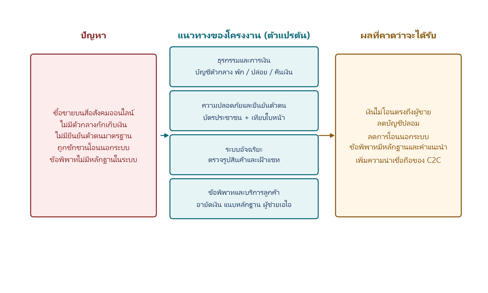

# บทที่ 1
# บทนำ

## 1.1 ความเป็นมาและความสำคัญของปัญหา

ปัจจุบันพาณิชย์อิเล็กทรอนิกส์ของไทยขยายตัวอย่างก้าวกระโดด โดยศูนย์วิจัยกรุงศรีคาดการณ์ว่ายอดขายออนไลน์จะเติบโตเฉลี่ยสูงถึงร้อยละ 12–13 ต่อปี จากพฤติกรรมผู้บริโภคที่คุ้นชินกับแพลตฟอร์มดิจิทัล [1] โดยเฉพาะการซื้อขายแบบบุคคลกับบุคคล (Consumer-to-Consumer: C2C) ผ่านแอปพลิเคชันสื่อสังคมออนไลน์ เช่น Facebook Instagram และ LINE ซึ่งสะดวกและเข้าถึงง่าย แต่แพลตฟอร์มเหล่านี้ถูกออกแบบมาเพื่อการสื่อสาร มิใช่ระบบธุรกรรมทางการเงิน จึงขาดกลไกยืนยันตัวตนผู้ใช้และการควบคุมความถูกต้องของธุรกรรม ส่งผลให้เกิดช่องโหว่ด้านความปลอดภัยและนำไปสู่การฉ้อโกงในวงกว้าง [2] สอดคล้องกับสถิติจากศูนย์ช่วยเหลือและจัดการปัญหาออนไลน์ ที่พบว่าปัญหาการซื้อขายออนไลน์ถูกร้องเรียนสูงถึง 10,306 เรื่อง คิดเป็นร้อยละ 41.79 ของข้อร้องเรียนทั้งหมด อาทิ การหลอกโอนเงินแล้วไม่ได้รับสินค้า หรือได้รับสินค้าไม่ตรงตามที่ระบุ [3]

ต้นเหตุสำคัญของปัญหานี้คือการที่ธุรกรรมเกิดขึ้นแบบสองฝ่ายโดยตรง โดยไม่มีตัวกลางทำหน้าที่กักเก็บเงินระหว่างรอการส่งมอบสินค้า เมื่อผู้ซื้อชำระเงินแล้ว ผู้ขายอาจไม่ส่งสินค้าหรือส่งสินค้าไม่ตรงเงื่อนไข โดยไม่มีกลไกใดคุ้มครองผู้ซื้อ แม้แพลตฟอร์ม E-Marketplace ขนาดใหญ่จะมีระบบบัญชีตัวกลาง เพื่อคุ้มครองผู้ซื้อและลดการทุจริตอยู่แล้ว [4] แต่ผู้บริโภคจำนวนมากยังคงนิยมซื้อขายผ่านสื่อสังคมออนไลน์ตามความเคยชิน ทำให้ความเสี่ยงจากการฉ้อโกงยังคงดำรงอยู่ในวงกว้าง

จากช่องว่างดังกล่าว คณะผู้จัดทำจึงพัฒนาแพลตฟอร์มซื้อขายสินค้าออนไลน์ระหว่างบุคคล ที่มีระบบบัญชีตัวกลางเป็นกลไกหลักในการควบคุมความปลอดภัยของธุรกรรม ร่วมกับระบบยืนยันตัวตนและระบบช่วยคัดกรองข้อพิพาท ผลที่คาดว่าจะได้รับนำเสนอในข้อ 1.4 ส่วนผลที่วัดได้จริงนำเสนอในบทที่ 4

---

## 1.2 วัตถุประสงค์

1.2.1 เพื่อศึกษาแนวคิดและเทคโนโลยีที่เกี่ยวข้องกับระบบบัญชีตัวกลาง ระบบยืนยันตัวตนอิเล็กทรอนิกส์ และปัญญาประดิษฐ์สำหรับคัดกรองข้อพิพาท

1.2.2 เพื่อออกแบบและพัฒนาแพลตฟอร์มซื้อขาย C2C ที่มีระบบยืนยันตัวตน บัญชีตัวกลาง และระบบคัดกรองข้อพิพาท

1.2.3 เพื่อทดสอบความถูกต้องในการควบคุมธุรกรรมของระบบบัญชีตัวกลาง และประเมินการทำงานของแพลตฟอร์มผ่านการทดสอบฟังก์ชันตามสถานการณ์ที่กำหนด รวมถึงการวัดความถูกต้องของกลไกคัดกรองที่เกี่ยวข้องในชุดทดสอบ

จากวัตถุประสงค์ข้อ 1.2.1 ถึง 1.2.3 ความสัมพันธ์ระหว่างปัญหาของการซื้อขายบนสื่อสังคมออนไลน์ แนวทางสี่ด้านของโครงงาน และผลที่คาดว่าจะได้รับ สรุปเป็นกรอบแนวคิดดังภาพที่ 1.1

---

## 1.3 ขอบเขตโครงงาน

การพัฒนาตามข้อ 1.2.2 ครอบคลุมสี่ด้านของวงจรธุรกรรม ได้แก่ ระบบตัวกลางกักเก็บเงินและการชำระเงิน ระบบยืนยันตัวตน ระบบอัจฉริยะสำหรับคัดกรองเนื้อหา และระบบข้อพิพาทกับบริการลูกค้า รายละเอียดมีดังนี้

### 1.3.1 ระบบตัวกลางกักเก็บเงิน

1.3.1.1 จัดให้มีห้องสนทนาสำหรับการเจรจาซื้อขาย โดยข้อความถูกส่งผ่านระบบแม่ข่ายของแพลตฟอร์ม และสามารถรับข้อความใหม่ได้โดยไม่ต้องโหลดหน้าใหม่เมื่อบริการเหตุการณ์ตามเวลาจริงพร้อมใช้งาน

1.3.1.2 ระบบตรวจจับข้อความต้องห้าม
1) ตรวจจับคำและรูปแบบที่มีลักษณะชักชวนให้โอนเงินนอกระบบ แลกช่องทางติดต่อภายนอก ส่งเลขบัญชี เบอร์โทรศัพท์ หรือลิงก์ภายนอก ด้วยระบบกรองคำที่กำหนดไว้  
2) วิเคราะห์ประโยคที่มีความเสี่ยงอยู่ในช่วงกำกวมร่วมกับปัญญาประดิษฐ์ตามลำดับ Groq, OpenRouter และ Google Gemini  
3) เมื่อพบการกระทำที่เข้าลักษณะต้องห้ามในระดับสูง ระบบจะไม่บันทึกข้อความนั้น และแจ้งเตือนผู้ส่งทันที กรณีเสี่ยงปานกลางจะบันทึกข้อความได้แต่ส่งเข้าคิวให้ผู้ดูแลระบบตรวจสอบ

1.3.1.3 ระบบประกาศสินค้าและคำสั่งซื้อ
1) ผู้ขายจัดทำประกาศขาย ประกอบด้วยชื่อสินค้า หมวดหมู่ ราคา รายละเอียด และรูปภาพ เพื่อให้ผู้ซื้อพิจารณาฉบับสมบูรณ์ก่อนสั่งซื้อ  
2) ผู้ซื้อสั่งซื้อจากประกาศดังกล่าว ระบบสร้างคำสั่งซื้อและเปิดห้องสนทนาคู่ค้าให้เจรจารายละเอียดการส่งมอบ  
3) รูปสินค้าถูกตรวจความน่าเชื่อถือเบื้องต้นด้วยข้อมูลจากไฟล์ภาพ และส่งภาพที่น่าสงสัยเข้าบริการวิเคราะห์ภาพ เพื่อลดการใช้ภาพหน้าจอหรือภาพคัดลอกจากแหล่งอื่น

1.3.1.4 ระบบชำระเงินเข้าบัญชีกลาง รองรับการชำระด้วยบัตรและการสร้างแหล่งชำระ PromptPay ผ่านผู้ให้บริการชำระเงิน รวมถึงการชำระด้วยคิวอาร์โค้ดพร้อมเพย์แล้วอัปโหลดสลิปเพื่อตรวจยอด เมื่อชำระสำเร็จ ระบบล็อกยอดเงินไว้ที่บัญชีกลางทันที ไม่โอนตรงถึงผู้ขาย

1.3.1.5 ระบบแจ้งการจัดส่งพัสดุ โดยให้ผู้ขายระบุบริษัทขนส่ง เช่น Flash Express, Kerry Express และไปรษณีย์ไทย พร้อมหมายเลขพัสดุ

1.3.1.6 ผู้ซื้อกดยืนยันรับสินค้าเพื่อสั่งให้ระบบปล่อยเงินแก่ผู้ขาย หากเกิดข้อพิพาทก่อนปล่อยเงิน ระบบจะระงับยอดไว้จนกว่าผู้ดูแลระบบจะวินิจฉัย การคืนเงินทำได้เมื่อคำสั่งซื้อถูกยกเลิกตามเงื่อนไข หรือเมื่อข้อพิพาทสรุปให้คืนผู้ซื้อ และสามารถแบ่งสัดส่วนได้ตามคำวินิจฉัย

1.3.1.7 เมื่อซื้อขายเสร็จสมบูรณ์ ระบบปิดคำสั่งซื้อตามสถานะของออเดอร์ ผู้ใช้ยังดูประวัติการสนทนาที่เกี่ยวข้องได้ตามสิทธิ์ที่มี

1.3.1.8 ผู้ใช้งานสามารถทำรายการซื้อขายกับคู่ค้ารายเดียวกันได้ทั้งสองบทบาท พร้อมกัน โดยเป็นผู้ซื้อในคำสั่งซื้อหนึ่ง และเป็นผู้ขายในอีกคำสั่งซื้อหนึ่งในเวลาเดียวกัน

### 1.3.2 ระบบเข้าสู่ระบบ ยืนยันตัวตน และความปลอดภัยของบัญชี

1.3.2.1 กำหนดให้เข้าสู่ระบบด้วยชื่อผู้ใช้หรืออีเมลพร้อมรหัสผ่าน หรือเข้าสู่ระบบผ่านบัญชี Google โดยตรวจสอบโทเคนฝั่งเครื่องแม่ข่าย

1.3.2.2 กำหนดให้ผู้ใช้งานยืนยันตัวตนด้วยภาพถ่ายบัตรประจำตัวประชาชนและภาพถ่ายใบหน้าจากกล้องก่อนใช้สิทธิ์ที่ระบบกำหนด โดยเชื่อมต่อผู้ให้บริการภายนอกเพื่ออ่านข้อมูลบนบัตรและเปรียบเทียบใบหน้ากับรูปบนบัตร หากบริการอัตโนมัติไม่พร้อม จะจัดเก็บเอกสารเข้ารหัสแล้วส่งให้ผู้ดูแลระบบตรวจสอบ ผู้ใช้งานที่ยังไม่ผ่านการยืนยันตัวตนจะถูกจำกัดสิทธิ์ในการลงประกาศขายและทำธุรกรรมที่ต้องใช้สถานะยืนยันแล้ว เมื่อผ่านการยืนยัน โปรไฟล์และบัตรสินค้าจะแสดงตราสัญลักษณ์ยืนยันตัวตน

1.3.2.3 กำหนดให้ผู้ใช้งานผูกบัญชีธนาคารสำหรับรับเงิน โดยระบุชื่อธนาคาร หมายเลขบัญชี และชื่อบัญชี ระบบจะแจ้งให้ดำเนินการหลังจากผ่านการยืนยันตัวตนแล้ว

### 1.3.3 ระบบแจ้งข้อพิพาทและการสนับสนุน

1.3.3.1 ผู้ซื้อและผู้ขายสามารถเปิดข้อพิพาทพร้อมเลือกหมวดหมู่ปัญหาได้ และแนบหลักฐานเป็นภาพถ่ายหรือเอกสาร

1.3.3.2 ผู้ใช้งานสามารถติดต่อผู้ดูแลระบบผ่านห้องสนทนาสนับสนุนของแพลตฟอร์ม เพื่อให้ติดตามเรื่องได้โดยไม่ต้องออกนอกระบบ

1.3.3.3 เมื่อเกิดข้อพิพาท ระบบจะดำเนินการล็อกเงินในบัญชีกลางทันที เพื่อป้องกันไม่ให้มีการโอนเงินก่อนมีข้อสรุป

1.3.3.4 ผู้ใช้งานสามารถติดต่อผู้ดูแลระบบได้โดยตรงผ่านห้องสนทนา โดยระบบจัดช่องทางสนับสนุนให้โดยไม่ต้องสร้างห้องภายนอก

### 1.3.4 ระบบผู้ดูแลและการตรวจสอบด้วยปัญญาประดิษฐ์

1.3.4.1 จัดให้มีแผงควบคุมสำหรับผู้ดูแลระบบ ประกอบด้วยข้อมูลผู้ใช้งาน คำสั่งซื้อ ยอดในบัญชีกลาง คำขอยืนยันตัวตนที่อยู่ระหว่างการตรวจสอบ และคำร้องข้อพิพาทที่ยังไม่ได้รับการดำเนินการ

1.3.4.2 นำปัญญาประดิษฐ์มาช่วยวิเคราะห์ข้อพิพาท โดยพิจารณาจากประวัติการสนทนา สถานะการขนส่ง หลักฐานที่แนบ และมูลค่าสินค้า พร้อมสรุปคำแนะนำให้ผู้ดูแลระบบ ได้แก่ คืนเงินแก่ผู้ซื้อ ปล่อยเงินให้ผู้ขาย แบ่งสัดส่วน หรือส่งให้ตรวจเพิ่ม ทั้งนี้คำแนะนำดังกล่าวเป็นข้อมูลประกอบการพิจารณา ไม่ใช่คำตัดสินที่มีผลผูกพัน

1.3.4.3 ให้ผู้ดูแลระบบพิจารณาวินิจฉัย และเลือกดำเนินการอย่างหนึ่งอย่างใดระหว่างการคืนเงินแก่ผู้ซื้อ การนำเงินให้แก่ผู้ขาย หรือการแบ่งสัดส่วน โดยระบบจะดำเนินการปรับยอดในบัญชีกลางและปิดรายการให้สอดคล้องกับคำวินิจฉัย

### 1.3.5 ระบบค้นหา สถาปัตยกรรม และความเป็นส่วนตัว

1.3.5.1 ระบบค้นหาประกาศสินค้าตามคำค้นและหมวดหมู่ เพื่อให้ผู้ซื้อเข้าถึงรายการที่ต้องการได้

1.3.5.2 พัฒนาเป็นเว็บแอปพลิเคชันบน PHP และจัดเก็บข้อมูลหลักในฐานข้อมูล MySQL ข้อความสนทนาสามารถส่งต่อแบบเหตุการณ์ตามเวลาจริงได้เมื่อบริการเสริมพร้อมใช้งาน หากไม่พร้อม ระบบจะอ่านข้อมูลจากฐานข้อมูลแทน โดยไม่ทำให้ธุรกรรมหลักหยุดทำงาน

1.3.5.3 ดำเนินการให้สอดคล้องกับพระราชบัญญัติคุ้มครองข้อมูลส่วนบุคคล พ.ศ. 2562 โดยเข้ารหัสข้อมูลอ่อนไหว จำกัดสิทธิ์การเข้าถึงข้อมูลบัตรประจำตัวประชาชนและข้อมูลบัญชีธนาคารให้เฉพาะผู้ดูแลระบบ และเก็บข้อมูลเท่าที่จำเป็นตามการขอความยินยอม

### 1.3.6 ข้อกำหนดด้านส่วนติดต่อผู้ใช้งาน

1.3.6.1 ออกแบบให้ปรับโครงสร้างการแสดงผลตามขนาดหน้าจอของคอมพิวเตอร์ แท็บเล็ต และสมาร์ตโฟน

1.3.6.2 หน้ายืนยันตัวตนจัดเป็นขั้นตอนถ่ายหรืออัปโหลดบัตรประชาชน และถ่ายภาพใบหน้าจากกล้องหน้า หน้าสินค้าแสดงรายละเอียด ราคา ตราสัญลักษณ์ผู้ขายที่ยืนยันตัวตนแล้ว และช่องทางเข้าสู่การชำระเงินผ่านบัญชีกลาง

1.3.6.3 รองรับการใช้งานผ่านเว็บเบราว์เซอร์รุ่นปัจจุบันที่รองรับกล้องและความปลอดภัยของวาระการใช้งาน

1.3.6.4 ประสบการณ์ผู้ใช้และการปรับแต่ง
1) ผู้ใช้กำหนดชื่อที่แสดงบนโปรไฟล์ได้  
2) รองรับการสลับรูปแบบการแสดงผลระหว่างธีมสว่างและธีมมืด  
3) มีระบบแจ้งเตือนในแอปเมื่อมีข้อความหรือเหตุการณ์ที่เกี่ยวข้องกับคำสั่งซื้อ

### 1.3.7 สามารถเผยแพร่บทความทางวิชาการได้

---

## 1.4 ประโยชน์ที่คาดว่าจะได้รับ

ข้อ 1.4.1 ถึง 1.4.10 เป็นผลที่คาดว่าจะได้รับ ไม่ใช่ข้อสรุปจากผลการทดลอง ไม่ใช้คำว่าการันตีหรือยกระดับในความหมายที่วัดแล้ว ตารางท้ายข้อนี้แยกสิ่งที่บทที่ 4 รองรับได้ ออกจากสิ่งที่ยังเป็นความคาดหวัง

1.4.1 มุ่งให้เงินค่าสินค้าถูกกักเก็บไว้ที่บัญชีกลาง ไม่ถูกโอนตรงถึงผู้ขายจนกว่าจะตรวจรับสินค้าเรียบร้อย หรือจนกว่ากระบวนการข้อพิพาทจะสิ้นสุด

1.4.2 มุ่งจัดระบบสแกนคำต้องห้ามและแจ้งเตือนเมื่อมีการชักชวนโอนนอกแพลตฟอร์ม

1.4.3 มุ่งให้มีช่องทางเปิดข้อพิพาท ระงับเงิน และเข้าสู่กระบวนการตรวจสอบคืนเงิน

1.4.4 มุ่งแสดงตราสัญลักษณ์ผู้ขายที่ผ่านการพิสูจน์ตัวตนบนโปรไฟล์และบัตรสินค้า

1.4.5 มุ่งให้ผู้ขายตรวจสอบได้ว่าผู้ซื้อชำระเงินเข้ากองกลางเรียบร้อยก่อนส่งมอบสินค้า

1.4.6 มุ่งให้ปัญญาประดิษฐ์สรุปบทสนทนาและเสนอแนวทางประกอบการพิจารณาของผู้ดูแลระบบ โดยผู้ดูแลระบบยังเป็นผู้ตัดสินเงิน

1.4.7 มุ่งจัดแผงควบคุมสรุปสถานะและระบบติดตามธุรกรรม

1.4.8 มุ่งเสนอต้นแบบการซื้อขายแบบบุคคลต่อบุคคลที่ผสานบัญชีตัวกลาง การยืนยันตัวตน และปัญญาประดิษฐ์

1.4.9 มุ่งเป็นทางเลือกแทนการโอนเงินตรงบนสื่อสังคมออนไลน์ ซึ่งเป็นช่องทางที่พบการร้องเรียนสูง

1.4.10 มุ่งจัดเก็บและเข้ารหัสข้อมูลอ่อนไหว ได้แก่ ข้อมูลบัตรประจำตัวประชาชนและบัญชีธนาคาร และจำกัดสิทธิ์การเข้าถึงให้เฉพาะผู้ได้รับอนุญาต

**ตารางที่ 1.1** สถานะของข้อ 1.4 เมื่อเทียบกับหลักฐานในบทที่ 4

| ข้อ | สิ่งที่ระบบทำได้ | สิ่งที่ยังพิสูจน์ไม่ได้ |
|-----|------------------|------------------------|
| 1.4.1, 1.4.3, 1.4.5 | กักเก็บ ระงับ ปล่อย หรือคืนเงินตามสถานะคำสั่งซื้อ | ความมั่นใจของผู้ซื้อผู้ขายในตลาดจริง |
| 1.4.2 | คัดกรองข้อความบนชุดทดสอบ และรายงานค่าบวกปลอม ค่าลบปลอม | การลดการโกงในตลาดจริง |
| 1.4.4 | แสดงตราสัญลักษณ์เมื่อผ่านการยืนยันตัวตน | ว่าลูกค้ากล้าซื้อมากขึ้น |
| 1.4.6 | ผู้ช่วยสรุปและเสนอแนวทาง | ว่าผู้ดูแลระบบตัดสินเร็วขึ้นหรือแม่นขึ้น |
| 1.4.7 | มีแผงควบคุมสถานะธุรกรรม | ว่าภาระงานลดลงเชิงปริมาณ |
| 1.4.8, 1.4.9 | เป็นต้นแบบในขอบเขตโครงงาน | การยกระดับมาตรฐานหรือลดอาชญากรรมในประเทศ |
| 1.4.10 | เข้ารหัสไฟล์และจำกัดสิทธิ์ในระบบ | ความเสี่ยงที่ยังเหลือเมื่อส่งภาพไปบริการภายนอก |

---

## 1.5 คำนิยามศัพท์เฉพาะ

**1.5.1 e-KYC** การยืนยันตัวตนทางดิจิทัล กระบวนการพิสูจน์และยืนยันตัวตนของผู้ใช้งานในรูปแบบดิจิทัล โดยการตรวจสอบความถูกต้องของภาพถ่ายใบหน้าเปรียบเทียบกับข้อมูลบนบัตรประจำตัวประชาชน ในโครงงานนี้ดำเนินการผ่านบริการภายนอกเป็นหลัก และมีผู้ดูแลระบบเป็นชั้นสำรองเมื่อบริการอัตโนมัติไม่พร้อม เพื่อเปิดสิทธิ์การขายให้แก่ผู้ขายตามที่ระบบกำหนด

**1.5.2 Escrow** ระบบบัญชีตัวกลางควบคุมธุรกรรม กลไกบัญชีตัวกลางที่ทำหน้าที่กักเก็บเงินค่าสินค้าของผู้ซื้อไว้ชั่วคราวในระบบอย่างปลอดภัย โดยแบ่งสถานะการกักเก็บเงินออกเป็นสถานะหลัก ได้แก่ ยังไม่ชำระเงิน กักเก็บเงิน ปล่อยยอดเงิน คืนเงิน และระงับเงินชั่วคราว ซึ่งกระบวนการปล่อยเงินหรือคืนเงินถูกควบคุมโดยระบบและดุลยพินิจของผู้ดูแลระบบ

**1.5.3 Digital Goods** ผลิตภัณฑ์ดิจิทัล สินค้าหรือผลผลิตที่ไม่มีองค์ประกอบทางกายภาพและจับต้องไม่ได้ แต่ส่งมอบสิทธิ์การเข้าถึงหรือการใช้งานผ่านระบบเครือข่ายออนไลน์ เช่น บัญชีผู้ใช้เกม หรือรหัสเติมเงินมูลค่าอิเล็กทรอนิกส์ ซึ่งเป็นกลุ่มสินค้าที่มีความเสี่ยงสูงต่อการฉ้อโกง

**1.5.4 Large Language Model API** โมเดลภาษาขนาดใหญ่ผ่านระบบคลาวด์ การเชื่อมต่อและประยุกต์ใช้บริการปัญญาประดิษฐ์ประมวลผลภาษาธรรมชาติผ่านเอพีไอ เพื่อตรวจจับข้อความเสี่ยง สกัดใจความสำคัญ วิเคราะห์บริบทคำร้องเรียน และประเมินน้ำหนักความน่าเชื่อถือ โดยข้อมูลถูกส่งประมวลผลผ่านช่องทางที่มีการเข้ารหัสความปลอดภัย

**1.5.5 Contextual categorization of disputes** การจัดหมวดหมู่ข้อพิพาทเชิงบริบท การวิเคราะห์ของปัญญาประดิษฐ์เพื่อจำแนกกลุ่มข้อมูลคำร้องเรียนตามลักษณะปัญหา ประเภทสินค้า และมูลค่า เพื่อนำมาประกอบการจัดลำดับความสำคัญของกรณีร้องเรียน

**1.5.6 Admin Dashboard** แผงควบคุมการบริหารจัดการระบบหลังบ้าน ส่วนต่อประสานสำหรับผู้ดูแลระบบ ที่ใช้ในการตรวจสอบข้อมูลยืนยันตัวตน และแสดงผลข้อพิพาทที่ผ่านการสรุปจากปัญญาประดิษฐ์ เพื่อให้มนุษย์ใช้เป็นข้อมูลสนับสนุนการตัดสินใจในการอนุมัติปล่อยเงินหรือคืนเงิน

**1.5.7 Verified Badge** ตราสัญลักษณ์ยืนยันตัวตน ที่แสดงบนโปรไฟล์และบัตรสินค้าเมื่อผู้ใช้ผ่านกระบวนการ e-KYC แล้ว

**1.5.8 C2C (Consumer-to-Consumer)** การซื้อขายสินค้าหรือบริการระหว่างบุคคลทั่วไปกับบุคคลทั่วไปโดยตรง โดยไม่ผ่านผู้ประกอบการรายใหญ่เป็นผู้ขายหลัก

---

## 1.6 ระยะเวลาในการดำเนินงาน

### 1.6.1 ขั้นเตรียมการและการศึกษาข้อมูล

1.6.1.1 ศึกษาและค้นคว้าข้อมูลเอกสารเพื่อกำหนดหัวข้อโครงงาน

1.6.1.2 ศึกษาเอกสาร งานวิจัย และทฤษฎีที่เกี่ยวข้อง ได้แก่ ระบบบัญชีตัวกลาง ระบบยืนยันตัวตนอิเล็กทรอนิกส์ (e-KYC) และระบบการจัดการข้อพิพาท

1.6.1.3 ศึกษาโมเดลภาษาขนาดใหญ่ แนวทางการรู้จำใบหน้าและอ่านบัตรประชาชน และแนวทางการประยุกต์ใช้ปัญญาประดิษฐ์ผ่านระบบคลาวด์เอพีไอ เพื่อใช้คัดกรองข้อความภาษาไทยและสรุปข้อมูลข้อพิพาท

### 1.6.2 ขั้นดำเนินการ

1.6.2.1 การออกแบบระบบ
1) ออกแบบสถาปัตยกรรมของระบบและกระบวนการทำงานของระบบบัญชีตัวกลาง  
2) ออกแบบส่วนติดต่อผู้ใช้งานสำหรับผู้ซื้อ ผู้ขาย และผู้ดูแลระบบ  
3) ออกแบบโครงสร้างฐานข้อมูลและความสัมพันธ์ของข้อมูลภายในระบบ

1.6.2.2 การพัฒนาระบบ
1) พัฒนาระบบซื้อขายผ่านประกาศสินค้า ห้องสนทนา ระบบแจ้งจัดส่งพัสดุ และสถานะคำสั่งซื้อ  
2) พัฒนาระบบฐานข้อมูลสำหรับจัดเก็บข้อมูลผู้ใช้งาน ประวัติการสนทนา ข้อมูลธุรกรรม และข้อมูลข้อพิพาท  
3) พัฒนาระบบสำหรับผู้ดูแลระบบ เพื่อใช้ตรวจสอบข้อมูลการยืนยันตัวตน e-KYC และพิจารณาตัดสินข้อพิพาท  
4) พัฒนาระบบเชื่อมต่อการชำระเงินเข้ากับระบบบัญชีตัวกลาง เพื่อรองรับการชำระเงินผ่านบัตร คิวอาร์โค้ดพร้อมเพย์ และการตรวจสลิป  
5) พัฒนาระบบเชื่อมต่อปัญญาประดิษฐ์ผ่านระบบคลาวด์เอพีไอ สำหรับการตรวจจับคำต้องห้าม การตรวจรูปสินค้า และการสรุปประวัติแชทเพื่อประกอบการพิจารณาข้อพิพาท

### 1.6.3 ขั้นตอนการทดสอบระบบ

1.6.3.1 ทดสอบการลงทะเบียนเข้าใช้งาน การยืนยันตัวตนด้วย e-KYC การลงประกาศของผู้ขาย การเปิดข้อพิพาท และการตรวจสอบข้อมูลโดยผู้ดูแลระบบ

1.6.3.2 ทดสอบความถูกต้องของระบบปัญญาประดิษฐ์ในการคัดกรองข้อความ สรุปและคัดแยกหมวดหมู่ข้อพิพาท

1.6.3.3 ทดสอบกระบวนการซื้อขายตั้งแต่เริ่มต้นจนเสร็จสิ้น ครอบคลุมการสั่งซื้อ การชำระเงินเข้าบัญชีกลาง ระบบแจ้งจัดส่งพัสดุ และการปล่อยเงินหรือคืนเงิน

1.6.3.4 วิเคราะห์ผลการทดสอบและปรับปรุงระบบตามข้อผิดพลาดที่พบ

### 1.6.4 ขั้นตอนการประเมินผลและสรุปผล

1.6.4.1 ประเมินประสิทธิภาพของระบบจากการทดสอบฟังก์ชัน ตัวชี้วัดในชุดที่รายงาน และการประเมินผู้ใช้หลังทดลองใช้ในกลุ่มจำกัด ส่วนการทดลองภาคสนามในตลาดจริงอยู่นอกขอบเขตที่วัดในงานนี้และอยู่ในข้อเสนอแนะ

1.6.4.2 สรุปผลการทดสอบและจัดทำรายงานโครงงานฉบับสมบูรณ์

1.6.4.3 จัดเตรียมและเรียบเรียงบทความวิจัยเพื่อเผยแพร่ทางวิชาการ

---

## 1.7 แผนการดำเนินงาน

**ตารางที่ 1.2** แผนการดำเนินงานของโครงงาน (พ.ศ. 2569–2570)

| กิจกรรมและขั้นตอนการดำเนินงาน | พ.ศ. 2569 พ.ค.–ส.ค. | พ.ศ. 2569 ก.ย.–ธ.ค. | พ.ศ. 2570 ม.ค.–เม.ย. | พ.ศ. 2570 พ.ค.–ก.ค. |
|-------------------------------|:-------------------:|:-------------------:|:--------------------:|:-------------------:|
| ขั้นเตรียมการและศึกษาข้อมูล ค้นคว้าเพื่อเลือกหัวข้อ | ดำเนินการ | | | |
| ศึกษาข้อมูลที่เกี่ยวข้องและทำความเข้าใจทฤษฎี | ดำเนินการ | ดำเนินการ | | |
| ขั้นดำเนินการ ออกแบบระบบ | | ดำเนินการ | | |
| ลงมือพัฒนาระบบ | | ดำเนินการ | ดำเนินการ | |
| ทดสอบการทำงานของระบบและการใช้งาน | | | ดำเนินการ | ดำเนินการ |
| ประเมินผล สรุปผลการทดลอง | | | | ดำเนินการ |
| เรียบเรียงรายงานและเตรียมบทความทางวิชาการ | | | | ดำเนินการ |

---

## เอกสารอ้างอิง

[1] วิจัยกรุงศรี. (2567). แนวโน้มธุรกิจ/อุตสาหกรรมร้านค้าปลีกสมัยใหม่ ปี 2567-2569. ธนาคารกรุงศรีอยุธยา. https://www.krungsri.com/th/research/industry/industry-outlook/wholesale-retail/modern-trade/io/modern-trade-2024-2026

[2] สำนักงานพัฒนาธุรกรรมทางอิเล็กทรอนิกส์. (2569). คู่มือแนวทางการพิสูจน์และยืนยันตัวตนสำหรับผู้ประกอบธุรกิจบริการแพลตฟอร์มดิจิทัลภายใต้กฎหมาย DPS. กระทรวงดิจิทัลเพื่อเศรษฐกิจและสังคม. https://www.etda.or.th

[3] สำนักงานพัฒนาธุรกรรมทางอิเล็กทรอนิกส์. (2568, 17 กันยายน). ETDA ชี้ 8 เดือนแรกปี 68 ร้องเรียนออนไลน์พุ่ง 2.7 หมื่น “สินค้าออนไลน์–เว็บเถื่อน” ครองแชมป์. ข่าวประชาสัมพันธ์ สพธอ. https://www.etda.or.th/th/pr-news/1212_online.aspx

[4] ธนาคารแห่งประเทศไทย. (2568). แนวปฏิบัติการคุ้มครองผู้ใช้บริการทางการเงินและการดูแลระบบชำระเงินสำหรับการค้าออนไลน์ (Escrow Service Guideline). ฝ่ายนโยบายระบบการชำระเงิน ธนาคารแห่งประเทศไทย. https://www.bot.or.th
