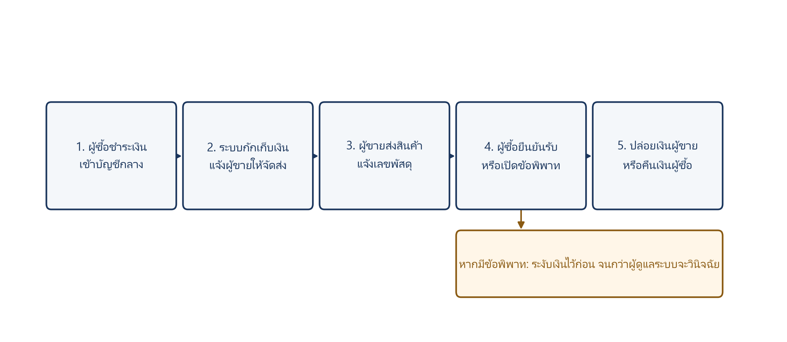
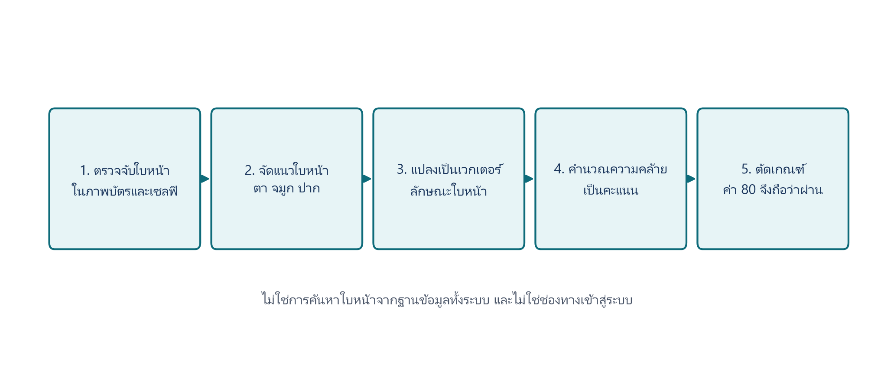
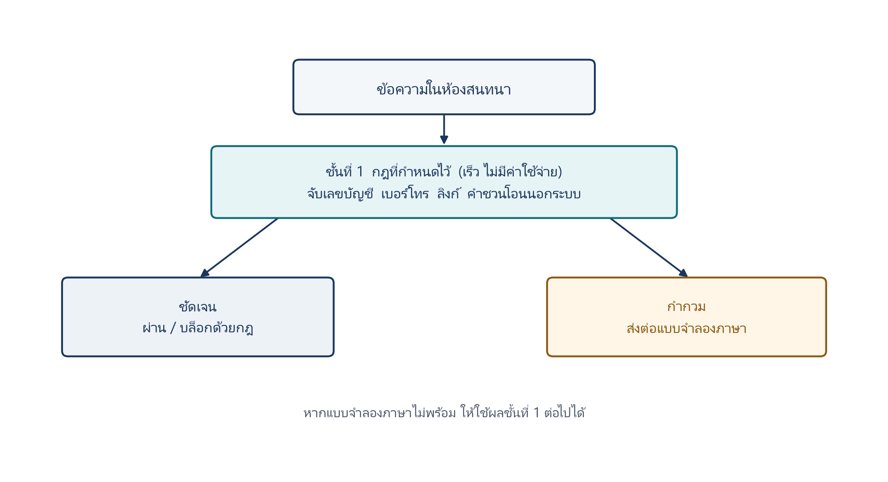

# บทที่ 2
# ทฤษฎีและงานวิจัยที่เกี่ยวข้อง

บทนี้นำเสนอแนวคิดที่ใช้เป็นฐานในการออกแบบระบบตามขอบเขตในบทที่ 1 โดยเรียงจากกลไกความเชื่อมั่นของตลาดออนไลน์ ระบบบัญชีตัวกลาง การยืนยันตัวตนอิเล็กทรอนิกส์ ทฤษฎีการตรวจสอบใบหน้า การอ่านข้อความจากภาพบัตร การคัดกรองเนื้อหาด้วยปัญญาประดิษฐ์ และตัวชี้วัดที่ใช้ประเมินผลในบทที่ 4 ทฤษฎีที่คัดสรรเป็นเรื่องที่ระบบนำมาใช้จริง ไม่ขยายไปยังเทคนิคที่โครงงานไม่ได้พัฒนา

## 2.1 ระบบบัญชีตัวกลางและความเชื่อมั่นในตลาดออนไลน์

### 2.1.1 ความเสี่ยงของการซื้อขายแบบบุคคลต่อบุคคล

การซื้อขายระหว่างบุคคลบนอินเทอร์เน็ตมีลักษณะไม่สมมาตรของข้อมูล ผู้ซื้อไม่เห็นสินค้าจริงก่อนชำระเงิน และมักไม่รู้จักผู้ขายมาก่อน Pavlou และ Gefen อธิบายว่าความเชื่อมั่นในตลาดออนไลน์ไม่ได้เกิดจากความคุ้นเคยระหว่างบุคคลเพียงอย่างเดียว แต่เกิดจากสถาบันที่ตลาดจัดให้ เช่น การรับประกัน ระบบชื่อเสียง และกลไกบุคคลที่สามที่ทำหน้าที่กักเก็บเงิน [1] เมื่อช่องทางซื้อขายย้ายไปอยู่บนสื่อสังคมออนไลน์ สถาบันเหล่านี้มักหายไป คู่ค้าเจรจาในห้องสนทนาแล้วโอนเงินตรงถึงกัน จึงเหลือเพียงความไว้ใจส่วนบุคคลซึ่งถูกฉ้อโกงได้ง่าย

Resnick และคณะชี้ว่าระบบชื่อเสียงช่วยลดความไม่แน่นอนได้ในระดับหนึ่ง แต่ชื่อเสียงบนสื่อสังคมออนไลน์ถูกสร้างขึ้นโดยไม่สุจริตได้ และไม่ได้ผูกกับตัวตนทางกฎหมาย [2] ดังนั้นต้นแบบที่มุ่งแก้ปัญหาการซื้อขายบนสื่อสังคมออนไลน์จึงต้องมีทั้งกลไกควบคุมเงินและกลไกพิสูจน์ตัวตน ไม่ใช่มีเพียงหน้าโปรไฟล์หรือคะแนนรีวิว

### 2.1.2 หลักการของระบบบัญชีตัวกลาง

ระบบบัญชีตัวกลาง คือการให้บุคคลที่สามถือเงินไว้ชั่วคราวจนกว่าเงื่อนไขที่ตกลงจะครบถ้วน เมื่อนำมาใช้กับการซื้อขายออนไลน์ เงินของผู้ซื้อจะไม่ตกเป็นของผู้ขายทันที แต่ถูกกักเก็บไว้จนกว่าผู้ซื้อจะได้รับสินค้า หรือจนกว่าผู้มีอำนาจวินิจฉัยข้อพิพาทจะมีคำวินิจฉัย ลำดับทั่วไปประกอบด้วยการที่ผู้ซื้อชำระเข้าบัญชีกลาง ระบบยืนยันยอดแล้วแจ้งผู้ขายให้จัดส่ง ผู้ขายส่งสินค้าและแจ้งหลักฐานการส่ง จากนั้นผู้ซื้อตรวจรับสินค้า ระบบจึงปล่อยเงินแก่ผู้ขาย หรือคืนเงินแก่ผู้ซื้อหากเงื่อนไขไม่ครบ

สถานะเงินจึงต้องแยกอย่างน้อยสี่สถานะ ได้แก่ ยังไม่ชำระเงิน กักเก็บเงิน ปล่อยยอดเงิน และระงับเงินชั่วคราวเมื่อมีข้อพิพาท หากไม่มีสถานะระงับเงิน ผู้ไม่สุจริตอาจเร่งให้ระบบปล่อยเงินก่อนมีหลักฐานครบถ้วน ลำดับดังกล่าวสรุปได้ดังภาพที่ 2.1

### 2.1.3 ข้อจำกัดเมื่อมีเพียงบัญชีตัวกลาง

บัญชีตัวกลางช่วยลดความเสี่ยงด้านเงิน แต่ไม่ตอบปัญหาที่เกิดก่อนและระหว่างการโอน ได้แก่ การใช้บัญชีปลอม การลงรูปสินค้าที่ไม่น่าเชื่อถือ และการชักชวนให้ออกไปโอนนอกระบบ หากผู้ใช้ถูกชักจูงให้โอนตรงสำเร็จ กลไกกักเก็บเงินจะไม่ถูกใช้เลย งานนี้จึงวางบัญชีตัวกลางเป็นแกน แล้วเสริมชั้นยืนยันตัวตนและชั้นคัดกรองความเสี่ยงรอบวงจรธุรกรรม ตามหลักการไม่พึ่งกลไกเดียวเมื่อชั้นใดชั้นหนึ่งถูกเลี่ยง [3]

## 2.2 การยืนยันตัวตนอิเล็กทรอนิกส์

### 2.2.1 ความหมายและการแยกจากการเข้าสู่ระบบ

การรู้จักลูกค้าเดิมเป็นกระบวนการของสถาบันการเงินเพื่อระบุตัวบุคคลและประเมินความเสี่ยง เมื่อย้ายสู่ช่องทางดิจิทัลจึงเรียกว่าการยืนยันตัวตนอิเล็กทรอนิกส์ แนวปฏิบัติสากลด้านอัตลักษณ์ดิจิทัลแยกให้เห็นว่าการพิสูจน์ตัวตนแตกต่างจากการยืนยันตัวเมื่อเข้าใช้ระบบ [4] ผู้ใช้ที่เข้าสู่ระบบได้ด้วยรหัสผ่านจึงยังไม่เท่ากับบุคคลตามบัตรประจำตัวประชาชน

ระดับการรับประกันตัวตนสูงขึ้นเมื่อมีหลักฐานมากขึ้น ในบริบทไทย กรมการปกครองกำหนดระดับของระบบอัตลักษณ์ดิจิทัลไว้หลายขั้น เช่น การตรวจบัตร การจับคู่ใบหน้า และการยืนยันผ่านแอปพลิเคชันพร้อมชิปบัตร [5] โครงงานนี้ใช้หลักเดียวกันในระดับระบบสารสนเทศ คือแยกการเข้าสู่ระบบออกจากการยืนยันตัวตน และไม่ตั้งสถานะผ่านการยืนยันตัวตนจากรหัสผ่านหรือบัญชี Google เพียงอย่างเดียว

### 2.2.2 องค์ประกอบมาตรฐานเมื่อใช้บัตรประชาชน

กระบวนการยืนยันตัวตนด้วยเอกสารราชการโดยทั่วไปมีสี่ส่วน ได้แก่ การตรวจว่าภาพที่ส่งมาเป็นบัตรที่อ่านได้ การอ่านชื่อและเลขบัตรจากภาพ การจับคู่ใบหน้าบนเอกสารกับใบหน้าของบุคคลที่ถือเครื่อง และการตรวจสอบว่าภาพใบหน้ามาจากบุคคลจริงที่อยู่ตรงกล้อง ไม่ใช่รูปถ่ายหรือวิดีโอบนหน้าจอ ระบบเชิงพาณิชย์มักรวมสี่ส่วนนี้ไว้ในบริการเดียว ส่วนต้นแบบอาจทำทีละส่วนแล้วเชื่อมด้วยตรรกะธุรกิจ จุดสำคัญคือต้องระบุให้ได้ว่าแต่ละส่วนทำอะไร และส่วนใดยังไม่มีในโหมดหลักของระบบ

### 2.2.3 กรอบกฎหมายที่เกี่ยวข้อง

ข้อมูลบนบัตรประชาชนและภาพใบหน้าเป็นข้อมูลส่วนบุคคล พระราชบัญญัติคุ้มครองข้อมูลส่วนบุคคล พ.ศ. 2562 กำหนดให้เก็บเท่าที่จำเป็น ขอความยินยอมโดยชัดแจ้ง และจัดมาตรการรักษาความมั่นคงปลอดภัยที่เหมาะสม [6] การออกแบบระบบยืนยันตัวตนจึงไม่ใช่เพียงเรื่องความถูกต้องของแบบจำลอง แต่รวมถึงการไม่เก็บบันทึกเลขบัตรแบบเปิด การเข้ารหัสไฟล์ภาพ และการแยกสิทธิ์ผู้ดูแลระบบออกจากผู้ใช้ทั่วไป

## 2.3 ทฤษฎีการตรวจสอบใบหน้า

### 2.3.1 ความแตกต่างของงานสามประเภท

วรรณกรรมด้านใบหน้าแบ่งงานออกเป็นสามประเภทที่มักถูกเรียกปนกัน [7] การตรวจจับใบหน้าตอบเพียงว่ามีใบหน้าในภาพหรือไม่ การตรวจสอบใบหน้าแบบหนึ่งต่อหนึ่งตอบว่าภาพสองภาพเป็นคนเดียวกันหรือไม่ และการระบุตัวตนจากฐานข้อมูลตอบว่าใบหน้านี้ตรงกับรายการใดในคลังภาพ โครงงานนี้ใช้การตรวจสอบแบบหนึ่งต่อหนึ่งระหว่างรูปบนบัตรกับภาพจากกล้อง ไม่ได้ใช้การสแกนหน้าเพื่อเข้าสู่ระบบ และไม่ได้ค้นหาผู้ใช้จากฐานใบหน้าทั้งหมด

### 2.3.2 ลำดับการประมวลผลของการเทียบใบหน้า

แม้ผู้ให้บริการภายนอกจะไม่เปิดเผยน้ำหนักของแบบจำลอง กระบวนการภายในของบริการเทียบใบหน้าโดยทั่วไปประกอบด้วยห้าขั้นตอน ซึ่งเป็นโครงสร้างเดียวกับระบบสมัยใหม่ตั้งแต่งานของ Taigman และคณะ และงานของ Schroff และคณะ เป็นต้นมา [8], [9]

ขั้นแรกเป็นการตรวจจับใบหน้าในภาพบัตรและในภาพจากกล้อง หากไม่พบใบหน้า ระบบควรแจ้งว่าคุณภาพภาพไม่เพียงพอ ไม่ใช่ตัดสินทันทีว่าเป็นคนละคน เพราะยังไม่ได้เปรียบเทียบตัวตน ขั้นที่สองเป็นการจัดแนวใบหน้าโดยใช้จุดสำคัญ เช่น ตา จมูก และปาก เพื่อลดผลของมุมกล้อง ขั้นที่สามเป็นการแปลงภาพหน้าที่จัดแนวแล้วเป็นชุดตัวเลขแทนลักษณะใบหน้า คนเดียวกันจะได้ค่าใกล้กัน คนละคนจะได้ค่าไกลกัน FaceNet เสนอให้เรียนรู้ปริภูมิที่ระยะทางสะท้อนความต่างของบุคคล [9] ส่วน ArcFace เพิ่มฟังก์ชันสูญเสียเชิงมุมเพื่อแยกบุคคลได้ชัดขึ้น [10]

ขั้นที่สี่เป็นการคำนวณความคล้าย แล้วแปลงเป็นคะแนนที่ระบบอ่านได้ ขั้นที่ห้าเป็นการตัดเกณฑ์ หากคะแนนถึงเกณฑ์ที่กำหนด จึงถือว่าเป็นคนเดียวกัน การเลือกเกณฑ์เป็นการแลกเปลี่ยนระหว่างการรับคนปลอมเข้ามา กับการปฏิเสธเจ้าของจริง ในระบบนี้กำหนดเกณฑ์เท่ากับ 80 ที่ระดับการตั้งค่าของระบบ ไม่ได้ฝังอยู่ในแบบจำลอง ลำดับห้าขั้นตอนนี้แสดงดังภาพที่ 2.2

### 2.3.3 ความยากของการเทียบรูปบนบัตรประชาชน

การเทียบภาพจากกล้องกับรูปบนบัตรยากกว่าการเทียบภาพสองใบของวันเดียวกัน เพราะรูปบัตรมีขนาดเล็ก พิมพ์บนพลาสติก มีแสงสะท้อน และอายุใบหน้าอาจต่างจากวันออกบัตรหลายปี ขณะที่ภาพจากกล้องมีมุม แสง และเครื่องแต่งกายที่เปลี่ยนไป งานของ Shi และ Jain จึงแยกโจทย์การเทียบรูปเอกสารกับภาพตนเองออกจากโจทย์ภาพทั่วไป [11] ในทางปฏิบัติ บริการที่รับพารามิเตอร์ว่าภาพแรกเป็นเอกสารจึงมีความหมาย เพราะจะค้นใบหน้าในช่องรูปบัตร ไม่ใช่เทียบทั้งใบบัตรกับทั้งภาพจากกล้อง

### 2.3.4 การโจมตีด้วยการนำเสนอภาพ

แม้คะแนนความคล้ายจะสูง ระบบที่รับภาพนิ่งยังอาจถูกหลอกด้วยการถือรูปถ่ายหรือเปิดวิดีโอบนหน้าจอ มาตรฐานระหว่างประเทศเรียกการโจมตีลักษณะนี้ว่าการโจมตีด้วยการนำเสนอ และเรียกการตรวจจับว่าการตรวจจับการโจมตีด้วยการนำเสนอ [12] แนวทางแบบไม่โต้ตอบวิเคราะห์ลักษณะของจอหรือกระดาษจากภาพ แนวทางแบบโต้ตอบให้ผู้ใช้กระพริบตา หันศีรษะ หรือทำตามคำสั่ง โหมดหลักของระบบนี้รับภาพนิ่งจากกล้องหน้า จึงมีชั้นป้องกันจำกัดกว่าโหมดที่มีการตรวจความมีชีวิตแบบโต้ตอบ ข้อนี้ต้องระบุให้ชัด เพื่อไม่ให้เข้าใจว่าการเทียบใบหน้าเท่ากับการพิสูจน์ว่าเป็นบุคคลมีชีวิตครบทุกชั้น

## 2.4 การรู้จำตัวอักษรจากภาพบัตรประชาชน

หากเทียบใบหน้าผ่านแต่ยังไม่รู้ว่าบัตรใบนั้นเป็นของใคร ระบบจะยืนยันได้เพียงว่าบุคคลที่ถือเครื่องมีใบหน้าคล้ายรูปบนเอกสาร ยังไม่สามารถผูกชื่อจริงกับบัญชีได้ การอ่านข้อความจากภาพจึงต้องทำงานก่อนหรือคู่กับการเทียบใบหน้า เพื่อสกัดชื่อและเลขบัตรไปใช้ในชั้นธุรกิจ เช่น แสดงชื่อจริงและเทียบกับชื่อบัญชีธนาคาร

สถาปัตยกรรมรู้จำตัวอักษรจากภาพที่ใช้อ้างอิงกันกว้างสกัดลักษณะด้วยโครงข่ายคอนโวลูชัน แล้วถอดลำดับตัวอักษรด้วยโครงข่ายวนซ้ำ [13] บริการอ่านบัตรสำเร็จรูปเพิ่มชั้นค้นหาบัตรในภาพ แก้ความเอียง และตรวจความสมเหตุสมผลของช่องข้อมูล เช่น ความยาวของเลขบัตรสิบสามหลัก หากอ่านชื่อหรือเลขบัตรไม่ครบ ระบบควรหยุดกระบวนการและให้ผู้ใช้ถ่ายใหม่ ไม่ควรส่งภาพที่อ่านเอกสารไม่สำเร็จไปเทียบใบหน้า เพราะจะได้สถานะที่อธิบายไม่ได้ว่าเอกสารนั้นเป็นของใคร

## 2.5 การคัดกรองความเสี่ยงด้วยปัญญาประดิษฐ์

### 2.5.1 การคัดกรองข้อความแบบหลายชั้น

การคัดกรองเนื้อหาด้วยแบบจำลองภาษาขนาดใหญ่เข้าใจบริบทได้ดี แต่มีต้นทุนและใช้เวลา หากเรียกทุกข้อความในตลาดซื้อขายระหว่างบุคคล ระบบจะช้าและมีค่าใช้จ่ายสูง แนวคิดแบบน้ำตกในงานรู้จำรูปแบบใช้ตัวจำแนกที่ทำงานเร็วเป็นชั้นแรก แล้วส่งเฉพาะกรณีที่ยากเข้าชั้นที่ซับซ้อนกว่า [14] เมื่อนำมาใช้กับการคัดกรองข้อความ จึงใช้กฎที่กำหนดไว้เป็นชั้นแรก แล้วส่งเฉพาะกรณีกำกวมเข้าแบบจำลองภาษา

จุดอ่อนของน้ำตกแบบดั้งเดิมคือ หากชั้นแรกให้คะแนนต่ำกับข้อความที่ดูไม่เข้ากฎ แต่มีความหมายชักชวน เช่น ข้อความสั้นที่บอกว่าโอนแล้ว ชั้นหลังจะไม่ถูกเรียก งานออกแบบจึงควรมีสัญญาณเพิ่มเพื่อส่งต่อเมื่อพบร่องรอยเสี่ยง แม้คะแนนของกฎจะยังไม่ถึงเกณฑ์บล็อก โครงสร้างการคัดกรองแบบหลายชั้นแสดงดังภาพที่ 2.3

### 2.5.2 การตรวจรูปสินค้า

รูปประกาศขายที่คัดลอกจากแหล่งอื่นหรือเป็นภาพหน้าจอจากห้องสนทนา เป็นสัญญาณว่าสินค้าอาจไม่มีอยู่จริง การวิเคราะห์ข้อมูลที่กล้องบันทึกไว้ในไฟล์ภาพ เช่น ยี่ห้อ รุ่น วันเวลา และพิกัด เป็นชั้นกรองที่ไม่มีค่าบริการภายนอก [15] ภาพที่น่าสงสัยจึงค่อยส่งเข้าบริการวิเคราะห์ภาพ เพื่อตรวจเนื้อหาไม่เหมาะสม การปรากฏของภาพบนเว็บอื่น และลักษณะที่เป็นภาพหน้าจอ

### 2.5.3 ผู้ช่วยตัดสินใจของมนุษย์

ระบบสนับสนุนการตัดสินใจควรเสนอทางเลือกพร้อมเหตุผล ไม่แทนที่ดุลยพินิจของคนเมื่อผลผูกพันกับเงิน [16] ในข้อพิพาทของบัญชีตัวกลาง หากปล่อยให้แบบจำลองภาษาสั่งคืนเงินหรือปล่อยเงินเอง ความผิดพลาดจะกลายเป็นความเสียหายทางการเงินทันที หลักการให้มนุษย์อยู่ในวงตัดสินใจจึงกำหนดให้ปัญญาประดิษฐ์สรุปหลักฐาน และให้ผู้ดูแลระบบเป็นผู้กดคำสั่งที่มีผลต่อยอดเงิน

## 2.6 ตัวชี้วัดที่ใช้ประเมินระบบ

การประเมินการตรวจสอบใบหน้ากำหนดคลาสบวกเป็นกรณีที่เป็นคนเดียวกัน และคลาสลบเป็นกรณีที่เป็นคนละคน ค่าทำนายถูกเมื่อระบบตัดสินตรงกับความจริง ได้แก่ การรับคนเดียวกันไว้ และการปฏิเสธคนละคน ค่าทำนายผิดได้แก่ การรับคนละคนเข้ามา และการปฏิเสธเจ้าของจริง [17]

ความถูกต้องคือสัดส่วนของค่าทำนายถูกต่อจำนวนตัวอย่างทั้งหมด ความแม่นยำคือสัดส่วนของกรณีที่ระบบรับไว้แล้วเป็นคนเดียวกันจริง การเรียกคืนคือสัดส่วนของเจ้าของจริงที่ระบบรับไว้ได้ อัตราการยอมรับผิดคือสัดส่วนของคนละคนที่ระบบรับไว้ อัตราการปฏิเสธผิดคือสัดส่วนของเจ้าของจริงที่ระบบปฏิเสธ อัตราการยอมรับผิดสำคัญในระบบเงิน เพราะเท่ากับเปิดบัญชีให้ผู้ไม่ใช่เจ้าของบัตร ส่วนอัตราการปฏิเสธผิดสำคัญด้านประสบการณ์ใช้งาน เพราะเจ้าของจริงต้องถ่ายใหม่หรือรอคนตรวจ

ค่าเกณฑ์ 80 คือจุดที่ผู้ออกแบบยอมแลกสองอัตรานี้ หากลดเกณฑ์ลง อัตราการยอมรับผิดมักเพิ่ม หากขึ้นเกณฑ์ อัตราการปฏิเสธผิดมักเพิ่ม การรายงานผลจึงต้องแสดงทั้งความถูกต้องรวมและคู่ของอัตราดังกล่าว ไม่ใช่ความถูกต้องเพียงตัวเดียว นอกจากนี้ต้นแบบธุรกรรมควรวัดเวลาตอบสนองของกระบวนการ อัตราที่บริการภายนอกล้มเหลวแล้วเข้าชั้นสำรองได้ และสัดส่วนข้อความที่ต้องส่งต่อแบบจำลองภาษา

การอ้างว่าเกณฑ์ 80 เป็นจุดเหมาะสมของระบบนี้ต้องอาศัยการกระจายคะแนนจากชุดทดสอบ ไม่ใช่การนับผ่านหรือไม่ผ่านเพียงอย่างเดียว และต้องแยกผลจากท่อจำลองออกจากผลบนบริการจริง เพราะท่อจำลองอาจสร้างคะแนนให้อยู่คนละฝั่งของเกณฑ์โดยการออกแบบ รายละเอียดเชิงประจักษ์นำเสนอในบทที่ 4 พร้อมข้อจำกัดว่าโหมดหลักยังรับภาพนิ่ง จึงยังไม่ได้วัดอัตราการโจมตีด้วยการนำเสนอ

## 2.7 การสังเคราะห์งานที่เกี่ยวข้องและช่องว่างที่ FLIXO เติม

งานที่เกี่ยวข้องอธิบายชิ้นส่วนได้ดี แต่ละชิ้นไม่ครอบคลุมวงจรซื้อขายระหว่างบุคคลบนสื่อสังคมออนไลน์ของไทยพร้อมกัน ตารางที่ 2.1 สังเคราะห์ว่าแต่ละแนวทางตอบอะไร และเหลือช่องว่างตรงไหน แล้วจึงระบุว่า FLIXO เติมช่องว่างใดในระดับการออกแบบ ไม่ใช่ในระดับผลลัพธ์ทางสังคม

| แนวทางหรืองานที่เกี่ยวข้อง | สิ่งที่ครอบคลุม | สิ่งที่ยังไม่ครอบคลุม | สิ่งที่ FLIXO เติมในระดับระบบ |
|---------------------------|----------------|----------------------|-------------------------------|
| ความเชื่อมั่นโดยสถาบันและบัญชีตัวกลาง [1] | กักเก็บเงินผ่านบุคคลที่สาม | ไม่ยืนยันตัวตนด้วยบัตรประชาชนไทย และไม่เฝ้าแชท | วางบัญชีตัวกลางเป็นแกน แล้วต่อชั้นตัวตนและชั้นคัดกรองเข้ากับสถานะเงิน |
| ระบบชื่อเสียง [2] | ลดความไม่แน่นอนเมื่อมีประวัติ | ชื่อเสียงบนสื่อสังคมออนไลน์ปลอมได้ และไม่ผูกกฎหมาย | ไม่ใช้คะแนนรีวิวแทนตัวตน แต่ใช้ e-KYC แยกจากการเข้าสู่ระบบ |
| แนวปฏิบัติอัตลักษณ์ดิจิทัล [4], [5] | แยกการพิสูจน์ตัวตนจากการเข้าสู่ระบบ | ไม่ใช่ระบบซื้อขาย และไม่ได้กำหนดท่อสำรองเมื่อบริการภายนอกล้มเหลว | ล็อกอินด้วยรหัสผ่านหรือ Google แล้วยืนยันตัวตนด้วยบัตรและใบหน้า มีชั้นสำรองโดยผู้ดูแลระบบ |
| FaceNet ArcFace DocFace [9], [10], [11] | เทียบใบหน้าแบบหนึ่งต่อหนึ่ง และโจทย์รูปเอกสารกับเซลฟี | ไม่ใช่ตลาด C2C และไม่ได้วัดบนชุดผู้ใช้ไทยขนาดใหญ่ในงานนี้ | ใช้บริการเทียบใบหน้าสำเร็จรูปกับรูปบนบัตร ไม่ฝึกโมเดลใหม่ และไม่ใช้ใบหน้าแทนการล็อกอิน |
| การตรวจจับการโจมตีด้วยการนำเสนอ [12] | อธิบายว่าภาพนิ่งถูกหลอกด้วยรูปหรือจอได้ | งานนี้ยังไม่ได้ทดลองชุดโจมตีดังกล่าว | รับหลักการนี้เป็นข้อจำกัดของเส้นทางหลัก ไม่ได้อ้างว่าแก้แล้ว |
| การคัดกรองแบบน้ำตก [14] และนิติวิทยาศาสตร์ภาพ [15] | ชั้นเร็วแล้วส่งต่อกรณียาก และการดูข้อมูลในไฟล์ภาพ | ไม่ผูกกับสถานะเงินของบัญชีตัวกลาง | กฎแล้วส่งต่อแบบจำลองภาษาในแชท และตรวจรูปสินค้าก่อนเข้าตลาด |
| ผู้ช่วยตัดสินใจของมนุษย์ [16] | เอไอเสนอทางเลือก คนตัดสินเมื่อผลผูกพันสูง | ไม่ได้วัดว่าคนเร็วขึ้นเมื่อมีผู้ช่วย | ผู้ช่วยข้อพิพาทแนะนำ แต่ผู้ดูแลระบบเป็นผู้กดเงิน |

จากตารางที่ 2.1 ช่องว่างหลักไม่ใช่การขาดทฤษฎีบัญชีตัวกลาง หรือการขาดแบบจำลองใบหน้า แต่เป็นการขาดต้นแบบที่เชื่อมสี่ชั้นเข้าด้วยกันในบริบท C2C ของไทย ได้แก่ เงิน ตัวตน เอไอคัดกรอง และข้อพิพาทที่มีคนอยู่ในวงตัดสินใจ

เพื่อให้เห็นการเชื่อมต่อไปยังบทที่ 3 และบทที่ 4 โดยตรง ตารางที่ 2.2 สรุปว่าทฤษฎีหรือแนวคิดใดถูกแปลงเป็นการออกแบบใน FLIXO

**ตารางที่ 2.2** ทฤษฎีหรืองานวิจัยที่เกี่ยวข้องกับสิ่งที่ FLIXO นำมาใช้

| ทฤษฎี / แนวคิด | สิ่งที่ FLIXO นำมาใช้ในระบบ | นำไปวัดในบทที่ 4 อย่างไร |
|----------------|-----------------------------|---------------------------|
| Escrow / ความเชื่อมั่นโดยสถาบัน | กักเก็บ ระงับ ปล่อย หรือคืนเงินตามสถานะคำสั่งซื้อ | ทดสอบฟังก์ชันสถานะเงินและชั้นสำรอง |
| e-KYC แยกจากการเข้าสู่ระบบ | Login ด้วยรหัสผ่านหรือ Google แล้วค่อยยืนยันตัวตนด้วยบัตรและใบหน้า | พิสูจน์เชิงระบบว่าหน้า Login ไม่มีสแกนหน้า |
| Face verification แบบ 1:1 | เทียบรูปบนบัตรกับภาพจากกล้อง เกณฑ์ 80 | ท่อจำลองและภาพจริง 4 คู่ แยกโหมดตีความ |
| OCR บัตรประชาชน | อ่านชื่อและเลขบัตรก่อนเทียบใบหน้า | รวมในท่อ e-KYC หากอ่านบัตรไม่สำเร็จจะไม่เทียบใบหน้า |
| Waterfall / cascaded filtering | ชั้นกฎ → LLM → fallback | live ablation แชท N=333 |
| Soft escalation / cascade gap | soft-trigger เมื่อพบ cue อ่อนแม้คะแนนกฎเป็นศูนย์ | เปรียบเทียบ cascade กับ Cascade+Soft |
| Human-in-the-loop | AI สรุปข้อพิพาท ผู้ดูแลระบบเป็นผู้กดเงิน | ท่อคำแนะนำบนฉลากจำลอง ยังไม่วัดเวลาแอดมิน |
| FAR / FRR / Precision / Recall | กรอบรายงานผล e-KYC และแชท | ตารางตัวชี้วัดและสถานะข้ออ้างที่พิสูจน์แล้ว/ยังไม่พิสูจน์ |

FLIXO เติมช่องว่างนี้สามระดับ ระดับแรกเป็นระดับวงจรธุรกรรม เงินไม่โอนตรงถึงผู้ขายจนกว่าระบบจะปล่อยหรือคืนตามเงื่อนไข ระดับที่สองเป็นระดับตัวตน การเข้าสู่ระบบไม่ถูกนับเป็นผ่านการยืนยันตัวตน ระดับที่สามเป็นระดับความเสี่ยงรอบเงิน รูปสินค้าและข้อความถูกคัดกรองก่อนหรือระหว่างธุรกรรม และเมื่อมีข้อพิพาทเงินถูกระงับแล้วให้คนตัดสิน

สิ่งที่ FLIXO ยังไม่เติม และต้องไม่ถูกอ่านว่าเป็นช่องว่างที่ปิดแล้ว ได้แก่ การพิสูจน์ว่าเกณฑ์ใบหน้า 80 เหมาะสมกับประชากร การกันการถือรูปหลอกกล้อง การลดเวลาตัดสินของผู้ดูแลระบบ และการลดการโกงในตลาดจริง รายการนี้ไปต่อที่บทที่ 4 และบทที่ 5

## 2.8 สรุปบทที่ 2

บทนี้อธิบายฐานคิดของระบบตั้งแต่ความเชื่อมั่นโดยสถาบัน กลไกบัญชีตัวกลาง การยืนยันตัวตนที่แยกจากการเข้าสู่ระบบ ลำดับเทียบใบหน้า ความยากของคู่ภาพบัตรกับภาพจากกล้อง ข้อจำกัดของภาพนิ่ง การอ่านข้อความจากบัตร การคัดกรองแบบหลายชั้น และตัวชี้วัด FAR กับ FRR ตารางที่ 2.2 เชื่อมทฤษฎีเข้ากับการออกแบบและการวัด ช่องว่างที่เหลือคือการเชื่อมชิ้นส่วนเหล่านี้เป็นวงจรเดียว แล้ววัดในขอบเขตที่ทดลองได้ ไม่ใช่การอ้างว่าต้นแบบปิดปัญหาการฉ้อโกงออนไลน์ทั้งระบบ

## เอกสารอ้างอิง

[1] P. A. Pavlou and D. Gefen. (2004). Building effective online marketplaces with institution-based trust. Information Systems Research, 15(1), 37–59.

[2] P. Resnick, K. Kuwabara, R. Zeckhauser, and E. Friedman. (2000). Reputation systems. Communications of the ACM, 43(12), 45–48.

[3] J. H. Saltzer and M. D. Schroeder. (1975). The protection of information in computer systems. Proceedings of the IEEE, 63(9), 1278–1308.

[4] National Institute of Standards and Technology. (2017). Digital Identity Guidelines (NIST SP 800-63-3).

[5] กรมการปกครอง. แนวทางการใช้ระบบอัตลักษณ์ดิจิทัลและระดับการรับประกันตัวตน. กระทรวงมหาดไทย.

[6] พระราชบัญญัติคุ้มครองข้อมูลส่วนบุคคล พ.ศ. 2562. ราชกิจจานุเบกษา.

[7] W. Zhao, R. Chellappa, P. J. Phillips, and A. Rosenfeld. (2003). Face recognition: A literature survey. ACM Computing Surveys, 35(4), 399–458.

[8] Y. Taigman, M. Yang, M. Ranzato, and L. Wolf. (2014). DeepFace: Closing the gap to human-level performance in face verification. Proceedings of the IEEE Conference on Computer Vision and Pattern Recognition, 1701–1708.

[9] F. Schroff, D. Kalenichenko, and J. Philbin. (2015). FaceNet: A unified embedding for face recognition and clustering. Proceedings of the IEEE Conference on Computer Vision and Pattern Recognition, 815–823.

[10] J. Deng, J. Guo, N. Xue, and S. Zafeiriou. (2019). ArcFace: Additive angular margin loss for deep face recognition. Proceedings of the IEEE/CVF Conference on Computer Vision and Pattern Recognition, 4690–4699.

[11] Y. Shi and A. K. Jain. (2018). DocFace: Matching ID document photos to selfies. Proceedings of the IEEE International Conference on Biometrics: Theory, Applications and Systems.

[12] ISO/IEC. (2016). Information technology — Biometric presentation attack detection — Part 1: Framework (ISO/IEC 30107-1).

[13] B. Shi, X. Bai, and C. Yao. (2017). An end-to-end trainable neural network for image-based sequence recognition and its application to scene text recognition. IEEE Transactions on Pattern Analysis and Machine Intelligence, 39(11), 2298–2304.

[14] P. Viola and M. Jones. (2001). Rapid object detection using a boosted cascade of simple features. Proceedings of the IEEE Computer Society Conference on Computer Vision and Pattern Recognition.

[15] H. Farid. (2016). Photo Forensics. Cambridge, MA: MIT Press.

[16] R. Parasuraman, T. B. Sheridan, and C. D. Wickens. (2000). A model for types and levels of human interaction with automation. IEEE Transactions on Systems, Man, and Cybernetics – Part A, 30(3), 286–297.

[17] ISO/IEC. Information technology — Biometric performance testing and reporting — Part 1: Principles and framework (ISO/IEC 19795-1).
