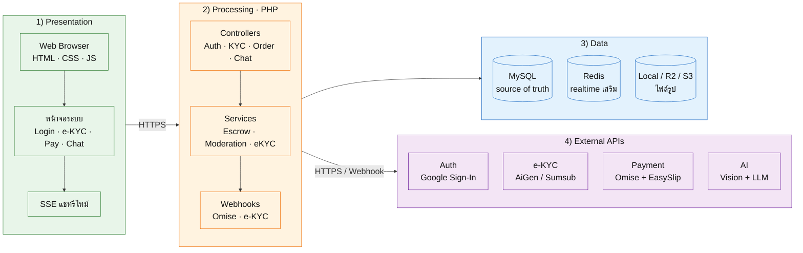
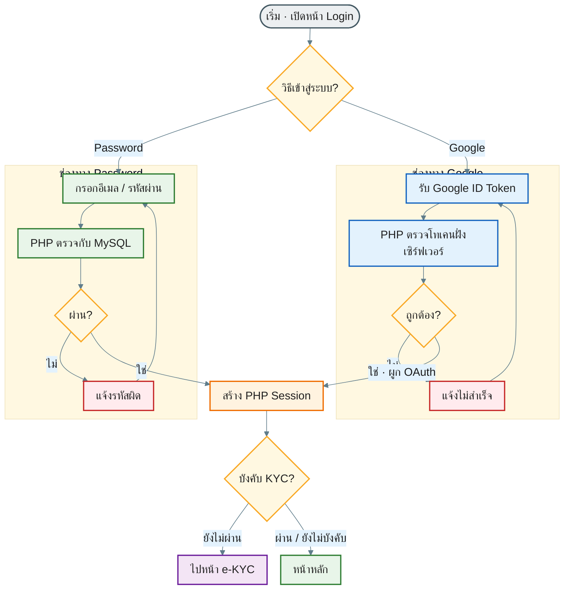
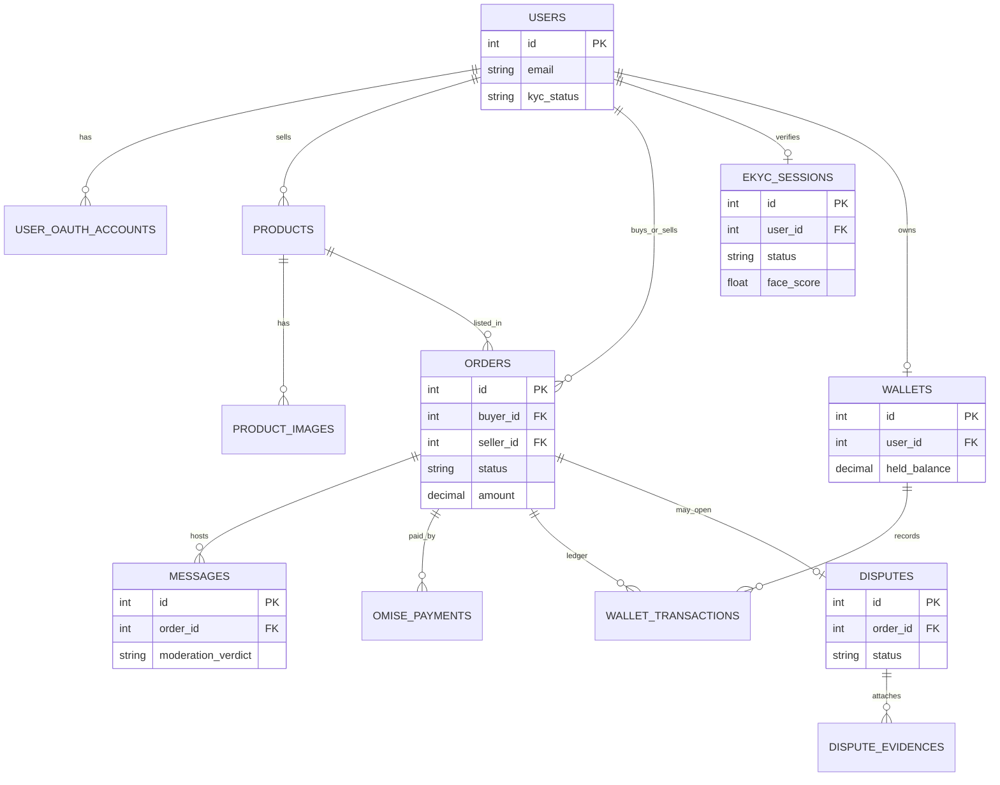
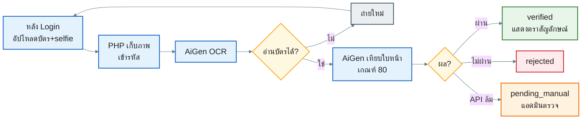
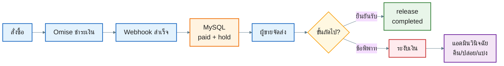
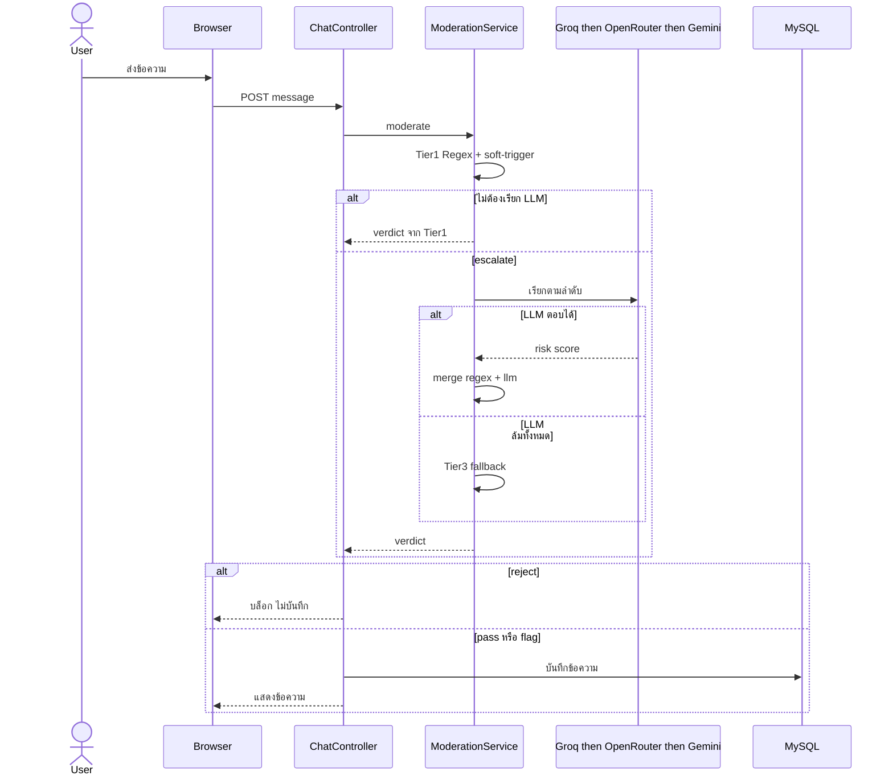

# แพ็กเกจไดอะแกรมบทที่ 3 — FLIXO Escrow (เวอร์ชันแนะนำ)

> **ใช้ชุดนี้เป็นหลัก** — จัดแนวที่ดีที่สุดต่อภาพแล้ว  
> เนื้อหาเป็นสแต็กจริงของ FLIXO (**ไม่ใช่** Flutter / Firebase / Firestore)  
> Export: [mermaid.live](https://mermaid.live) → PNG → `docs/thesis_figures/`

| ภาพ | แนวที่ใช้ | ไฟล์เป้าหมาย |
|-----|-----------|--------------|
| 3.2 | Architecture แบบชั้นซ้อน (layered) | `fig3_2_architecture.png` |
| ตาราง 3.1 | ตาราง Word | — |
| 3.3 | Flowchart 2 คอลัมน์ (Mermaid) | `fig3_3_login_flow.png` |
| 3.3ก | Screenshot จริง | `ui10_login.png` |
| 3.3.2 | ER Diagram | `fig3_3_3_er.png` |
| 3.4 | Sequence | `fig3_4_ekyc_sequence.png` |
| 3.8 | Sequence | `fig3_8_escrow_sequence.png` |
| 3.6b เสริม | Sequence สั้น | `fig3_6b_chat_sequence.png` |

**เคล็ดลับ:** ถ้าลูกศรทับตัวอักษร ให้สลับ `TB`/`LR` หรือใส่บล็อก `%%{init:...}%%` ตามที่มีในแต่ละรูป

### ถ้าตัวหนังสือในกล่องเล็กเกินไปตอนใส่ Word (สำคัญ)

สาเหตุ: PNG กว้างมากแต่ฟอนต์ใน Mermaid เล็ก → ย่อลงหน้ากระดาษแล้วอ่านยาก  
**อย่าแก้แค่ขยายรูปใน Word** — ต้อง export ใหม่โดยฟอนต์ใหญ่ขึ้น

ทำตามนี้ทีละข้อ:

1. ใช้โค้ดในไฟล์นี้ใหม่ (ตั้ง `fontSize` ประมาณ **20–22px** แล้ว)
2. วางใน mermaid.live → ที่แถบตั้งค่า/Actions ถ้ามี **Width / Scale / PNG size** ให้เลือกค่าสูงสุด (เช่น width 2400–3200 หรือ scale 2–3)
3. หรือซูมหน้าเว็บเบราว์เซอร์เป็น **150% หรือ 175%** แล้วค่อย Actions → PNG
4. ใน Word ตั้งความกว้างรูปประมาณ **15–16 ซม.** (เกือบเต็มเนื้อหา) ไม่ต้องย่อเหลือครึ่งหน้า
5. ดู Print Preview / ซูม 100% ถ้ายังเล็ก ให้เพิ่ม `fontSize` เป็น `24px` แล้ว export ซ้ำ

---

## ตารางที่ 3.1 บริการภายนอก (ใส่ใน Word — ไม่ export จาก Mermaid)

| กลุ่ม | บริการ | โปรโตคอล | หน้าที่ในระบบ | ชั้นสำรองเมื่อล้มเหลว |
|-------|--------|----------|----------------|------------------------|
| Auth | Google Sign-In (GIS) | OAuth 2.0 / ID Token | เข้าสู่ระบบ; ตรวจโทเคนฝั่งเซิร์ฟเวอร์ | รหัสผ่าน / อีเมล |
| e-KYC | AiGen | HTTPS REST | OCR บัตร + เทียบใบหน้า (เกณฑ์ 80) | Manual Review โดยแอดมิน |
| e-KYC | Sumsub | HTTPS REST + Webhook | ยืนยันตัวตน / liveness ตามตั้งค่า | Manual Review |
| e-KYC | ThaiD (DOPA) | OpenID Connect | อัตลักษณ์ดิจิทัลแบบขนาน | ไม่แทนที่ช่องทางเอกสาร |
| Payment | Omise | HTTPS REST + Webhook | บัตร / PromptPay + callback ยืนยันยอด | สลิป + EasySlip / รอตรวจ |
| Slip | EasySlip | HTTPS REST | สร้าง/ตรวจสลิปโอน | แอดมินตรวจสลิป |
| Vision | Google Cloud Vision | HTTPS REST | วิเคราะห์รูปสินค้าหลังชั้น EXIF | ใช้ผล EXIF + flag |
| LLM | Groq → OpenRouter → Gemini | HTTPS REST | ข้อความกำกวม + ผู้ช่วยข้อพิพาท | heuristic / flag |
| Infra | Redis, R2/S3, SMTP, Web Push | ตามบริการ | รีไทม์ / เก็บไฟล์ / อีเมล / แจ้งเตือน | อ่าน MySQL / ทำงานต่อได้ |

---

## ภาพที่ 3.2 — Architecture (แนว LR กว้าง — ใช้ชุดนี้)

**คำบรรยาย:**  
ภาพที่ 3.2 สถาปัตยกรรมเว็บแอปพลิเคชันสี่ชั้นของ FLIXO Escrow ชั้นนำเสนอเป็นหน้าเว็บบนเบราว์เซอร์ ชั้นประมวลผลเป็น PHP บน Apache ชั้นข้อมูลใช้ MySQL เป็นแหล่งความจริงของสถานะเงิน โดยมี Redis และ Object Storage เป็นส่วนเสริม บริการภายนอกเชื่อมผ่าน HTTPS/Webhook ตามหน้าที่

> **สำคัญ:** ต้องเป็น `flowchart LR` จะได้ภาพกว้าง ตัวอักษรใหญ่ตอนใส่ Word

**พูดใต้ภาพ 3 ข้อ:** Login ≠ e-KYC · MySQL เป็น source of truth ของเงิน · API ล้มแล้วไม่ปล่อยเงินโดยไม่มีเงื่อนไข

---

## ภาพที่ 3.3 — ขั้นตอนเข้าสู่ระบบ (Password + Google)

**คำบรรยาย:**  
ภาพที่ 3.3 ขั้นตอนเข้าสู่ระบบสองช่องทาง (Password / Google) วางคู่กันแล้วบรรจบที่ Session และตรวจ KYC ไม่มีสแกนใบหน้าตอน Login

**ไฟล์:** `fig3_3_login_flow.png`  
**Export จาก:** [mermaid.live](https://mermaid.live) — ซูม 150–175% แล้ว Actions → PNG (กว้างประมาณ 2400+)

หน้าจอเข้าสู่ระบบจริงใช้ **ภาพที่ 3.3ก** จาก `appendix_ch4/screenshots/ui10_login.png`

> **สำคัญตอน export 3.3:** ถ้าได้ PNG สูงยาว (>2500 px สูง) ให้ขยายหน้าต่างพรีวิวแนวนอนให้กว้างสุด ก่อน Actions → PNG  
> เป้าหมายสัดส่วนประมาณ **กว้าง ≥ สูง** หรือสูงไม่เกิน ~1800 px

### วิธี export

1. คัดลอกบล็อก Mermaid ด้านบนทั้งก้อน → วางใน mermaid.live  
2. ขยายพรีวิวแนวนอนให้กว้าง · อย่าซูมจนภาพสูงเกินหน้าจอแล้วค่อย PNG  
3. ซูมเบราว์เซอร์ **125–150%** → Actions → PNG  
4. เซฟทับ `docs/thesis_figures/fig3_3_login_flow.png`  
5. ใน Word กว้างประมาณ **15–16 ซม.**

| ภาพ | ไฟล์ |
|-----|------|
| 3.3 | `fig3_3_login_flow.png` |
| 3.3ก | `ui10_login.png` |

---

## ภาพที่ 3.3.2 — ER Diagram (แนว ER)

**คำบรรยาย:**  
ภาพที่ 3.3.2 แผนภาพความสัมพันธ์เอนทิตีหลักของฐานข้อมูล MySQL เน้นวงจรบัญชีตัวกลาง การยืนยันตัวตน ข้อความ และข้อพิพาท

ถ้ายังแน่น: ลบบล็อก `{ ... }` ของตารางออก เหลือแค่ชื่อเอนทิตีกับเส้นสัมพันธ์

---

## ภาพที่ 3.4 — e-KYC Flow (กระชับ · LR · มีสี)

**คำบรรยาย:**  
ภาพที่ 3.4 ขั้นตอนการยืนยันตัวตนหลังเข้าสู่ระบบแล้ว หากบริการภายนอกไม่พร้อม ระบบส่งเข้าคิวให้ผู้ดูแลระบบตรวจด้วยมือ

> Export ทับ `fig3_4_ekyc_sequence.png` · แนว LR กว้าง อ่านง่ายใน Word

---

## ภาพที่ 3.8 — Escrow Payment Flow (กระชับ · LR · มีสี)

**คำบรรยาย:**  
ภาพที่ 3.8 ขั้นตอนการชำระเงินผ่าน Omise การกักเก็บยอดในบัญชีกลาง และการปล่อยหรือคืนเงินตามเงื่อนไข

> Export ทับ `fig3_8_escrow_sequence.png`

---

## ภาพที่ 3.6b เสริม — Chat Cascade Sequence (ถ้าจะใส่บท 3)

**คำบรรยาย:**  
ภาพที่ 3.6บ แผนภาพลำดับการคัดกรองข้อความแบบหลายชั้น รายละเอียดตัวเลขประเมินอยู่ในบทที่ 4

---

## ลำดับทำใน mermaid.live

1. คัดลอกบล็อกของ **ภาพที่ 3.2** → วาง → ถ้าเส้นทับ ลองเปลี่ยน `flowchart TB` เป็น `flowchart LR` เฉพาะรูปนั้น  
2. Actions → PNG → เซฟชื่อตามตารางบน  
3. ทำต่อ 3.3 (Mermaid) → 3.3.2 → 3.4 → 3.8  
4. ใส่ Word ตามคำบรรยายใต้แต่ละหัวข้อ  
5. ตาราง 3.1 คัดลอกลง Word เป็นตาราง ไม่ต้องทำเป็นรูป

## Checklist สั้น

- [ ] 3.2 เป็นชั้นซ้อน มี PHP + MySQL ชัด  
- [ ] 3.3 เป็น flowchart login ไม่มีกล้อง  
- [ ] 3.3.2 เป็น ER  
- [ ] 3.4 และ 3.8 เป็น sequence  
- [ ] ไม่มีคำว่า Firebase / Flutter / Firestore ในรูป
