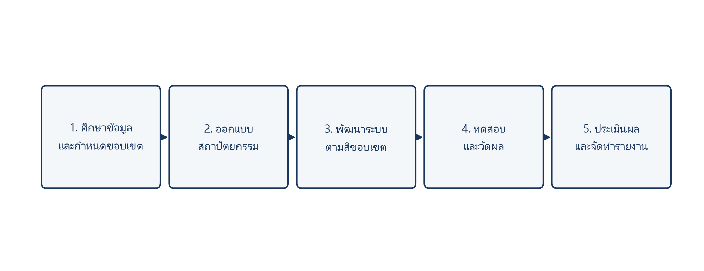
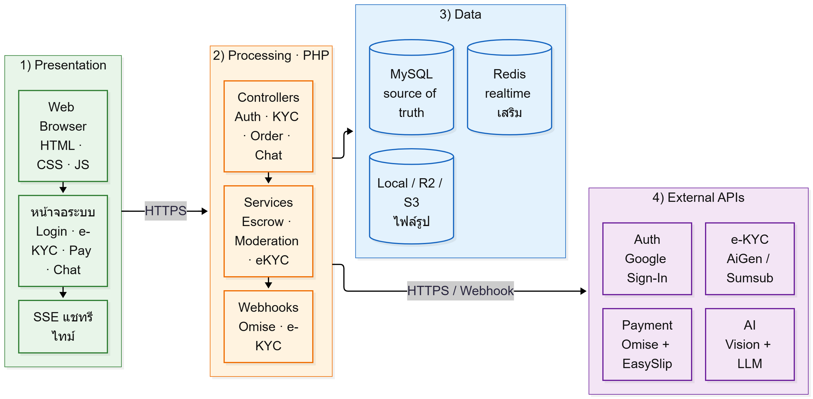
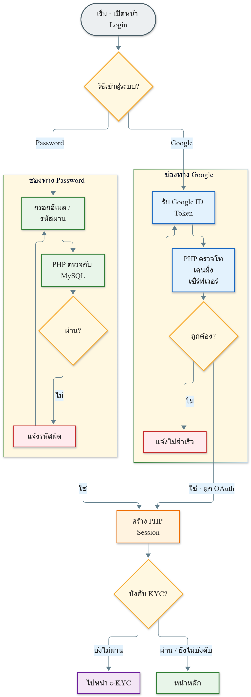
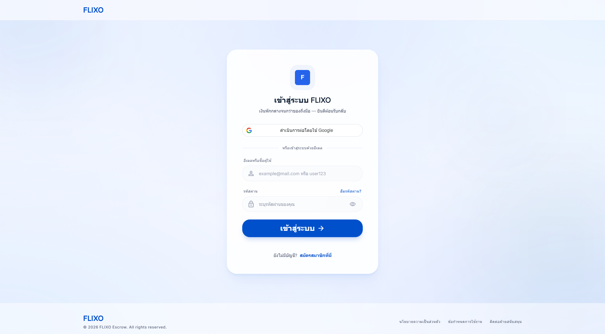
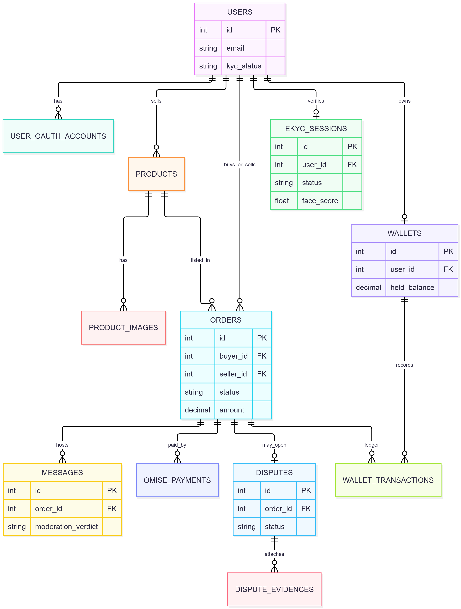
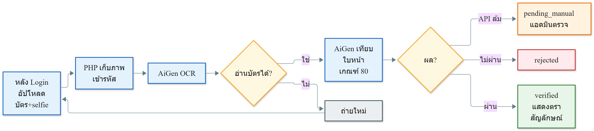
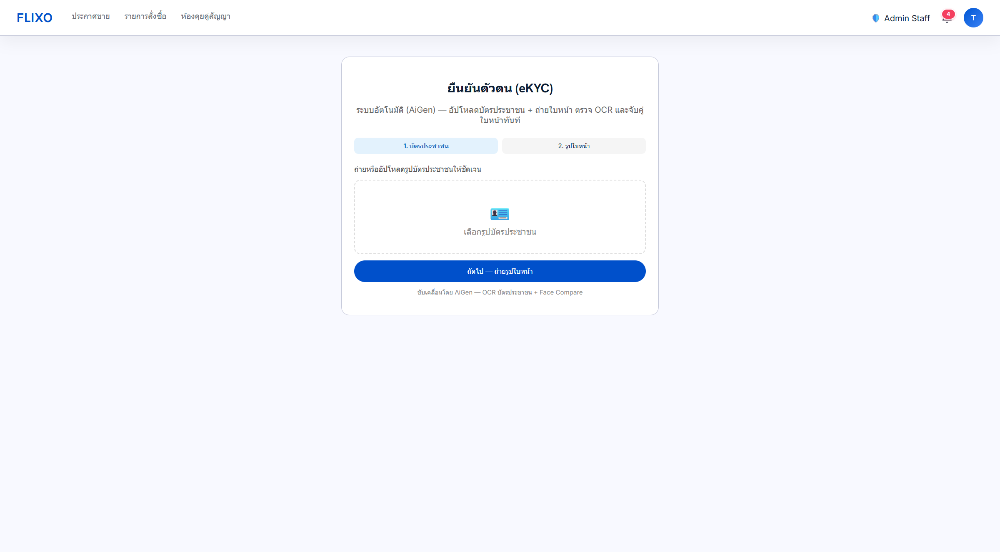
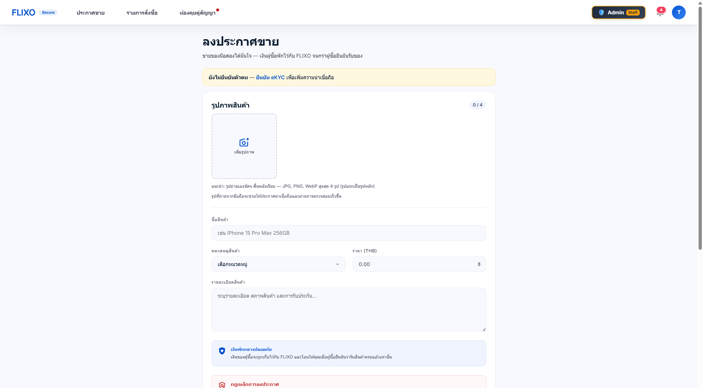
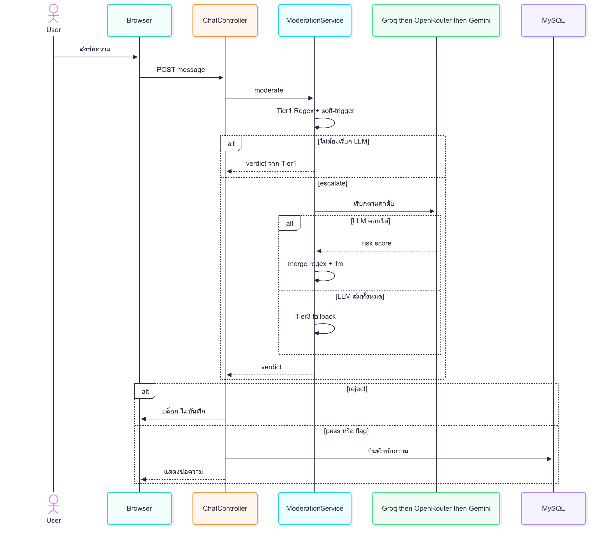
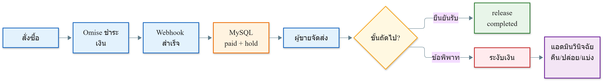

# บทที่ 3
# การออกแบบและพัฒนาระบบ

บทนี้นำเสนอการออกแบบและพัฒนาระบบตามวัตถุประสงค์ข้อ 1.2.2 และขอบเขตในบทที่ 1 เนื้อหาในบทนี้เป็นข้ออ้างเชิงออกแบบ ไม่ใช่ข้อสรุปว่าโมดูลทำงานดีเพียงใด ข้อจำกัดหลักมีสี่ประการ ได้แก่ ช่องทางยืนยันตัวตนหลักยังรับภาพนิ่ง การพึ่งบริการภายนอก ความเป็นส่วนตัวของภาพบัตรและใบหน้า และขนาดตัวอย่างที่ใช้ประเมินในบทที่ 4 ข้อจำกัดเหล่านี้ถูกนำไปวัดและอภิปรายเป็นแกนของบทที่ 4 ไม่เก็บไว้ท้ายเล่มเพียงอย่างเดียว

## 3.1 ภาพรวมระบบ

ระบบถูกออกแบบเป็นเว็บแอปพลิเคชันสี่ชั้น ชั้นนำเสนอรับข้อมูลจากผู้ใช้และแสดงผลบนเบราว์เซอร์ ชั้นประมวลผลบังคับกฎธุรกิจด้วย PHP และเรียกบริการภายนอก ชั้นข้อมูลจัดเก็บสถานะธุรกรรมในฐานข้อมูลเชิงสัมพันธ์ ชั้นบริการภายนอกเชื่อมต่อ API ตามหน้าที่ จุดสำคัญเชิงออกแบบคือการแยกการเข้าสู่ระบบออกจากการยืนยันตัวตน การเข้าสู่ระบบยืนยันเพียงว่าผู้ใช้ถือบัญชีนั้นอยู่ การยืนยันตัวตนพิสูจน์ว่าบุคคลตรงกับบัตรประชาชน

การพัฒนาครอบคลุมสี่ขอบเขตตามบทที่ 1 ขอบเขตธุรกรรมและการเงินทำหน้าที่กักเก็บเงิน ปล่อยเงิน คืนเงิน และระงับเงินเมื่อมีข้อพิพาท ขอบเขตความปลอดภัยและการยืนยันตัวตนทำหน้าที่พิสูจน์ตัวตนและแสดงตราสัญลักษณ์บนโปรไฟล์ ขอบเขตระบบอัจฉริยะทำหน้าที่ตรวจรูปสินค้าและเฝ้าห้องสนทนา ขอบเขตข้อพิพาทและบริการลูกค้าทำหน้าที่เปิดคำร้อง แนบหลักฐาน และช่วยผู้ดูแลระบบพิจารณาโดยไม่ตัดสินแทน ขั้นตอนการดำเนินงานวิจัยแสดงดังภาพที่ 3.1

## 3.2 สถาปัตยกรรมระบบ

### 3.2.1 ชั้นนำเสนอ (Presentation)

ผู้ใช้ติดต่อระบบผ่านเว็บเบราว์เซอร์ ชั้นนำเสนอเป็นหน้าเว็บที่เรนเดอร์จากฝั่งเซิร์ฟเวอร์ร่วมกับ JavaScript บนเครื่องลูกข่าย ประกอบด้วยหน้าเข้าสู่ระบบ หน้ายืนยันตัวตน หน้าประกาศสินค้า หน้าชำระเงิน ห้องสนทนา หน้าข้อพิพาท และแผงควบคุมผู้ดูแลระบบ ห้องสนทนาใช้ SSE อ่านเหตุการณ์ตามเวลาจริงเมื่อบริการเสริมพร้อมใช้งาน

### 3.2.2 ชั้นประมวลผล (Processing)

ชั้นประมวลผลทำงานบน PHP ภายใต้เว็บเซิร์ฟเวอร์ Apache โครงสร้างแบ่งเป็น Controllers ที่รับคำขอ HTTP และ Services ที่บังคับกฎธุรกิจ ได้แก่ บัญชีตัวกลาง การคัดกรองแชท การตรวจรูปสินค้า ท่อ e-KYC และผู้ช่วยข้อพิพาท จุดรับ webhook ของผู้ให้บริการชำระเงินและยืนยันตัวตนอยู่ในชั้นนี้เช่นกัน การตรวจโทเคน Google และการอัปเดตสถานะเงินทำที่เซิร์ฟเวอร์ ไม่ฝากความน่าเชื่อถือไว้ที่เบราว์เซอร์เพียงอย่างเดียว

### 3.2.3 ชั้นข้อมูล (Data)

สถานะคำสั่งซื้อ ยอดกักเก็บ ข้อความ และผลการยืนยันตัวตนจัดเก็บใน MySQL หรือ MariaDB ซึ่งเป็นแหล่งความจริงของธุรกรรมเงิน Redis ใช้เป็นช่องทาง Pub/Sub สำหรับแชทรีไทม์เมื่อพร้อมใช้งาน แต่ไม่เก็บยอด escrow ไฟล์ภาพจัดเก็บบนดิสก์ของเครื่องแม่ข่ายเป็นค่าเริ่มต้น และย้ายไปหน่วยจัดเก็บวัตถุ เช่น Cloudflare R2 หรือ S3 ได้เมื่อตั้งค่าไว้

### 3.2.4 บริการภายนอก (External APIs)

บริการภายนอกเชื่อมต่อผ่าน HTTPS หรือ Webhook ตามกลุ่มหน้าที่ ดังตารางที่ 3.1

| กลุ่ม | บริการ | หน้าที่ | ชั้นสำรองเมื่อล้มเหลว |
|-------|--------|---------|------------------------|
| Auth | Google Sign-In | เข้าสู่ระบบด้วย ID Token ตรวจฝั่งเซิร์ฟเวอร์ | รหัสผ่าน / อีเมล |
| e-KYC | AiGen | OCR บัตร + เทียบใบหน้า (เกณฑ์ 80) | คิวตรวจโดยผู้ดูแลระบบ |
| e-KYC | Sumsub | ช่องทางยืนยันตัวตน / liveness ตามที่ตั้งค่า | คิวตรวจโดยผู้ดูแลระบบ |
| e-KYC | ThaiD (DOPA) | อัตลักษณ์ดิจิทัลแบบขนาน | ไม่แทนที่ช่องทางเอกสาร |
| Payment | Omise | บัตร / PromptPay + webhook ยืนยันยอด | สลิป + EasySlip / รอตรวจ |
| Slip | EasySlip | สร้างและตรวจสลิปโอน | ผู้ดูแลระบบตรวจสลิป |
| Vision | Google Cloud Vision | วิเคราะห์รูปสินค้าที่น่าสงสัยหลังชั้น EXIF | ใช้ผล EXIF + flag |
| LLM | Groq → OpenRouter → Gemini | วิเคราะห์ข้อความกำกวมและผู้ช่วยข้อพิพาท | heuristic / flag |
| Infra | Redis, R2/S3, SMTP, Web Push | รีไทม์ จัดเก็บ อีเมล แจ้งเตือน | อ่าน MySQL / ทำงานต่อโดยไม่อีเมล |

สถาปัตยกรรมสี่ชั้นแสดงดังภาพที่ 3.2 เมื่อ Redis ไม่พร้อม ห้องสนทนาอ่านข้อความจาก MySQL แทน การออกแบบนี้ทำให้ธุรกรรมหลักไม่หยุดเมื่อบริการเสริมล้มเหลว และยอดเงินยังยึดสถานะในฐานข้อมูลเป็นหลัก

## 3.3 ระบบเข้าสู่ระบบและแบบจำลองข้อมูล

### 3.3.1 ขั้นตอนเข้าสู่ระบบ (Login Flow)

ผู้ใช้เข้าสู่ระบบได้สองช่องทาง ช่องทางแรกใช้ชื่อผู้ใช้หรืออีเมลพร้อมรหัสผ่าน ช่องทางที่สองใช้บัญชี Google โดยเครื่องลูกข่ายได้รับโทเคนแล้วนำไปตรวจสอบฝั่งเครื่องแม่ข่าย หากโทเคนไม่ถูกต้อง ผู้ใช้ยังเข้าสู่ระบบด้วยรหัสผ่านได้ เมื่อเข้าสู่ระบบสำเร็จ ระบบสร้างเซสชัน PHP และเข้าสู่หน้าหลักของบัญชี หากต้องการใช้สิทธิ์ที่ระบบกำหนดให้ต้องผ่านการยืนยันตัวตนก่อน ระบบจะนำผู้ใช้ไปยังหน้าพิสูจน์ตัวตน

ขั้นตอนเข้าสู่ระบบทั้งสองช่องทางแสดงรวมในภาพที่ 3.3 โดย Password และ Google วางคู่กันแล้วมาบรรจบที่ Session และตรวจ KYC ไม่มีช่องสแกนใบหน้าในโฟลว์เข้าสู่ระบบ เพราะการยืนยันตัวตนทำหลังเข้าสู่ระบบแล้ว หน้าจอจริงแสดงดังภาพที่ 3.3ก

### 3.3.2 แผนภาพความสัมพันธ์เอนทิตี (ER Diagram)

แกนข้อมูลของระบบอยู่ใน MySQL ผู้ใช้หนึ่งคนมีบัญชีเข้าสู่ระบบและสถานะยืนยันตัวตนแยกกัน มีประกาศสินค้าและคำสั่งซื้อได้หลายรายการ แต่ละคำสั่งซื้อผูกข้อความ การชำระเงิน รายการในสมุดบัญชีกระเป๋าเงิน และข้อพิพาทได้ ความสัมพันธ์หลักแสดงดังภาพที่ 3.3.2 โดยตัดตารางบันทึกเหตุการณ์และโทรมาตรที่ไม่ได้ใช้เล่าเรื่องธุรกรรมออกจากรูปหลัก

## 3.4 ระบบยืนยันตัวตน

### 3.4.1 ลำดับการเลือกช่องทาง

ระบบมีช่องทางยืนยันตัวตนหลายช่องทาง หากตั้งค่าบริการอ่านบัตรและเทียบใบหน้าไว้ จะใช้ช่องทางนั้นเป็นหลัก หากไม่มี จะใช้ช่องทางที่มีการตรวจความมีชีวิต หากไม่มีทั้งสองช่องทาง ผู้ใช้ส่งเอกสารให้ผู้ดูแลระบบตรวจด้วยมือ นอกจากนี้ผู้ใช้สามารถเลือกยืนยันผ่านระบบอัตลักษณ์ดิจิทัลของกรมการปกครองได้เมื่อได้รับอนุญาต ซึ่งเป็นเส้นทางขนาน ไม่ได้แทนที่ช่องทางเอกสาร

### 3.4.2 การอ่านบัตรและการเทียบใบหน้า

ผู้ใช้ที่เข้าสู่ระบบแล้วเปิดหน้ายืนยันตัวตน ขั้นแรกถ่ายหรืออัปโหลดบัตรประชาชน ขั้นที่สองเปิดกล้องหน้าถ่ายภาพใบหน้าที่ความละเอียด 640 คูณ 480 จุด จากนั้นให้ความยินยอมตามกฎหมายว่าด้วยข้อมูลส่วนบุคคล ระบบส่งภาพบัตรไปอ่านข้อความ หากอ่านชื่อและเลขบัตรไม่สำเร็จ จะปฏิเสธและให้ถ่ายใหม่ โดยยังไม่เทียบใบหน้า เพราะยังผูกชื่อจริงกับบัญชีไม่ได้ ลำดับขั้นตอนการยืนยันตัวตนแสดงดังภาพที่ 3.4 และส่วนติดต่อผู้ใช้ขั้นอัปโหลดบัตรแสดงดังภาพที่ 3.5

เมื่ออ่านบัตรสำเร็จ ระบบส่งภาพบัตรคู่กับภาพจากกล้องไปเทียบใบหน้า โดยระบุว่าภาพแรกเป็นเอกสารราชการ เพื่อให้บริการค้นใบหน้าในช่องรูปบัตร ไม่เทียบทั้งใบบัตรกับภาพจากกล้อง เกณฑ์ความคล้ายกำหนดไว้ที่ 80 หากไม่พบใบหน้าหรือไม่พบบัตรในภาพ ระบบแจ้งให้ถ่ายใหม่ หากคะแนนไม่ถึงเกณฑ์ ระบบปฏิเสธพร้อมแสดงผลให้ผู้ใช้ทราบ หากผ่านเกณฑ์ ระบบตั้งสถานะยืนยันแล้วและแสดงตราสัญลักษณ์บนโปรไฟล์กับบัตรสินค้า ชื่อที่ได้จากบัตรจะตัดคำนำหน้าออกก่อนบันทึก เพื่อให้เทียบกับชื่อบัญชีธนาคารได้ เลขบัตรในบันทึกเหตุการณ์ถูกปกปิดบางส่วน ภาพถูกเข้ารหัสก่อนจัดเก็บ

ช่องทางนี้ใช้ภาพนิ่งจากกล้องหน้า จึงเป็นการตรวจสอบใบหน้าแบบหนึ่งต่อหนึ่ง ไม่ใช่การตรวจความมีชีวิตแบบโต้ตอบ หากต้องการชั้นดังกล่าว ระบบรองรับช่องทางอื่นที่มีการตรวจความมีชีวิต หรือช่องทางอัตลักษณ์ดิจิทัลตามระดับที่กำหนด หากเรียกบริการไม่สำเร็จเพราะเครือข่ายหรือบริการไม่พร้อม ระบบไม่ปฏิเสธผู้ใช้ทิ้ง แต่ส่งเอกสารเข้าคิวให้ผู้ดูแลระบบตรวจด้วยมือ

### 3.4.3 ชั้นสำรองโดยผู้ดูแลระบบ

เมื่อช่องทางอัตโนมัติไม่พร้อม ระบบเก็บบัตรและภาพใบหน้าในรูปแบบเข้ารหัส ตั้งสถานะรอตรวจ และแสดงผลให้ผู้ใช้ทราบว่าอยู่ระหว่างการตรวจสอบ ผู้ดูแลระบบเปิดรายการในแผงควบคุม ดูภาพตามสิทธิ์ แล้วอนุมัติหรือปฏิเสธ การออกแบบนี้ทำให้บริการหลักไม่หยุดเมื่อบริการภายนอกล้มเหลว

## 3.5 ระบบตรวจจับภาพสินค้า

เมื่อผู้ขายลงประกาศ ระบบตรวจรูปสินค้าสองชั้น ชั้นแรกวิเคราะห์ข้อมูลที่กล้องบันทึกในไฟล์ภาพ เช่น ยี่ห้อ รุ่น วันเวลา และพิกัด ภาพที่น่าสงสัยหรือมีลักษณะเป็นภาพหน้าจอจะถูกส่งเข้าชั้นที่สอง ซึ่งใช้บริการวิเคราะห์ภาพเพื่อตรวจเนื้อหาไม่เหมาะสม การปรากฏของภาพบนเว็บอื่น และป้ายกำกับที่เกี่ยวข้อง ผลลัพธ์มีสามระดับ ได้แก่ ผ่าน ติดตาม และบล็อกการลงประกาศ หากบริการวิเคราะห์ภาพไม่พร้อม ระบบไม่บล็อกโดยอัตโนมัติจากชั้นนั้น แต่ใช้ผลชั้นแรกเป็นข้อมูลติดตามให้ผู้ดูแลระบบ หน้าลงประกาศขายแสดงดังภาพที่ 3.6 โดยระบบแจ้งเมื่อผู้ใช้ยังไม่ผ่านการยืนยันตัวตน และอธิบายว่าเงินผู้ซื้อจะถูกกักเก็บจนกว่าผู้ซื้อยืนยันรับสินค้า

## 3.6 ระบบคัดกรองห้องสนทนา

ข้อความในห้องสนทนาของคำสั่งซื้อถูกตรวจก่อนบันทึก ชั้นแรกใช้กฎที่กำหนดไว้เพื่อจับเลขบัญชี เบอร์โทรศัพท์ ลิงก์ภายนอก และคำชักชวนให้โอนนอกระบบ หากคะแนนอยู่ในช่วงกำกวม หรือมีสัญญาณอ่อน (soft-trigger) เช่น การยืนยันการโอนหรือโทเคนที่แทนข้อมูลส่วนบุคคลหลังปกปิด ข้อความถูกส่งต่อแบบจำลองภาษาตามลำดับ Groq, OpenRouter และ Gemini หากมีภาพแนบ ระบบอ่านข้อความในภาพแล้วนำเข้ากระบวนการชุดเดียวกัน

เมื่อความเสี่ยงสูงถึงเกณฑ์ ระบบไม่บันทึกข้อความนั้น และแจ้งผู้ส่งทันทีว่าไม่สามารถส่งได้เพราะเข้าลักษณะต้องห้าม เมื่อความเสี่ยงปานกลาง ข้อความถูกบันทึกได้แต่ติดเครื่องหมายเข้าคิวผู้ดูแลระบบ หากแบบจำลองภาษาทั้งหมดไม่พร้อม ระบบใช้ผลของกฎชั้นแรกต่อไปได้โดยไม่ทำให้ห้องสนทนาหยุดทำงาน ลำดับการคัดกรองแบบหลายชั้นแสดงดังภาพที่ 3.6บ ส่วนผลการวัดบนชุดข้อความจริงนำเสนอในบทที่ 4

## 3.7 ระบบข้อพิพาทและผู้ช่วยผู้ดูแลระบบ

ผู้ซื้อหรือผู้ขายเปิดคำร้องข้อพิพาทได้เมื่อสินค้าไม่ตรงตามที่ระบุ ส่งไม่สำเร็จ หรือมีเหตุตามหมวดหมู่ที่กำหนด เมื่อเปิดคำร้อง ยอดเงินในบัญชีกลางถูกระงับทันที คู่กรณีแนบหลักฐานเป็นภาพถ่ายหรือเอกสารได้ ระบบแยกหลักฐานเป็นฝั่งผู้ซื้อและฝั่งผู้ขาย

ผู้ช่วยปัญญาประดิษฐ์อ่านประวัติห้องสนทนา สถานะการขนส่ง และหลักฐานที่แนบ แล้วเสนอแนวทางแก่ผู้ดูแลระบบ ได้แก่ คืนเงินผู้ซื้อ ปล่อยเงินผู้ขาย แบ่งสัดส่วน หรือส่งให้ตรวจเพิ่ม คำแนะนำนี้ไม่ใช่คำตัดสินที่มีผลผูกพัน ผู้ดูแลระบบเป็นผู้กดคำสั่งที่มีผลต่อยอดเงิน หากแบบจำลองภาษาไม่พร้อม ระบบใช้กฎเชิงตรรกะจากสถานะพัสดุและหลักฐานที่มีเป็นชั้นสำรอง ผู้ใช้ติดต่อฝ่ายสนับสนุนผ่านห้องสนทนาของระบบได้โดยไม่ต้องออกนอกแพลตฟอร์ม

## 3.8 ระบบชำระเงินและบัญชีตัวกลาง

ผู้ซื้อชำระเงินได้ผ่านบัตรหรือแหล่งชำระพร้อมเพย์ของผู้ให้บริการชำระเงิน Omise และผ่านคิวอาร์โค้ดพร้อมเพย์ของแพลตฟอร์มแล้วอัปโหลดสลิปเพื่อตรวจยอดด้วย EasySlip เมื่อชำระสำเร็จ webhook ยืนยันยอดแล้วยอดถูกบันทึกในกระเป๋าเงินบัญชีกลางบน MySQL ผู้ขายเห็นว่ามีคำสั่งซื้อที่ชำระแล้วแต่ยังถอนส่วนนี้ไม่ได้จนกว่าเงื่อนไขจะสำเร็จ ลำดับการชำระเงิน การกักเก็บยอด และการปล่อยหรือคืนเงินแสดงดังภาพที่ 3.8

ผู้ขายแจ้งการจัดส่งโดยระบุผู้ให้บริการขนส่งและหมายเลขพัสดุ ผู้ซื้อยืนยันรับสินค้าเพื่อให้ระบบปล่อยเงิน หากเปิดข้อพิพาทก่อนปล่อยเงิน ยอดถูกระงับไว้ การคืนเงินทำได้เมื่อคำสั่งซื้อถูกยกเลิกตามเงื่อนไข หรือเมื่อผู้ดูแลระบบวินิจฉัยให้คืนผู้ซื้อ และสามารถแบ่งสัดส่วนได้ตามคำวินิจฉัย หากช่องทางชำระเงินหลักไม่พร้อม ผู้ใช้ยังใช้ช่องทางสลิปหรือรอผู้ดูแลระบบตรวจสอบได้ตามสถานะของคำสั่งซื้อ

## 3.9 บริการสนับสนุนและความต่อเนื่องของระบบ

ระบบส่งอีเมลธุรกรรมและจดหมายรีเซ็ตรหัสผ่านได้เมื่อตั้งค่าครบ หากไม่ครบ ธุรกรรมหลักยังดำเนินต่อได้ มีระบบแจ้งเตือนในแอปเมื่อมีเหตุการณ์ที่เกี่ยวข้องกับคำสั่งซื้อ ไฟล์อัปโหลดอยู่บนเครื่องแม่ข่ายเป็นค่าเริ่มต้น และย้ายไปหน่วยจัดเก็บวัตถุได้เมื่อตั้งค่าไว้ ห้องสนทนาใช้บริการเสริมสำหรับเหตุการณ์ตามเวลาจริงเมื่อพร้อม และอ่านฐานข้อมูลแทนเมื่อไม่พร้อม

หลักการร่วมของทุกโมดูลคือ หากบริการภายนอกล้มเหลว ระบบต้องไม่หยุดทั้งแพลตฟอร์ม และต้องไม่เปิดช่องให้เงินถูกปล่อยโดยไม่มีเงื่อนไข ชั้นอัตโนมัติทำงานเมื่อบริการพร้อม ชั้นมนุษย์หรือกฎเชิงตรรกะรักษาความต่อเนื่องเมื่อบริการไม่พร้อม

## 3.10 ข้อจำกัดของระบบที่นำไปสู่การประเมิน

การออกแบบในบทนี้ยังมีข้อจำกัดสามประการที่ต้องนำไปวัดในบทที่ 4 ประการแรก ช่องทางยืนยันตัวตนหลักรับภาพนิ่งจากกล้องหน้า จึงเป็นการตรวจสอบใบหน้าแบบหนึ่งต่อหนึ่ง ไม่ใช่การตรวจความมีชีวิตแบบโต้ตอบ ระบบยังป้องกันการถือรูปถ่ายหรือเปิดวิดีโอบนหน้าจอได้จำกัด ประการที่สอง ชั้นอัตโนมัติพึ่งบริการภายนอกทั้งการอ่านบัตร เทียบใบหน้า วิเคราะห์ภาพ แบบจำลองภาษา และการชำระเงิน ความถูกต้องของแบบจำลองจึงไม่เท่ากับความถูกต้องของท่อประมวลผลในเครื่อง และความพร้อมใช้ของระบบขึ้นกับชั้นสำรองเมื่อบริการเหล่านั้นล้มเหลว ประการที่สาม ภาพบัตรประชาชนและภาพใบหน้าเป็นข้อมูลอ่อนไหว ระบบเข้ารหัสไฟล์และปกปิดเลขบัตรในบันทึก แต่การส่งภาพไปประมวลผลภายนอกยังเป็นความเสี่ยงด้านความเป็นส่วนตัวที่ต้องเปิดเผยต่อผู้ใช้

ข้อจำกัดเหล่านี้กำหนดทิศทางการประเมินว่าต้องรายงานอัตราความผิดพลาด ไม่ใช่สถานะผ่านหรือไม่ผ่านเพียงอย่างเดียว ต้องให้เหตุผลของเกณฑ์ 80 จากคะแนนจริง ต้องแยกผลท่อจำลองออกจากบริการจริง และต้องระบุสิ่งที่ยังไม่ได้ทดลอง โดยเฉพาะการโจมตีด้วยการนำเสนอ และการวัดเวลาตัดสินข้อพิพาทของผู้ดูแลระบบก่อนและหลังมีผู้ช่วยปัญญาประดิษฐ์

## 3.11 สรุปบทที่ 3

บทนี้นำเสนอการออกแบบระบบตามสี่ขอบเขตในบทที่ 1 บนสถาปัตยกรรมสี่ชั้น ได้แก่ เว็บบนเบราว์เซอร์ ชั้นประมวลผล PHP ชั้นข้อมูล MySQL พร้อม Redis และที่เก็บวัตถุเป็นส่วนเสริม และบริการภายนอกตามตารางที่ 3.1 ระบบแยกการเข้าสู่ระบบออกจากการยืนยันตัวตน ใช้การอ่านบัตรแล้วเทียบใบหน้าเป็นช่องทางหลักของการพิสูจน์ตัวตน กักเก็บเงินในบัญชีกลางจนกว่าเงื่อนไขจะครบ คัดกรองรูปสินค้าและห้องสนทนาด้วยชั้นกฎร่วมกับปัญญาประดิษฐ์ และให้ผู้ช่วยสรุปข้อพิพาทโดยผู้ดูแลระบบเป็นผู้ตัดสินเงิน ทุกโมดูลมีชั้นสำรองเมื่อบริการภายนอกไม่พร้อม การที่ระบบมีหน้าที่เหล่านี้ไม่เท่ากับว่าทุกหน้าที่ถูกพิสูจน์แล้วว่าทำงานดี รายละเอียดการวัดและข้ออ้างที่ยังไม่พิสูจน์อยู่ที่บทที่ 4 และบทที่ 5
