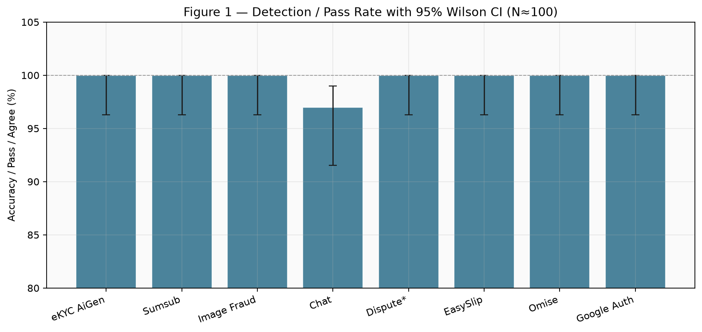
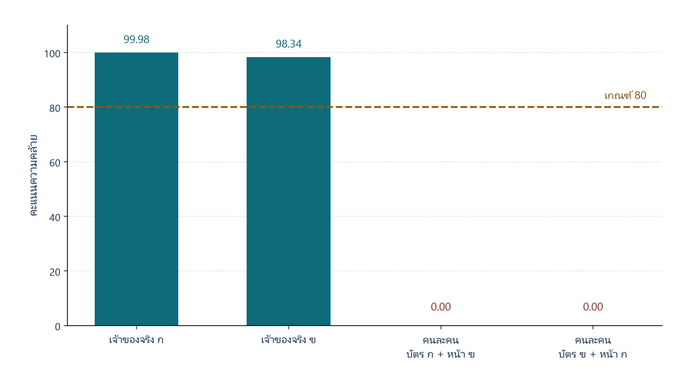
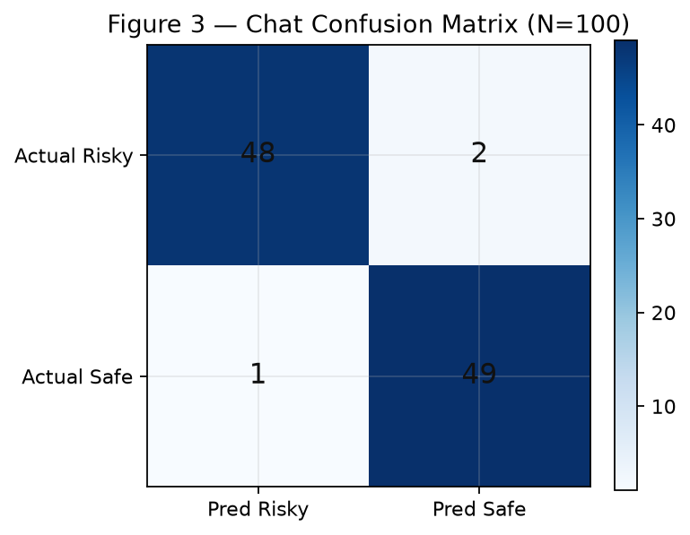
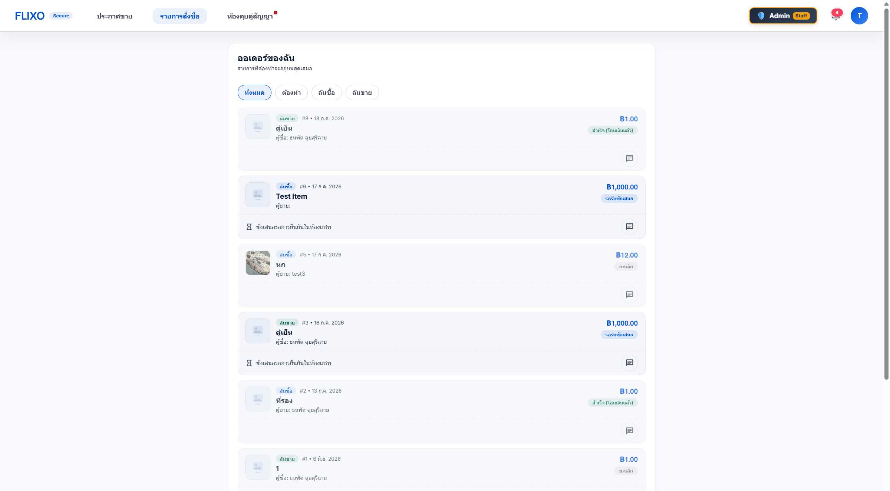

# บทที่ 4
# ผลการทดลองและการประเมินระบบ

บทนี้ตอบวัตถุประสงค์ข้อ 1.2.3 โดยวัดว่าระบบทำงานได้ดีแค่ไหนในขอบเขตที่ทดลองได้ ไม่ได้อธิบายการออกแบบซ้ำบทที่ 3 แกนของบทคือข้อจำกัดของหลักฐาน แล้วจึงรายงานตัวเลข ไม่กลับกัน ข้อความในบทที่ 1 ข้อ 1.4 ยังเป็นผลที่คาดหวังจนกว่าตารางในบทนี้จะรองรับ

## 4.1 ข้อจำกัดหลักที่ใช้กำกับทุกข้ออ้าง

ก่อนอ่านความถูกต้องร้อยละใด ต้องยึดข้อจำกัดสี่ข้อนี้เป็นกรอบตีความ

ประการแรก ช่องทางยืนยันตัวตนหลักรับภาพนิ่งจากกล้องหน้า จึงเป็นการเทียบใบหน้าแบบหนึ่งต่อหนึ่ง ไม่ใช่การตรวจความมีชีวิต งานนี้ยังไม่ได้ทดสอบการโจมตีด้วยการนำเสนอ ได้แก่ การถือรูปถ่าย การพิมพ์รูป และการเปิดวิดีโอบนหน้าจอ จึงอ้างไม่ได้ว่าชั้นใบหน้ากันการปลอมแปลงกล้องได้

ประการที่สอง ชั้นอัตโนมัติพึ่งบริการภายนอก ความถูกต้องของท่อในเครื่องไม่เท่ากับความถูกต้องของแบบจำลองบนประชากร และความต่อเนื่องของระบบในบทนี้คืออัตราสำเร็จของชั้นสำรองเมื่อบังคับให้บริการล้มเหลว ไม่ใช่สัดส่วนเวลาที่เครื่องแม่ข่ายพร้อมใช้จริง

ประการที่สาม ภาพบัตรประชาชนและภาพใบหน้าเป็นข้อมูลอ่อนไหว ระบบเข้ารหัสไฟล์และปกปิดเลขบัตรในบันทึก แต่ยังส่งภาพไปประมวลผลภายนอกตามความยินยอม ข้อ 1.4.10 จึงเป็นมาตรการในระบบ ไม่ใช่การขจัดความเสี่ยงด้านความเป็นส่วนตัวทั้งหมด

ประการที่สี่ ขนาดตัวอย่างจำกัด ภาพจริงของ e-KYC มีสี่คู่ ชุดคัดกรองแชทหลักที่ใช้สรุปในบทนี้มีสามร้อยสามสิบสามข้อความที่ได้จากภาพแคปแชทฉ้อโกงจริงหลัง OCR ผู้ช่วยข้อพิพาททดสอบกับฉลากจำลอง ไม่ใช่กับผู้ดูแลระบบจริง การขยายเป็นห้าร้อยครั้งที่เคยวางไว้ยังไม่ได้รอบบนข้อมูลภาพใบหน้าปัจจุบัน

ภายใต้กรอบนี้ จุดที่ระบบทำได้และเก็บไว้เป็นหลักฐานเชิงระบบได้แก่ การแยกการเข้าสู่ระบบออกจากการยืนยันตัวตน การระงับเงินเมื่อมีข้อพิพาท และการมีชั้นสำรองเมื่อบริการภายนอกล้มเหลว

## 4.2 ข้ออ้างที่พิสูจน์แล้วและข้ออ้างที่ยังไม่พิสูจน์

ตารางที่ 4.1 เป็นตารางหลักของบท ไม่ใช่ภาคผนวก ข้ออ้างที่ไม่มีแถวในตารางนี้ไม่ถูกใช้เป็นข้อสรุป

| ข้ออ้าง | สถานะ | หลักฐาน | สิ่งที่ยังขาด |
|---------|--------|---------|--------------|
| แยกการเข้าสู่ระบบออกจากการยืนยันตัวตน | พิสูจน์เชิงระบบ | หน้าเข้าสู่ระบบไม่มีสแกนหน้า | — |
| กักเก็บ ระงับ ปล่อย หรือคืนเงินตามสถานะ | พิสูจน์เชิงฟังก์ชัน | บัญชีกลางและข้อพิพาทในระบบ | ความมั่นใจในตลาดจริงขนาดใหญ่ |
| ชั้นสำรองเมื่อบริการภายนอกล้มเหลว | พิสูจน์เชิงทดลอง | 10 จาก 10 กรณีที่จำลอง | uptime ของเครื่องจริง |
| e-KYC มี Accuracy Precision Recall FAR FRR | พิสูจน์จำกัด | ท่อจำลอง 100 ครั้ง และภาพจริง 4 คู่ แยกโหมดตีความ | ชุดภาพจริงขนาดใหญ่ |
| เกณฑ์ 80 เป็นจุดเหมาะสมของประชากร | ยังไม่พิสูจน์ | คะแนนจริงห่างจาก 80 แต่ N=4 | FAR/FRR หลายเกณฑ์บนชุดใหญ่ |
| กันการถือรูปหรือเปิดวิดีโอบนจอ | ยังไม่พิสูจน์ | โหมดหลักเป็นภาพนิ่ง | ชุดทดสอบการนำเสนอ |
| คัดกรองแชทมี FP และ FN ที่วัดได้ | พิสูจน์บนชุดข้อความ | N=333 live ablation: Soft Rec 0.952 FN=3 FP=19 | พฤติกรรมผู้ใช้จริงทั้งแพลตฟอร์ม |
| ผู้ใช้ทดลองเข้าใจและพึงพอใจระบบในระดับหนึ่ง | พิสูจน์จำกัดบนกลุ่มทดลอง | แบบประเมิน N=33 ค่าเฉลี่ยรวม 4.20/5 | กลุ่มตัวอย่างกว้างกว่าและภาคสนาม |
| ผู้ช่วยข้อพิพาททำให้คนตัดสินเร็วขึ้น | ยังไม่พิสูจน์ | ท่อคำแนะนำทำงานบนฉลากจำลอง | รอบก่อน–หลังกับผู้ดูแลระบบ |
| ลดการโกงหรือยกระดับความเชื่อมั่นในตลาดจริง | ผลคาดหวัง | ไม่มีทดลองภาคสนาม | ข้อมูลผู้ใช้จริงในตลาด |

## 4.3 สรุปผลเชิงปริมาณทุกโมดูล

ตารางที่ 4.2 รวมตัวชี้วัดที่บททฤษฎีกำหนดไว้แล้ว ค่าความถูกต้องสูงต้องอ่านคู่กับคอลัมน์โหมดหลักฐานและข้อจำกัดการตีความ ค่าที่เกิดจากท่อจำลองกับค่าจากบริการหรือชุดข้อมูลจริงต้องไม่ถูกรวมเป็นตัวเลขเดียว

| โมดูล | โหมดหลักฐาน | จำนวน | ความถูกต้อง | ความแม่นยำ | การเรียกคืน | FAR หรือ FP | FRR หรือ FN | เวลาเฉลี่ย (ms) | ข้อจำกัดการตีความ |
|--------|-------------|--------|-------------|------------|-------------|-------------|-------------|-----------------|-------------------|
| e-KYC ท่อจำลอง | Simulation | 100 | 100% | 100% | 100% | FAR 0% | FRR 0% | 2,429 | คะแนนถูกสร้างตามสถานการณ์ ไม่ใช่ใบหน้าประชากร |
| e-KYC ภาพจริง | Real image | 4 | แยกคลาสได้ที่เกณฑ์ 80 | — | — | 0/2 | 0/2 | 4,657 | ตัวอย่างเล็ก ใช้เป็นหลักฐานเชิงสาธิต ไม่โชว์เป็น 100% ของประชากร |
| คัดกรองแชท Cascade+Soft | Live dataset | 333 | 93.4% | 75.9% | 95.2% | FP = 19 | FN = 3 | 549 | ข้อความจากแคปแชทฉ้อโกงจริงหลัง OCR ไม่ใช่ทั้งตลาด |
| ผู้ช่วยข้อพิพาท | Simulation labels | 100 | สอดคล้อง 100% | — | — | — | — | 1,333 | สอดคล้องกับฉลากจำลอง ไม่ใช่เวลามนุษย์ |
| ประเมินผู้ใช้หลังทดลองใช้ | Survey | 33 | ค่าเฉลี่ยรวม 4.20/5 | — | — | — | — | — | กลุ่มทดลองใช้ ไม่ใช่ตลาดจริง |
| ชั้นสำรองของระบบ | Failure injection | 10 | สำเร็จ 10/10 | — | — | — | — | สลับชั้นได้ทันที | จำลองบนเครื่องพัฒนา |

ภาพที่ 4.1 แสดงความถูกต้องพร้อมช่วงเชื่อมั่นของโมดูลที่รายงานเป็นสัดส่วนในชุดหลักฐานเดิมบางส่วน และต้องอ่านคู่กับตารางที่ 4.2 โหมดหลักฐาน

## 4.4 การยืนยันตัวตนด้วยบัตรและใบหน้า

### 4.4.1 ชุดทดสอบ

โหมดท่อจำลองจำนวน 100 ครั้ง แบ่งเจ้าของจริง 50 ครั้ง และคนละคน 50 ครั้ง เพื่อตรวจว่าเมื่อได้คะแนนแล้วระบบตั้งสถานะอนุมัติหรือปฏิเสธถูกต้อง โหมดบริการจริงใช้ผู้ร่วมทดลองสองคนด้วยความยินยอม จำนวนสี่คู่ ได้แก่ เจ้าของจริงสองคู่ และสลับบัตรกับใบหน้าอีกสองคู่ คลาสบวกคือคนเดียวกัน คลาสลบคือคนละคน เกณฑ์ที่ระบบใช้เท่ากับ 80

งานนี้ยังไม่มีชุดภาพจริงขนาดใหญ่พอจะประมาณ FAR และ FRR ของประชากร ตารางหลายเกณฑ์ด้านล่างจึงแยกสองความหมาย คนละตารางคนละการตีความ

### 4.4.2 ผลที่เกณฑ์ 80

ท่อจำลองได้ค่าบวกจริง 50 ค่าลบจริง 50 ค่าบวกปลอม 0 ค่าลบปลอม 0 ช่วงเชื่อมั่นแบบวิลสันที่ร้อยละ 95 ของความถูกต้องอยู่ที่ร้อยละ 96.3 ถึง 100.0 เวลาเปอร์เซ็นไทล์ที่ 95 เท่ากับ 3,407 มิลลิวินาที ผลนี้พิสูจน์ท่อสถานะ ไม่พิสูจน์แบบจำลองใบหน้า เพราะคะแนนจำลองถูกสร้างให้อยู่คนละฝั่งของเกณฑ์ตามสถานการณ์ที่กำหนด

ภาพจริงสี่คู่ อ่านบัตรครบ คะแนนเจ้าของจริงเท่ากับ 99.98 และ 98.34 คะแนนคนละคนเท่ากับ 0 ทั้งสองคู่ ที่เกณฑ์ 80 ระบบอนุมัติเจ้าของจริงและปฏิเสธคนละคนครบ เวลาเฉลี่ย 4,657 มิลลิวินาที เปอร์เซ็นไทล์ที่ 95 เท่ากับ 5,050 มิลลิวินาที

ภาพที่ 4.2 แสดงคะแนนจริงเทียบกับเกณฑ์ 80

### 4.4.3 FAR และ FRR ที่หลายเกณฑ์

ตารางที่ 4.3 ใช้คะแนนภาพจริงสี่คู่ หากขยับเกณฑ์ภายในช่วง 1 ถึง 98 คำตัดสินของชุดนี้ไม่เปลี่ยน เมื่อเกณฑ์สูงกว่า 98.34 เจ้าของจริงหนึ่งคู่จะถูกปฏิเสธ จึงเกิด FRR ตารางนี้แสดงว่าเกณฑ์ 80 ไม่ได้เป็นจุดเดียวที่ชุดเล็กนี้รองรับ และยังแทนเส้นแลกเปลี่ยนของประชากรไม่ได้

| เกณฑ์ | FAR (N=4) | FRR (N=4) | คำตัดสินของชุดนี้ |
|--------|-----------|-----------|-------------------|
| 50 | 0/2 | 0/2 | เหมือนเกณฑ์ 80 |
| 80 | 0/2 | 0/2 | ค่าที่ใช้ในระบบ |
| 90 | 0/2 | 0/2 | ยังไม่ตัดเจ้าของจริง |
| 99 | 0/2 | 1/2 | ปฏิเสธเจ้าของจริงหนึ่งคู่ |
| 100 | 0/2 | 2/2 | ปฏิเสธเจ้าของจริงทั้งสองคู่ |

ตารางที่ 4.4 ใช้คะแนนท่อจำลองหนึ่งร้อยครั้ง เพื่อแสดงว่าท่อตอบสนองต่อการขยับเกณฑ์อย่างไร ไม่ใช้เป็น ROC ของแบบจำลองจริง เพราะคะแนนจำลองถูกสร้างจากเกณฑ์ 80 โดยตรง เจ้าของจริงในชุดนี้อยู่ระหว่าง 80.26 ถึง 99.90 คนละคนอยู่ระหว่าง 35.85 ถึง 74.74

| เกณฑ์ | FAR (ท่อจำลอง) | FRR (ท่อจำลอง) |
|--------|----------------|----------------|
| 60 | 26% | 0% |
| 70 | 14% | 0% |
| 75 | 0% | 0% |
| 80 | 0% | 0% |
| 85 | 0% | 20% |
| 90 | 0% | 50% |
| 95 | 0% | 74% |

เหตุผลที่ยังใช้ 80 มีสองชั้นที่อ้างได้ ชั้นแรก ระบบเงินยอมให้เจ้าของจริงถ่ายใหม่ได้ง่ายกว่าการรับคนละคน ชั้นที่สอง ในชุดภาพจริงสี่คู่ เกณฑ์ 80 อยู่ในช่วงว่างระหว่าง 0 กับ 98.34 เหตุผลที่ยังอ้างไม่ได้คือ 80 ทำให้ FAR และ FRR ของประชากรต่ำที่สุด การทดลองขั้นถัดไปต้องเก็บภาพจริงเพิ่ม แล้วรายงานตารางแบบ 4.3 บนชุดนั้น

### 4.4.4 การโจมตีด้วยการนำเสนอ

เส้นทางหลักยังเป็นภาพนิ่ง งานนี้ไม่มีผล FAR ของการถือรูป การพิมพ์รูป หรือวิดีโอบนจอ ช่องทางที่มีการตรวจความมีชีวิตเป็นทางเลือก ไม่ใช่เส้นทางที่รายงานในตารางที่ 4.2 ข้อจำกัดนี้ถูกวางไว้ต้นบทเพราะถ้าเก็บไว้ท้ายบท จะทำให้ความถูกต้องร้อยละ 100 ของ e-KYC ถูกอ่านเกินจริง

## 4.5 การคัดกรองห้องสนทนา

ชั้นแรกใช้กฎ ชั้นหลังส่งข้อความกำกวมเข้าแบบจำลองภาษาตามลำดับ Groq OpenRouter และ Gemini คลาสบวกคือข้อความชักชวนโอนนอกระบบหรือแลกช่องทางติดต่อ คลาสลบคือข้อความเจรจาปกติ จุดที่วัดในบทนี้คือช่องว่างของน้ำตกแบบเดิม เมื่อชั้นกฎให้คะแนนศูนย์แล้วไม่เรียกแบบจำลองภาษา และผลของสัญญาณส่งต่อแบบอ่อน soft-trigger ที่บังคับ escalate โดยยังไม่บล็อกข้อความจากสัญญาณนั้นเพียงอย่างเดียว

### 4.5.1 ชุดข้อมูลและเงื่อนไขการทดลอง

ชุดหลักที่ใช้สรุปผลมีสามร้อยสามสิบสามข้อความ ได้จากภาพแคปแชทฉ้อโกงจำนวนหนึ่งร้อยภาพหลัง OCR และปกปิดข้อมูลส่วนบุคคล ฉลากทองคำแบ่งเป็น BLOCK 63 ข้อความ และ ALLOW 270 ข้อความ การทดลองเป็นแบบสามระบบบนชุดเดียวกันในโหมดบริการจริง ได้แก่ Regex-only, Cascade โดยปิด soft-trigger และ Cascade+Soft ซึ่งเป็นระบบที่เสนอ

ชุดนำร่องเดิมหนึ่งร้อยและหนึ่งร้อยยี่สิบข้อความยังใช้เป็นบริบทว่าก่อนมี soft-trigger ชั้นกฎพลาดข้อความกำกวมได้ แต่ไม่ใช้แทนตัวเลขหลักในตารางสรุปของบทนี้

### 4.5.2 ผล live ablation สามระบบ

ตารางที่ 4.5 เปรียบเทียบสามระบบบนชุด N=333

| ระบบ | ความถูกต้อง | ความแม่นยำ | การเรียกคืน | F1 | FN | FP | จบที่ Tier1 |
|------|-------------|------------|-------------|----|----|----|-------------|
| Regex-only | 94.3% | 97.8% | 71.4% | 0.826 | 18 | 1 | — |
| Cascade ไม่มี soft | 90.7% | 75.8% | 74.6% | 0.752 | 16 | 15 | 77.5% |
| Cascade+Soft ที่เสนอ | 93.4% | 75.9% | 95.2% | 0.845 | 3 | 19 | 70.6% |

จากตารางที่ 4.5 ระบบที่เสนอเพิ่มการเรียกคืนจาก 0.746 เป็น 0.952 และลดค่าลบปลอมจาก 16 เหลือ 3 โดย soft-trigger กู้คืนข้อความที่ cascade เดิมพลาดได้ 13 กรณี และยังจบที่ชั้นกฎได้ร้อยละ 70.6 จึงประหยัดการเรียกแบบจำลองภาษาเมื่อเทียบกับการส่งทุกข้อความเข้าบริการภายนอก

งานนี้ไม่เคลมว่าความถูกต้องของ Cascade+Soft ชนะ Regex-only เพราะร้อยละ 93.4 เทียบร้อยละ 94.3 และผล McNemar ประมาณ p=0.73 ไม่มีนัยสำคัญที่ระดับ 0.05 การเปรียบเทียบ cascade เดิมกับ soft ได้ p ประมาณ 0.081 ซึ่งใกล้เคียงแต่ยังไม่ต่ำกว่า 0.05 จึงเน้นขนาดผลของการกู้คืนค่าลบปลอมและการเรียกคืนมากกว่าการชนะด้านความถูกต้อง

ภาพที่ 4.3 เป็นเมทริกซ์ความสับสนจากชุดนำร่องเดิม ใช้ประกอบการอธิบายชนิดความผิดพลาด ไม่แทนที่ตารางที่ 4.5

ตารางที่ 4.6 สรุปชนิดความผิดพลาดของระบบที่เสนอบนชุด N=333

| ชนิดความผิดพลาด | จำนวน | ความหมายในการตีความ |
|-----------------|--------|----------------------|
| ค่าลบปลอม FN | 3 | ยังมีข้อความเสี่ยงที่หลุด แต่ลดจาก cascade เดิมอย่างชัดเจน |
| ค่าบวกปลอม FP | 19 | แลกมาด้วยการ escalate มากขึ้น และยังไม่สรุปว่าลดการโกงในตลาดได้ |

ผลนี้พิสูจน์ได้ว่า soft-trigger ปิดช่องว่าง cascade บนชุดข้อความที่รายงานได้บางส่วน ยังไม่พิสูจน์ว่าการโกงในแพลตฟอร์มจริงลดลง

## 4.6 ผู้ช่วยตัดสินข้อพิพาท

ผู้ช่วยเสนอคืนเงินผู้ซื้อ ปล่อยเงินผู้ขาย แบ่งสัดส่วน หรือส่งให้ตรวจเพิ่ม ผู้ดูแลระบบเป็นผู้กดคำสั่งที่มีผลต่อยอดเงิน ไม่มีเส้นทางที่แบบจำลองภาษาสั่งโอนเงินเอง

ชุดจำลองหนึ่งร้อยกรณีมีความสอดคล้องกับฉลากที่กำหนดไว้ร้อยละ 100 เวลาตอบสนองเฉลี่ย 1,333 มิลลิวินาที ความเชื่อมั่นเฉลี่ยของคำแนะนำประมาณ 65 จาก 100 ผลนี้พิสูจน์ว่าท่อสรุปผลทำงาน ไม่พิสูจน์ว่าคนตัดสินเร็วขึ้น ข้อ 1.4.6 จึงยังเป็นผลคาดหวัง

การทดลองที่ยังไม่มีคือรอบก่อน–หลังกับผู้ดูแลระบบ รอบแรกตัดสินจากหลักฐานโดยไม่มีคำแนะนำ รอบหลังมีคำแนะนำ แล้ววัดเวลา ความสอดคล้องระหว่างผู้ตัดสิน และสัดส่วนที่เปลี่ยนคำสั่งหลังอ่านคำแนะนำ

## 4.7 ชั้นสำรองของระบบ

การจำลองความล้มเหลวทีละบริการ จำนวน 10 กรณี ชั้นสำรองทำงานครบ 10 กรณี ระบบไม่หยุดทั้งแพลตฟอร์ม และไม่ปล่อยเงินโดยไม่มีเงื่อนไข ผลนี้คืออัตราสำเร็จของชั้นสำรองบนเครื่องพัฒนา ไม่ใช่ uptime และไม่ใช่เวลาที่บริการภายนอกฟื้นเอง

การทดสอบฟังก์ชันสิบสองสถานการณ์ผ่านครบสิบสองรายการ หน้าจอผลลัพธ์ของบัญชีตัวกลางแสดงดังภาพที่ 4.4 และภาพที่ 4.5

## 4.8 การประเมินผู้ใช้หลังทดลองใช้ระบบ

นอกจากการทดสอบฟังก์ชันและตัวชี้วัดกลไก งานนี้เก็บแบบประเมินสั้นผ่าน Google Forms จากผู้ทดลองใช้ระบบจำนวน 33 คน มาตรวัดเป็น Likert 5 ระดับ รายละเอียดคำตอบเก็บไว้ในภาคผนวก

ผู้ตอบแบ่งเป็นผู้ซื้อ 10 คน ผู้ขาย 14 คน และทดลองทั้งสองบทบาท 9 คน ในจำนวนนี้เคยซื้อขายบนโซเชียลมาก่อน 20 คน และไม่เคย 13 คน

ตารางที่ 4.7 สรุปค่าเฉลี่ยและส่วนเบี่ยงเบนมาตรฐานของข้อประเมินหลัก

| ประเด็น | ค่าเฉลี่ย | ส่วนเบี่ยงเบนมาตรฐาน |
|---------|-----------|------------------------|
| เข้าใจว่าเงินถูกกักเก็บที่บัญชีกลาง | 4.18 | 0.81 |
| เข้าใจสถานะคำสั่งซื้อในแต่ละขั้น | 4.27 | 0.67 |
| ขั้นตอนซื้อขายใช้งานได้โดยไม่สับสน | 4.06 | 0.75 |
| หน้าเข้าสู่ระบบแยกจากการยืนยันตัวตนอย่างชัดเจน | 4.18 | 0.68 |
| มั่นใจขึ้นเมื่อเทียบกับการโอนตรง | 4.21 | 0.74 |
| พึงพอใจโดยรวมต่อการทดลองใช้ | 4.30 | 0.81 |
| ค่าเฉลี่ยรวมทุกข้อ Likert | 4.20 | 0.74 |

จากคำถามปลายเปิด จุดที่เข้าใจยากบ่อย ได้แก่ การกักเงินค่าสินค้า และขั้นตอนการยืนยันตัวตน สิ่งที่ถูกเสนอให้ปรับปรุงบ่อย ได้แก่ การเพิ่มคำอธิบายแต่ละขั้นตอน และการทำให้ขั้นตอนสั้นลง

ผลนี้สนับสนุนว่าในกลุ่มทดลองใช้ระบบ ผู้ใช้เข้าใจกลไกบัญชีตัวกลางและแยก Login กับ e-KYC ได้ในระดับค่อนข้างสูง และพึงพอใจโดยรวมเฉลี่ย 4.30 จาก 5 แต่ยังไม่ใช่หลักฐานว่าลดการโกงในตลาดจริง และไม่แทนการทดลองภาคสนามขนาดใหญ่

## 4.9 สรุปบทที่ 4

สิ่งที่พิสูจน์ได้มีขอบเขตชัด ระบบแยกการเข้าสู่ระบบออกจากการยืนยันตัวตน กักเก็บและระงับเงินได้ ท่อ e-KYC แมปคะแนนเป็นสถานะได้บนชุดจำลอง ส่วนภาพจริงสี่คู่แยกคลาสได้ที่เกณฑ์ 80 แต่แทนประชากรไม่ได้ บนชุดแชท N=333 ระบบ Cascade+Soft เพิ่มการเรียกคืนเป็น 0.952 และลดค่าลบปลอมเหลือ 3 โดยยังจบที่ชั้นกฎได้ร้อยละ 70.6 ทั้งที่ยังไม่ชนะ Regex-only ด้านความถูกต้อง ชั้นสำรองทำงานครบสิบกรณีที่จำลอง และการประเมินผู้ใช้หลังทดลองใช้ N=33 ได้ค่าเฉลี่ยรวม 4.20 จาก 5

สิ่งที่ยังไม่พิสูจน์และถูกวางเป็นแกนของบท ได้แก่ การโจมตีด้วยการนำเสนอ จุดเหมาะสมของเกณฑ์ 80 บนชุดภาพจริงขนาดใหญ่ การลดเวลาตัดสินของผู้ดูแลระบบ และการลดการโกงในตลาดจริง ข้อ 1.2.3 ตามถ้อยคำที่กำหนดในบทที่ 1 ตอบได้ด้วยความถูกต้องของกลไกบัญชีตัวกลาง การทดสอบฟังก์ชันตามสถานการณ์ ตัวชี้วัดในชุดที่รายงาน และการประเมินผู้ใช้หลังทดลองใช้ในกลุ่มจำกัด ข้อสรุปทีละข้ออ้างรวบไว้ในบทที่ 5 ตารางที่ 5.1
