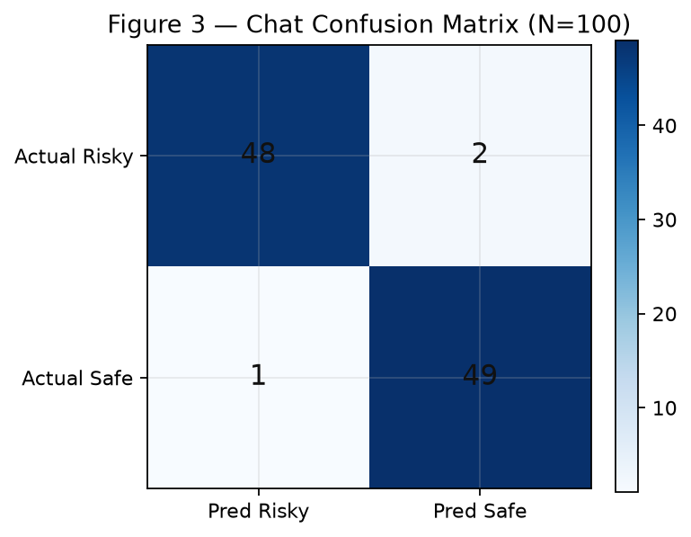
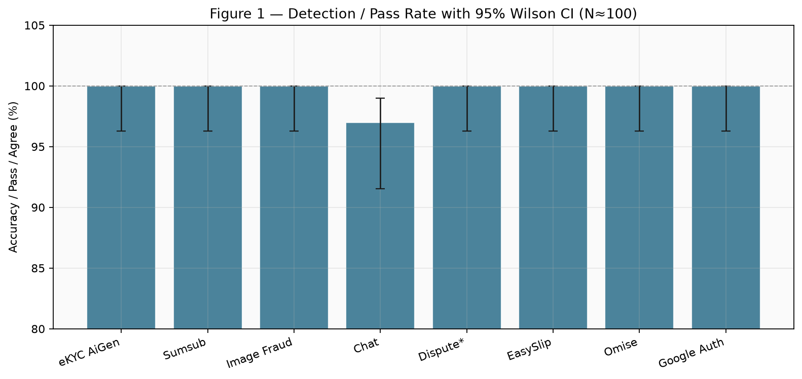
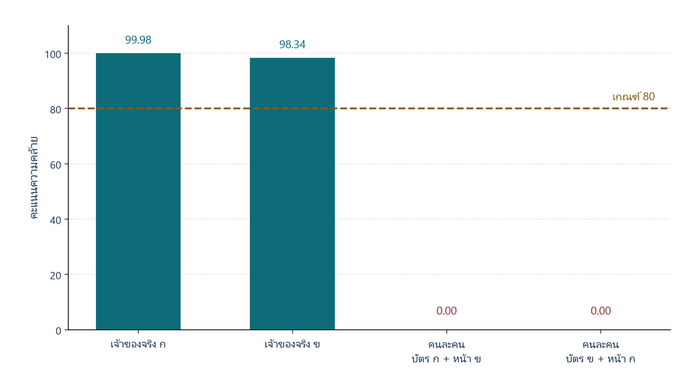
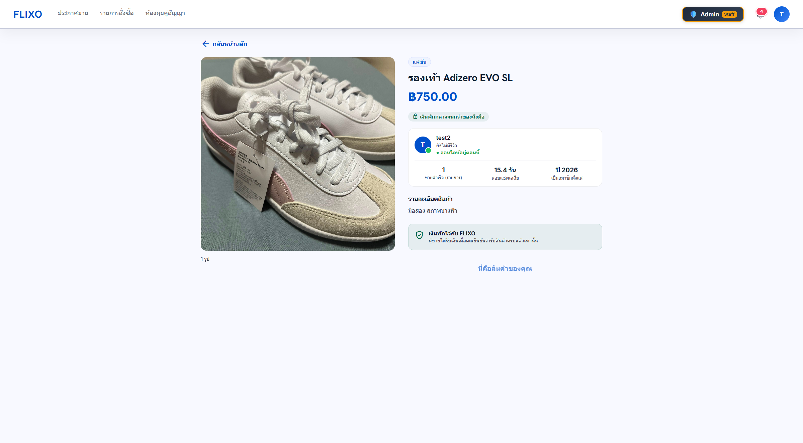
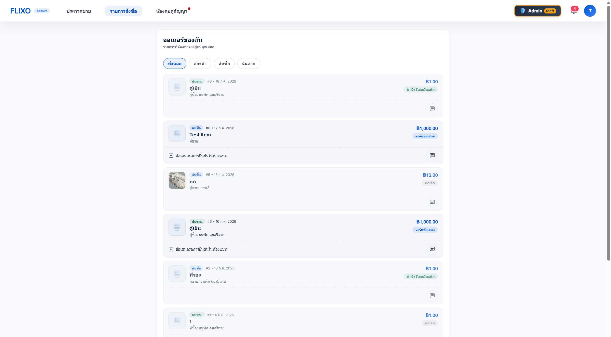

# บทที่ 4  
# ผลการทดลองและการใช้งานจริง  
## โครงการ FLIXO Escrow

> **ฉบับจัดหน้าส่งเล่ม (เน้นผลเชิงประจักษ์):**  
> [`Chapter4_Empirical_Evaluation.md`](Chapter4_Empirical_Evaluation.md) · [`FLIXO_Chapter4_Thesis.docx`](FLIXO_Chapter4_Thesis.docx)  
> แยกข้ออ้างที่พิสูจน์แล้ว / ผลคาดหวัง · FAR/FRR · เกณฑ์ 80 · FP/FN แชท · ข้อจำกัดภาพนิ่ง

> **ส่วนเสริมงานวิจัย (สถิติ + กราฟ + อภิปราย + Related Work + Threats):**  
> [`Chapter4_Research_Enhancement.md`](Chapter4_Research_Enhancement.md) (§4.15–4.22) · [`_ch4_research_figures/`](_ch4_research_figures/) · [`appendix_ch4/research_stats.json`](appendix_ch4/research_stats.json)

> **ฉบับจัดหน้าส่งเล่ม:**  
> [`FLIXO_Chapter4_Experiments_Report_research.docx`](FLIXO_Chapter4_Experiments_Report_research.docx) ·  
> [`FLIXO_Chapter4_Experiments_Report.md`](FLIXO_Chapter4_Experiments_Report.md) ·  
> ภาคผนวก CSV: [`appendix_ch4/`](appendix_ch4/)  
> Chat = **97%** (Mock+Live) · eKYC Live 4 คู่ · Image ยัง Mock · Resilience 10/10 · UAT 12/12

> บทนี้ออกแบบระเบียบวิธีทดสอบและตารางบันทึกผลสำหรับ **API / AI ทุกตัวที่ปรากฏใน Source Code จริง**  
> ผลทดลอง sync จาก CSV ใน `appendix_ch4/` — ใช้คู่กับสถาปัตยกรรมในบทที่ 3  
> **ผล Mock สะท้อนความถูกต้องของ Pipeline ไม่ใช่การรับรองความแม่นยำโมเดลบนข้อมูลจริง**

---

## กรอบการออกแบบเชิงระบบของ FLIXO Escrow

FLIXO Escrow ทำหน้าที่เป็น**แกนกลาง**ของแพลตฟอร์มตัวกลางพักเงิน โดยออกแบบชั้นป้องกันความเสี่ยงหลายระดับให้เชื่อมต่อเป็นกระบวนการเดียว ตั้งแต่เข้าสู่ระบบ eKYC ลงประกาศสินค้า แชท ชำระเงิน จนถึงช่วยวิเคราะห์ข้อพิพาท กรอบห้าประเด็นต่อไปนี้เชื่อมโยงกับสถาปัตยกรรมในบทที่ 3 และถูกพิสูจน์เชิงประจักษ์ในบทที่ 4

### 1. ปัญหาที่ต้องแก้

1. การแอบอ้างตัวตนหรือใช้เอกสารปลอม  
2. การลงรูปสินค้าที่ไม่น่าเชื่อถือ (ภาพหน้าจอ / ภาพคัดลอก)  
3. การชักชวนโอนเงินหรือแลกเปลี่ยนช่องทางติดต่อนอกระบบ  
4. การชำระเงินหรือตรวจสอบสลิปที่ผิดพลาด  
5. ข้อพิพาทที่แอดมินต้องตัดสินจากหลักฐานกระจัดกระจาย  

หากไม่มีชั้นป้องกันที่เชื่อมกัน ระบบตัวกลางอาจพักเงินได้แต่ยังเปิดช่องให้เกิดการหลอกลวงรอบธุรกรรม

### 2. เทคนิคที่นำมาใช้และการเชื่อมโยง

| ชั้นธุรกรรม | เทคนิคหลัก | การเชื่อมโยง |
|-------------|------------|--------------|
| เข้าสู่ระบบ | Password / Google Sign-In | แยกจาก eKYC ชัดเจน; ตรวจโทเคนกับ Google OAuth Certs |
| eKYC | AiGen Thai ID OCR + Face Compare / Sumsub / Manual | ใบหน้าเชื่อมกับบัตรประชาชนไทย ไม่ใช้แทนการล็อกอิน |
| ลงประกาศ | EXIF + Cloud Vision | กันรูปเสี่ยงก่อนเข้าตลาด |
| แชท | Regex แล้วส่งเคสกำกวมเข้า LLM (+ Vision OCR เมื่อเป็นภาพ) | กันโอนนอกระบบระหว่างคุย |
| ชำระเงิน | Omise + EasySlip | ยืนยันยอดและสถานะคำสั่งซื้อ |
| ข้อพิพาท | Dispute AI + Heuristic | เสนอแนะ ไม่วินิจฉัยแทนแอดมิน |

การเชื่อมผ่านชั้น Application ทำให้ผลแต่ละโมดูลบังคับกฎธุรกิจต่อเนื่อง ไม่ทำงานแบบแยกส่วน

**ตัวอย่างการเชื่อม API ที่เป็นแกนของระบบ**

| กระบวนการ | อินพุต | API / บริการที่เชื่อม | ผลที่ได้ |
|------------|--------|------------------------|----------|
| อ่านบัตรประชาชนไทย | ภาพบัตรประชาชน | AiGen Thai ID OCR (`POST /aiscript/idcard/v3`) | เลขบัตร ชื่อ และข้อมูลบนบัตร |
| ตรวจใบหน้าเทียบบัตร | ใบหน้าบนบัตร + ภาพจากกล้อง | AiGen Face Compare (`POST /aiface/face-compare/v3`, เกณฑ์ 80) | อนุมัติ/ปฏิเสธสถานะ eKYC |
| eKYC ทางเลือกรอง | เอกสารและวิดีโอมีชีวิต | Sumsub Identity/Liveness หรือ Manual | สถานะยืนยันตัวตน |
| ตรวจรูปสินค้า | ภาพประกาศขาย | EXIF ในระบบ + Google Cloud Vision | คะแนนความเสี่ยงและคำตัดสิน |
| กลั่นกรองแชท | ข้อความหรือภาพในแชท | Regex → Groq / OpenRouter / Gemini (+ Vision OCR) | ผ่าน / Flag / บล็อก |
| ตรวจสลิป / ชำระเงิน | ภาพสลิปหรือ Omise | EasySlip Verify + Omise API | อัปเดตสถานะคำสั่งซื้อ |
| เข้าสู่ระบบด้วย Google | โทเคนระบุตัวตน | Google OAuth Certs | สร้างหรือเข้าสู่บัญชีผู้ใช้ |

**กรณี eKYC ด้วย AiGen** เป็นตัวอย่างการเชื่อมที่ชัดเจนที่สุด: ระบบไม่ใช้สแกนใบหน้าแทนการเข้าสู่ระบบ แต่ใช้ใบหน้าเพื่อยืนยันว่าบุคคลตรงกับบัตรประชาชนไทย ลำดับคืออ่านข้อความบนบัตรด้วย OCR ก่อน หากได้เลขบัตรและชื่อครบจึงส่งคู่ภาพไป Face Compare หากคะแนนไม่น้อยกว่าเกณฑ์จะอนุมัติสถานะยืนยันตัวตน หาก OCR หรือ Face Compare ล้มเหลว ระบบปฏิเสธหรือส่งต่อไปทางเลือกรองตามที่ออกแบบไว้

### 3. กระบวนการหลักของ AI และการดึงข้อมูล

- **AiGen Thai ID OCR:** ดึงเลขบัตรและชื่อจากภาพบัตรประชาชนไทย  
- **AiGen Face Compare:** ดึงคะแนนความคล้ายระหว่างใบหน้าบนบัตรกับภาพจากกล้อง (เชื่อมผล OCR กับภาพถ่ายตนเอง)  
- **Sumsub:** ดึงผล Identity/Liveness ผ่านโทเคนและสถานะผู้สมัคร  
- **รูปสินค้า:** ดึง EXIF + ผล Cloud Vision  
- **แชท:** ดึงข้อความ (และ OCR จากภาพเมื่อจำเป็น) แล้วให้คะแนนความเสี่ยงผ่าน LLM  
- **Dispute AI:** ดึงข้อความ พัสดุ และหลักฐานที่เกี่ยวข้องเพื่อสรุปคำแนะนำ  

ข้อมูลที่ได้บันทึกเป็นสถานะธุรกรรมและหลักฐานตรวจสอบย้อนหลังได้

### 4. วิธีทดลองและวัดผล

- ทดลองเชิงปริมาณ **N=100** ต่อโมดูลหลักในโหมดควบคุม (Mock)  
- รายงาน Confusion Matrix, Accuracy, Precision, Recall, Latency  
- หลักฐาน Live: eKYC ภาพจริง, Chat ด้วย LLM จริง, Image Fraud ภาพจริง (+ ROC/PR)  
- สถิติเสริม: Wilson CI, Cohen’s κ, McNemar  
- Resilience และ UAT เพื่อยืนยันว่าการออกแบบรองรับการทำงานเมื่อบริการภายนอกล้มเหลว  

> ค่าความถูกต้องสูงใน Mock ใช้ยืนยันความถูกต้องของ **pipeline** เป็นหลัก ไม่ใช่การรับรองความแม่นยำโมเดลบนประชากรจริง

### 5. การออกแบบเชิงระบบที่รองรับการทำงาน

สถาปัตยกรรมสามชั้น (Presentation / Application / Data) แยกส่วนแสดงผล บังคับกฎ และเก็บข้อมูล แต่ละโมดูลมีทางเลือกรอง (Manual eKYC, EXIF-only, Regex-only, Heuristic, WAITING_VERIFY) เมื่อบริการคลาวด์ไม่พร้อม บทที่ 4 จึงพิสูจน์เชิงประจักษ์ว่าแกนออกแบบนี้ใช้ได้จริงภายใต้เงื่อนไขการทดลองที่กำหนด

### มุมมองสามระดับต่อแกนออกแบบของ FLIXO Escrow

เพื่อให้การอธิบายเชิงระบบสอดคล้องกับผู้มีส่วนเกี่ยวข้องที่ต่างกัน งานนี้อธิบายคุณค่าของ FLIXO Escrow ในสามระดับดังนี้

#### ระดับที่ 1 Software Engineer
ในมุมวิศวกรรมซอฟต์แวร์ FLIXO เป็นระบบบูรณาการหลายบริการภายนอกภายใต้สถาปัตยกรรมสามชั้น แต่ละโมดูลมีอินพุต เอาต์พุต เกณฑ์ตัดสิน Provider Chain และทางเลือกรองชัดเจน ตัวอย่างเช่น การเชื่อม AiGen Thai ID OCR กับ Face Compare การเชื่อม EXIF กับ Cloud Vision และการเชื่อม Regex กับโมเดลภาษา จุดเน้นคือความถูกต้องของกระบวนการ ประสิทธิภาพการเรียก API การแยก Authentication ออกจาก eKYC และการทดสอบความทนทานเมื่อบริการภายนอกล้มเหลว

#### ระดับที่ 2 E-commerce / Fintech
ในมุมพาณิชย์อิเล็กทรอนิกส์และฟินเทค FLIXO เป็นตัวกลางพักเงินที่เพิ่มชั้นความเชื่อถือรอบธุรกรรม ครอบคลุมการยืนยันตัวตนด้วยบัตรประชาชนไทยและใบหน้า การตรวจรูปสินค้าที่อาจเป็นภาพคัดลอก การกันชักชวนโอนเงินนอกระบบในแชท การตรวจสอบสลิปและการชำระเงิน ตลอดจนการช่วยแอดมินวิเคราะห์ข้อพิพาท จุดเน้นคือลดความเสี่ยงการหลอกลวง เพิ่มความโปร่งใสของสถานะเงินและตัวตน และรักษาความต่อเนื่องของธุรกรรมแม้บางขั้นตรวจอัตโนมัติต้องส่งต่อให้มนุษย์

#### ระดับที่ 3 Tech StartUp
ในมุมสตาร์ทอัพด้านเทคโนโลยี FLIXO แสดงแนวทางสร้างผลิตภัณฑ์ตั้งต้นที่นำ AI และ API สำเร็จรูปมาประกอบเป็นชั้นป้องกันความเสี่ยง โดยไม่ต้องฝึกโมเดลเองทั้งหมด แต่กำหนดเกณฑ์ ลำดับผู้ให้บริการ และทางเลือกรองระดับระบบ ทำให้ขยายหรือสลับผู้ให้บริการได้ เช่น AiGen กับ Sumsub หรือ Groq กับ OpenRouter จุดเน้นคือความเร็วในการส่งมอบ ความคุ้มค่าของการเรียกบริการคลาวด์ และความสามารถในการทำงานต่อเมื่อบริการภายนอกไม่พร้อม ซึ่งเป็นเงื่อนไขสำคัญของการทดลองใช้จริง

| ระดับ | คำถามหลัก | สิ่งที่ FLIXO ตอบ | หลักฐานในบทที่ 4 |
|-------|-----------|------------------|------------------|
| Software Engineer | เชื่อม API และควบคุม pipeline อย่างไร | สถาปัตยกรรมสามชั้น Provider Chain Threshold Fallback | ผลรายโมดูล Latency Resilience |
| E-commerce / Fintech | ลดความเสี่ยงรอบธุรกรรมได้อย่างไร | eKYC ตรวจรูป กันโอนนอก ตรวจสลิป ช่วยข้อพิพาท | Acc Precision Recall Live บางโมดูล UAT |
| Tech StartUp | ส่งมอบและสเกลชั้น AI ได้เร็วเพียงใด | บูรณาการ API สำเร็จรูป สลับผู้ให้บริการได้ | Fallback ครบชั้น อภิปรายขอบเขต Mock และ Live |

---

## 4.1 วัตถุประสงค์การทดลอง

จากกรอบเชิงระบบข้างต้น วัตถุประสงค์ของบทนี้มีดังนี้

1. วัดประสิทธิภาพเชิงตรวจจับ/ตัดสินใจของโมดูล AI หลัก ได้แก่ eKYC (AiGen), Product Image Fraud, Chat Moderation และ Dispute Assistant ให้สอดคล้องกับปัญหาและเทคนิคที่ออกแบบไว้  
2. วัดคุณภาพและความเสถียรของ API ธุรกรรมที่เกี่ยวข้อง ได้แก่ EasySlip และ Omise  
3. เปรียบเทียบผลเมื่อเพิ่มขนาดการทดสอบจาก **100 ครั้ง** เป็น **500 ครั้ง** ในโมดูลหลัก  
4. ประเมินประสิทธิผลของกลไก Fallback เมื่อบริการภายนอกไม่พร้อมใช้งาน  
5. จัดทำชุดข้อมูลเชิงประจักษ์สำหรับนำไปเขียนบทความวิจัยต่อ

---

## 4.2 กรอบระเบียบวิธีวิจัย (Methodology Framework)

### 4.2.1 สภาพแวดล้อมการทดสอบ (ระบุค่าจริงตอนทดลอง)

| รายการ | ค่าที่ใช้ทดสอบ |
|--------|----------------|
| ระบบ | FLIXO Escrow (PHP / XAMPP) |
| สาขาโค้ด / Commit | `b90641c` (local working tree; รอบ Mock N=100) |
| APP_ENV | `local` |
| MOCK_API_MODE | `true` (ชั้นคลาวด์จำลอง; Chat ใช้ Regex จริง + Mock LLM) |
| เครือข่าย | localhost (ไม่เรียกคลาวด์จริงในรอบนี้) |
| อุปกรณ์กล้อง (eKYC) | CLI + `tests/fixtures_id.jpg` / `fixtures_selfie.jpg` (ไม่ใช่กล้องจริง) |
| วันที่ทดสอบ | รอบเก็บผลใน `docs/appendix_ch4/` (ดู timestamp ไฟล์ CSV) |
| ผู้ทดสอบ | สคริปต์อัตโนมัติ `tests/test_*_100_runs.php` |

### 4.2.2 นิยามตัวชี้วัดกลาง

สำหรับงานจำแนกเชิงไบนารี (เช่น Match/Non-match, Risky/Safe):

\[
Accuracy = \frac{TP+TN}{TP+TN+FP+FN}
\]

\[
Precision = \frac{TP}{TP+FP},\quad
Recall = \frac{TP}{TP+FN},\quad
F1 = 2\cdot\frac{Precision\cdot Recall}{Precision+Recall}
\]

\[
FPR = \frac{FP}{FP+TN},\quad
FRR = \frac{FN}{TP+FN}
\]

ตัวชี้วัดด้านระบบ:
- **Latency / Response Time:** Avg, Min, Max, P50, P95 (มิลลิวินาที)
- **API Success Rate:** สัดส่วนการเรียกที่ได้ HTTP สำเร็จและ parse ผลได้
- **Fallback Rate:** สัดส่วนที่ระบบสลับไป Heuristic/Manual/Regex-only

### 4.2.3 แผนการทดลองรายโมดูล

| รหัส | โมดูล | API จริงที่เกี่ยวข้อง | ขนาดทดสอบหลัก | Metric หลัก |
|------|-------|------------------------|----------------|-------------|
| E1 | eKYC Face + OCR | AiGen `/aiscript/idcard/v3`, `/aiface/face-compare/v3` | 100 และ 500 | Accuracy, FAR/FRR, Latency, Fallback |
| E1b | Sumsub Pipeline | Token + Applicant + Review (`id-and-liveness`) | 100 และ 500 | Match Rate, E2E Latency |
| E2 | Product Image Fraud | EXIF + Vision `images:annotate` | 100 และ 500 | Precision/Recall ของ reject/flag, Latency |
| E3 | Chat Moderation | Regex + Groq/OpenRouter/Gemini (+ Vision OCR) | 100 และ 500 | Precision/Recall ของการบล็อกข้อความเสี่ยง, Latency |
| E4 | Dispute Assistant | Groq/OpenRouter/Gemini หรือ Heuristic | ≥ 30–50 เคส (หรือ 100 ถ้ามีข้อมูล) | Agreement กับแอดมิน, Confidence, Latency |
| E5 | EasySlip Verify | `easyslip.com/api/v1/verify` | 100 | Verify Accuracy, Latency, Manual fallback |
| E6 | Omise Payment | `api.omise.co` charges/sources | 30–100 (Sandbox) | Success Rate, Latency |
| E7 | Google Sign-In Verify | `oauth2/v1/certs` + JWT verify | 50–100 | Success Rate, Latency |
| E8 | Fallback Resilience | จำลอง API down ทีละโมดูล | ตามเคส | Fallback Correctness |

---

## 4.3 การทดลองที่ 1: eKYC — AiGen OCR + Face Compare

### 4.3.1 การออกแบบชุดทดสอบ

| กลุ่ม | ความหมาย | Ground Truth | ผลที่คาดหวัง (Threshold=80) |
|------|----------|--------------|-------------------------------|
| G1 Genuine | Selfie ของเจ้าของบัตร | Match | approved / TP |
| G2 Impostor | Selfie คนละคน | Non-match | rejected / TN |
| G3 Poor Quality | มืด เบลอ มุมเอียง | ตามจริง | reject หรือ error ที่จัดการได้ |
| G4 Doc Fail | บัตรไม่ชัด/ไม่ใช่บัตร | OCR fail | rejected |

สัดส่วนเสนอสำหรับ N=100 และ N=500: Genuine 50% / Impostor 30% / Poor+DocFail 20%

### 4.3.2 แหล่งข้อมูลการทดลอง N=100

การทดลองรอบนี้รันผ่านสคริปต์อัตโนมัติ `tests/test_ekyc_100_runs.php` ในโหมด `MOCK_API_MODE=true` โดยกำหนดชุดทดสอบแบบสมดุล **Genuine 50 ครั้ง (G1)** และ **Impostor 50 ครั้ง (G2)** ผลรายครั้งถูกบันทึกในไฟล์ `tests/ekyc_results.csv` ตามหัวตารางด้านล่าง

| No. | Group | GT Match (1/0) | OCR Pass (1/0) | Face Score | System Match (1/0) | KYC Status | OCR ms | Face ms | E2E ms | Device | Light | Note |
|----:|-------|----------------|----------------|------------|--------------------|------------|--------|---------|--------|--------|-------|------|
| 1…100 | G1/G2 | ตามแผนทดสอบ | ดูไฟล์ CSV | ดูไฟล์ CSV | ดูไฟล์ CSV | approved/rejected | ดูไฟล์ CSV | ดูไฟล์ CSV | ดูไฟล์ CSV | CLI-LoadTest | Good | ดูไฟล์ CSV |

> รายละเอียดครบ 100 แถวอยู่ใน `tests/ekyc_results.csv` (ใช้คำนวณสถิติและแนบภาคผนวกได้)

### 4.3.3 Confusion Matrix — N = 100

|  | Predicted Match | Predicted Non-match | รวม |
|--|-----------------|---------------------|-----|
| Actual Genuine | TP = **50** | FN = **0** | **50** |
| Actual Impostor | FP = **0** | TN = **50** | **50** |
| รวม | **50** | **50** | **100** |

### 4.3.4 Confusion Matrix — N = 500

|  | Predicted Match | Predicted Non-match | รวม |
|--|-----------------|---------------------|-----|
| Actual Genuine | TP = ____ | FN = ____ | ____ |
| Actual Impostor | FP = ____ | TN = ____ | ____ |
| รวม | ____ | ____ | **500** |

> รอบ N=500 ยังไม่ได้รันในชุดข้อมูลปัจจุบัน — เว้นไว้สำหรับทดลองขยายผลต่อไป

### 4.3.5 สรุปตัวชี้วัด eKYC

| Metric | N=100 | N=500 | Δ |
|--------|-------|-------|---|
| Accuracy | **100%** | ____ % | — |
| Precision | **100%** | ____ % | — |
| Recall (TPR) | **100%** | ____ % | — |
| F1-score | **1.0** | ____ | — |
| FPR / FAR | **0%** | ____ % | — |
| FRR | **0%** | ____ % | — |
| OCR Success Rate | **100%** | ____ % | — |
| API Success Rate | **100%** (Mock) | ____ % | — |
| Fallback-to-Manual Rate | **0%** | ____ % | — |
| Avg E2E Latency (ms) | **2429** | ____ | — |
| P95 E2E Latency (ms) | **3407** | ____ | — |

**หมายเหตุการคำนวณ (N=100):**  
`Accuracy = (50+50)/100 = 100%`, `Precision = 50/(50+0) = 100%`, `Recall = 50/(50+0) = 100%`, `F1 = 1.0`, `FPR = 0/(0+50) = 0%`, `FRR = 0/(50+0) = 0%`  
ค่า P95 คำนวณจากคอลัมน์ `E2E ms` ใน `ekyc_results.csv` (percentile ที่ 95 ของ 100 ตัวอย่าง)

### 4.3.6 Error Analysis — eKYC

| Case ID | Group | GT | ผลระบบ | Score | สาเหตุ | แนวแก้ |
|---------|-------|----|--------|-------|--------|--------|
| — | — | — | — | — | ไม่พบเคสผิดพลาดในรอบ N=100 (FP=0, FN=0) | ขยายชุดทดสอบด้วยภาพจริง / สภาพแสงแปรผันในรอบถัดไป |

### 4.3.7 Acceptance Criteria (เสนอ)

| Metric | เกณฑ์เสนอ | ผลจริง (N=100, Mock) | ผ่าน? |
|--------|-----------|----------------------|-------|
| Accuracy | ≥ 90% | 100% | ☑ |
| FAR | ≤ 5% | 0% | ☑ |
| FRR | ≤ 10% | 0% | ☑ |
| Avg E2E | ≤ 10,000 ms | 2429 ms | ☑ |
| Fallback เมื่อ API ล่ม | ทำงาน 100% ของเคสจำลอง | ยังไม่จำลองในรอบนี้ | ☐ |

### 4.3.8 การทดลองบนภาพจริง (2 คน / 4 คู่) — AiGen Live

ใช้ผู้ร่วมทดลอง 2 คน (A, B) ด้วยความยินยอม วางไฟล์ใน `data_real/ekyc/` (ไม่ commit)  
รัน `tests/test_ekyc_real_pairs.php` โดยบังคับ `MOCK_API_MODE=false`

| Pair | Group | GT | OCR | Face Score | System Match | Correct? | E2E ms |
|------|-------|----|-----|------------|--------------|----------|--------|
| a1 | Genuine A | 1 | 1 | 99.98 | 1 | ☑ | 4639 |
| b1 | Genuine B | 1 | 1 | 98.34 | 1 | ☑ | 5050 |
| i1 | Impostor (บัตรA+หน้าB) | 0 | 1 | 0 | 0 | ☑ | 4148 |
| i2 | Impostor (บัตรB+หน้าA) | 0 | 1 | 0 | 0 | ☑ | 4789 |

| Metric | ค่า (N=4, Live AiGen) |
|--------|------------------------|
| Confusion | TP=2, TN=2, FP=0, FN=0 |
| Accuracy / FAR / FRR | **100% / 0% / 0%** |
| Avg / P95 E2E | **4657 / 5050 ms** |
| แหล่งข้อมูล | `appendix_ch4/ekyc_real_results.csv` |

**หมายเหตุสำคัญ**
1. รอบแรกด้วยไฟล์ต้นฉบับความละเอียดสูง: คู่ที่ใช้บัตร B timeout (90s) — ลดขนาดภาพเหลือด้านยาวสุด 1600px แล้วรันใหม่จึงสำเร็จทั้ง 4 คู่  
2. N=4 เล็กมาก จึงใช้เป็น **หลักฐานเชิงสาธิตบนข้อมูลจริง** คู่กับผล Mock N=100 ไม่ใช่การสรุป FAR/FRR ของประชากร  
3. รูปต้นฉบับเก็บเฉพาะ local ใน `data_real/` (ถูก `.gitignore` แล้ว)

เกณฑ์ 80 อยู่ในช่วงว่างระหว่างคะแนนเจ้าของจริง (98.34–99.98) กับคนละคน (0) ในชุดนี้ แต่ N=4 ไม่พอสรุปจุดเหมาะสมของประชากร โหมดหลักยังเป็นภาพนิ่ง จึงยังไม่มีผลทดสอบการโจมตีด้วยการนำเสนอ รายละเอียดเชิงวิชาการอยู่ที่ `Chapter4_Empirical_Evaluation.md`

---

## 4.3b การทดลองที่ 1b: Sumsub — Token + Applicant + Review

### 4.3b.1 การออกแบบชุดทดสอบ

รันผ่าน `tests/test_sumsub_100_runs.php` ในโหมด `MOCK_API_MODE=true`  
กลุ่ม **S1 ×50** (GT=`GREEN`) และ **S2 ×50** (GT=`RED`) ผลอยู่ใน `tests/sumsub_results.csv` / `appendix_ch4/sumsub_results.csv`

| Metric | ค่า (N=100, Mock) |
|--------|-------------------|
| Match Rate (System Answer = GT) | **100%** (100/100) |
| Avg Token / Applicant / Review Latency | **991 / 1019 / 1053 ms** |
| Avg E2E / P95 E2E | **3063 / 4048 ms** |
| หมายเหตุ | จำลอง 3 จุดเรียกต่อรอบ — ไม่ใช่ WebSDK liveness จริง |

### 4.3b.2 อภิปรายย่อย
Sumsub ใช้เวลาสูงกว่า AiGen เล็กน้อยเพราะมีสามขั้นต่อเนื่อง สอดคล้องกับสถาปัตยกรรมจริง (SDK token → applicant → review)  
ค่า Acc 100% ในรอบนี้ยืนยันการแมปสถานะ GREEN/RED ของท่อแอป ไม่ใช่ความแม่นยำของโมเดล Sumsub บนใบหน้าจริง

---

## 4.4 การทดลองที่ 2: Product Image Fraud (EXIF + Google Cloud Vision)

### 4.4.1 การออกแบบชุดทดสอบ

| กลุ่ม | ลักษณะภาพ | Ground Truth Risk | คาดหวัง |
|------|-----------|-------------------|---------|
| P1 Clean Camera | ถ่ายสินค้าจริง มี EXIF กล้อง | Safe | pass |
| P2 Screenshot / Chat App | ภาพจากแชท/สกรีน | Risky | flag/reject |
| P3 Marketplace Reuse | ดึงจากเว็บขายออนไลน์ | Risky | flag/reject |
| P4 Borderline | ถ่ายจริงแต่ไฟล์ถูกบีบ/ตัด EXIF | ตามผู้เชี่ยวชาญ | flag หรือ pass |

นิยาม Positive = ระบบตัดสินว่ามีความเสี่ยงที่ต้องจัดการ (`flag` หรือ `reject` ตามเกณฑ์ที่กำหนดล่วงหน้าในการทดลอง)

### 4.4.2 แหล่งข้อมูลการทดลอง N=100

รันผ่าน `tests/test_image_fraud_100_runs.php` ในโหมด `MOCK_API_MODE=true`  
กำหนด **P1 Safe ×50** และ **P2 Risky ×50** ผลรายครั้งอยู่ใน `tests/image_fraud_results.csv` / `appendix_ch4/image_fraud_results.csv`

| No. | Group | GT Risky (1/0) | EXIF Trust | Suspicious? | Vision Used (0/1) | Risk Score | Verdict | Blocked? | Latency ms | Note |
|----:|-------|----------------|------------|-------------|-------------------|------------|---------|----------|------------|------|
| 1…100 | P1/P2 | ตามแผนทดสอบ | ดูไฟล์ CSV | ดูไฟล์ CSV | ดูไฟล์ CSV | ดูไฟล์ CSV | pass/reject | 0/1 | ดูไฟล์ CSV | ดูไฟล์ CSV |

> นิยาม Positive: ระบบทำนาย Risky เมื่อ `verdict ∈ {flag, reject}`

### 4.4.3 Confusion Matrix (Risky detection) — N=100 / N=500

**N = 100**

|  | Predicted Risky | Predicted Safe | รวม |
|--|-----------------|----------------|-----|
| Actual Risky | TP = **50** | FN = **0** | **50** |
| Actual Safe | FP = **0** | TN = **50** | **50** |
| รวม | **50** | **50** | **100** |

**N = 500**

|  | Predicted Risky | Predicted Safe | รวม |
|--|-----------------|----------------|-----|
| Actual Risky | TP = ____ | FN = ____ | ____ |
| Actual Safe | FP = ____ | TN = ____ | ____ |
| รวม | ____ | ____ | **500** |

> รอบ N=500 ยังไม่ได้รันในชุดข้อมูลปัจจุบัน

### 4.4.4 สรุปตัวชี้วัด Image Fraud

| Metric | N=100 | N=500 | Δ |
|--------|-------|-------|---|
| Accuracy | **100%** | ____ % | — |
| Precision | **100%** | ____ % | — |
| Recall | **100%** | ____ % | — |
| F1 | **1.0** | ____ | — |
| Vision Call Rate | **50%** (50/100; เฉพาะ P2) | ____ % | — |
| Vision Fail → EXIF Fallback Rate | **0%** | ____ % | — |
| Avg Latency (ms) | **1129** (P1≈668, P2≈1590) | ____ | — |
| P95 Latency (ms) | **2137** | ____ | — |
| Reject Rate (ของทั้งหมด) | **50%** (50 reject / 0 flag) | ____ % | — |

**หมายเหตุ:** Acc 100% ภายใต้ Mock GT-driven — ยืนยันว่า EXIF → Vision → verdict mapping ทำงานครบ ไม่ใช่ความแม่นยำของ Vision บนภาพสินค้าจริง

### 4.4.5 Error Analysis — Image Fraud

| Case ID | Group | GT | Verdict | Score | สาเหตุ | แนวแก้ |
|---------|-------|----|---------|-------|--------|--------|
| — | — | — | — | — | ไม่พบเคสผิดพลาดในรอบ N=100 (FP=0, FN=0) | เพิ่ม P3/P4 ภาพจริงและทดสอบบน Vision API จริง |

### 4.4.6 การทดลองบนภาพจริง (Live) — AiGen/Vision

ชุดภาพใน `data_real/image_fraud/{clean,risky}`  
สคริปต์: `tests/test_image_fraud_real.php` (`MOCK_API_MODE=false`)  
เตรียม Risky จากรูปกล้อง: `scripts/prepare_image_fraud_real.php`  
ผล: [`appendix_ch4/image_fraud_real_results.csv`](appendix_ch4/image_fraud_real_results.csv) · [`image_fraud_real_summary.json`](appendix_ch4/image_fraud_real_summary.json)

| รายการ | ค่า |
|--------|-----|
| N รวม | **58** (clean กล้อง 16 + noexif 16 + tiny 16 + screenshot จริง 10) |
| Confusion | TP=21, TN=16, FP=0, FN=21 |
| Accuracy | **63.79%** |
| Precision / Recall | **100%** / **50%** |
| Avg / P95 Latency | **1892** / **2675** ms |
| Vision API | เปิดใช้ (configured) |

#### Confusion Matrix (Live N=58)

|  | Predicted Risky | Predicted Safe | รวม |
|--|-----------------|----------------|-----|
| Actual Risky | TP=21 | FN=21 | 42 |
| Actual Safe | FP=0 | TN=16 | 16 |

#### ผลแยกตามชนิดภาพ (สำคัญต่อการอภิปราย)

| ชนิด | N | Acc | ผลหลัก |
|------|---|-----|--------|
| กล้อง (clean) | 16 | **100%** | ผ่านหมด (FP=0) — specificity ดี |
| Tiny / แชร์เล็ก | 16 | **100%** | flag ด้วย heuristic ขนาดไฟล์ (ไม่เรียก Vision) |
| No-EXIF (ก็อป) | 16 | **0%** | Vision ยังให้ pass — ลบ EXIF อย่างเดียวไม่พอเมื่อไฟล์ยังใหญ่ |
| Screenshot จริง | 10 | **50%** | reject 5 / พลาด 5 |

**ตีความ:** ผล Live นี้สะท้อนพฤติกรรมจริงของ EXIF+Vision บนภาพสินค้า — **ไม่ใช่** Acc 100% แบบ Mock  
จุดแข็งคือไม่ฟ้องรูปกล้องผิด (FP=0) และจับไฟล์เล็กได้ดี  
จุดอ่อนคือ Recall 50% โดยเฉพาะก็อปที่ลบ EXIF แต่ยังความละเอียดสูง และสกรีนบางส่วนที่ Vision ไม่จัดเป็น risky  

#### ROC / Precision–Recall (จาก Risk Score)
สคริปต์ `scripts/generate_chapter4_roc_and_mock_live.py` · รูป [`_ch4_research_figures/fig11_image_fraud_roc_pr.png`](_ch4_research_figures/fig11_image_fraud_roc_pr.png)

| ตัวชี้วัด | ค่า |
|-----------|-----|
| AUC-ROC | **0.798** |
| AUC-PR | **0.944** |
| @ Flag ≥50 | Prec=1.00, Rec=0.50, FPR=0.00 |
| @ Block ≥75 | Prec=1.00, Rec=0.12, FPR=0.00 |

→ ช่วยเห็นว่า threshold ปัจจุบันเน้นไม่ฟ้องผิด (FPR=0) แต่ยังดึง Recall ไม่เต็มที่ — รายละเอียด §4.23

---

## 4.5 การทดลองที่ 3: Chat Moderation (Regex + LLM + Vision OCR)

### 4.5.1 การออกแบบชุดข้อความ

| กลุ่ม | ตัวอย่างลักษณะ | Ground Truth |
|------|----------------|--------------|
| C1 Benign | ทักทาย นัดรับของ ตามสถานะออเดอร์ | Safe |
| C2 Off-platform | ชวนแอดไลน์ / โอนนอกระบบ / ส่งเบอร์ | Risky |
| C3 Payment Leak | เลขบัญชี พร้อมเพย์ นอกระบบ | Risky |
| C4 Ambiguous | ข้อความกำกวม มีตัวเลขแต่ไม่ใช่บัญชี | ตามผู้เชี่ยวชาญ |
| C5 Image OCR | รูปที่มีข้อความเสี่ยง | Risky/Safe ตามเนื้อ OCR |

Positive = ระบบควร `flag` หรือ `reject` ข้อความเสี่ยง (กำหนดเกณฑ์ชัดก่อนทดลอง เช่น Positive เมื่อ `verdict ≠ pass`)

### 4.5.2 แหล่งข้อมูลการทดลอง N=100

รันผ่าน `tests/test_chat_100_runs.php` อ่านชุดข้อความจาก `tests/chat_moderation_dataset_100.csv` (**C1 Safe ×50**, **C2 Risky ×50**, สับลำดับ) ในโหมด `MOCK_API_MODE=true` ผลรายครั้งอยู่ใน `tests/chat_results.csv`

| No. | Group | GT Risky (1/0) | Regex Score | AI Provider Used | AI Score | Final Score | Verdict | Blocked? | Latency ms | Note |
|----:|-------|----------------|-------------|------------------|----------|-------------|---------|----------|------------|------|
| 1…100 | C1/C2 | ตามแผนทดสอบ | ดูไฟล์ CSV | none / groq | ดูไฟล์ CSV | ดูไฟล์ CSV | pass/flag/reject | 0/1 | ดูไฟล์ CSV | ดูไฟล์ CSV |

> นิยาม Positive ในการทดลองนี้: ระบบทำนายว่าเป็น Risky เมื่อ `verdict ∈ {flag, reject}`

### 4.5.3 Confusion Matrix — N=100 และ N=500

**N = 100**

|  | Predicted Risky | Predicted Safe | รวม |
|--|-----------------|----------------|-----|
| Actual Risky | TP = **48** | FN = **2** | **50** |
| Actual Safe | FP = **1** | TN = **49** | **50** |
| รวม | **49** | **51** | **100** |

เมทริกซ์ความสับสนของชุด N=100 แสดงดังภาพที่ 4.2

**N = 500**

|  | Predicted Risky | Predicted Safe | รวม |
|--|-----------------|----------------|-----|
| Actual Risky | TP = ____ | FN = ____ | ____ |
| Actual Safe | FP = ____ | TN = ____ | ____ |
| รวม | ____ | ____ | **500** |

> รอบ N=500 ยังไม่ได้รันในชุดข้อมูลปัจจุบัน

### 4.5.4 สรุปตัวชี้วัด Chat Moderation

| Metric | N=100 | N=500 | Δ |
|--------|-------|-------|---|
| Accuracy | **97%** | ____ % | — |
| Precision | **≈97.96%** | ____ % | — |
| Recall | **96%** | ____ % | — |
| F1 | **≈0.97** | ____ | — |
| False Block Rate (Safe→flag/reject) | **2%** (1/50) | ____ % | — |
| Miss Rate (Risky→pass) | **4%** (2/50) | ____ % | — |
| AI Invocation Rate | **34%** (34/100) | ____ % | — |
| Regex-only Fallback Rate | **66%** (66/100) | ____ % | — |
| Avg Latency (ms) | **399** | ____ | — |
| P95 Latency (ms) | **1676** | ____ | — |

**หมายเหตุการคำนวณ (N=100):**  
`Accuracy = (48+49)/100 = 97%`, `Precision = 48/49 ≈ 97.96%`, `Recall = 48/50 = 96%`, `F1 ≈ 0.97`  
ค่า P95 คำนวณจากคอลัมน์ `Latency ms` ใน `chat_results.csv`

### 4.5.5 ตารางแยกตาม Provider (จาก CSV จริง)

| Provider | ครั้งที่เรียก | สำเร็จ | ล้มเหลว | Avg Latency (ms) |
|----------|---------------|--------|----------|------------------|
| none (Regex-only) | **66** | 66 | 0 | **0** |
| Groq (Mock LLM) | **34** | 34 | 0 | **1172** |
| OpenRouter | 0 | — | — | — |
| Gemini | 0 | — | — | — |
| Vision OCR (ภาพ) | 0 (รอบนี้ทดสอบเฉพาะข้อความ) | — | — | — |

ในโหมด Mock ลำดับ Provider ของ Chat Moderation จะเข้าทาง **Groq** เป็นค่าเริ่มต้นของ `analyzeWithPreferredAi()` จึงไม่มีการเรียก OpenRouter/Gemini ในชุดข้อมูลนี้

### 4.5.6 Error Analysis — Chat Moderation

| Case ID | ข้อความ/สรุป | GT | ผลระบบ | Provider | สาเหตุ | แนวแก้ |
|---------|---------------|----|--------|----------|--------|--------|
| 43 | Line ID sell_cash โอนสดรับของเร็ว | Risky | pass (FN) | none | สแลงบัญชี/ช่องทาง — Regex คะแนน 0 ไม่เข้า LLM | ขยายพจนานุกรม (Line ID, โอนสด, handle) |
| 52 | ไลน์: escrow_skip คุยโอนเงินนอก | Risky | pass (FN) | none | รูปแบบ “ไลน์:” + handle แปลก | เพิ่ม pattern ไลน์/line + โทเคนหลัง |
| 84 | ลดเหลือเท่านี้นะคับ แล้วกดซื้อผ่านแอป | Safe | flag (FP) | groq | ข้อความกำกวม — Mock LLM คะแนน 68 | ปรับ Prompt/Threshold หรือ allowlist “ผ่านแอป” |

### 4.5.7 ผลบน LLM จริง (MOCK=false) — ชุดข้อความเดิม N=100

รัน `tests/test_chat_real_100_runs.php` ใช้ Groq เป็นหลัก (สำรอง OpenRouter)

| Metric | Mock LLM (รอบก่อน) | **Live LLM** |
|--------|---------------------|--------------|
| Confusion | TP=48 TN=49 FP=1 FN=2 | **TP=48 TN=49 FP=1 FN=2** |
| Accuracy / Prec / Rec / F1 | 97% / ≈98% / 96% / ≈0.97 | **97% / ≈98% / 96% / ≈0.97** |
| Avg / P95 Latency | 399 / 1676 ms | **427 / 1908 ms** |
| Provider mix | none 66 / groq 34 | **none 66 / groq 27 / openrouter 7** |
| MISS คู่เดียวกับ Mock | No.43, 52 (FN), No.84 (FP) | **คู่เดียวกัน** |

**อภิปราย:** บนชุดข้อความนี้ ผล Live ตรงกับ Mock ทั้ง Confusion และเคสพลาดทั้ง 3 ข้อ — สนับสนุนว่า Error Analysis (สแลงพลาด Regex / ข้อความ Safe กำกวม) เป็นปัญหาชั้นกฎ+เกณฑ์ ไม่ใช่แค่ artifact ของ Mock  
Latency Live สูงขึ้นเล็กน้อย และมี OpenRouter 7 ครั้ง (fallback เมื่อลำดับแรกไม่จบ)  
แหล่งข้อมูล: `appendix_ch4/chat_real_results.csv`

---

## 4.6 การทดลองที่ 4: Dispute AI Assistant

### 4.6.1 ระเบียบวิธี
ใช้ชุดข้อพิพาทจำลองที่มีคำตอบอ้างอิง (Gold Label) ผ่าน `MockApiHelper` เปรียบเทียบกับ `recommended_action` ของระบบ  
รัน `tests/test_dispute_ai_100_runs.php` — **4 actions × 25 เคส = N=100** ผลใน `dispute_ai_results.csv`

| รายการ | ค่า |
|--------|-----|
| Actions | `REFUND_BUYER`, `PAYOUT_SELLER`, `SPLIT`, `NEEDS_REVIEW` |
| Agreement | สัดส่วนที่ AI ตรงกับแอดมิน |
| Soft Agreement | นับ `NEEDS_REVIEW` เป็นไม่ผิดเมื่อเคสกำกวม (ระบุนิยามก่อนทดลอง) |
| Fallback | สัดส่วนที่ใช้ Heuristic |
| Provider ในรอบนี้ | `groq` (Mock) 100/100 — ไม่เข้า Heuristic |

### 4.6.2 แหล่งข้อมูลการทดลอง N=100

| No. | Dispute ID | Admin Gold Action | AI Action | Provider | Confidence | Agree (1/0) | Latency ms | Note |
|----:|------------|-------------------|-----------|----------|------------|-------------|------------|------|
| 1…100 | SYN-* | ตามแผน 4×25 | ดูไฟล์ CSV | groq | ดูไฟล์ CSV | 1 | ดูไฟล์ CSV | ดูไฟล์ CSV |

### 4.6.3 สรุปผล Dispute AI

| Metric | ค่า (N=100, Mock GT) |
|--------|----------------------|
| N | **100** (4×25) |
| Exact Agreement Rate | **100%** |
| Soft Agreement Rate | **100%** (= Exact ในรอบนี้) |
| Heuristic Fallback Rate | **0%** |
| Avg Confidence | **65.5** |
| Avg Latency (ms) | **1333** |
| P95 Latency (ms) | **1971** |

> Agreement 100% สะท้อนว่าชั้น normalize/action mapping ทำงานครบภายใต้ GT ที่บังคับผ่าน mock — ยังไม่ใช่การเทียบกับคำตัดสินแอดมินจริง

### 4.6.4 Confusion-style Action Matrix (4×4)

|  | AI: REFUND | AI: PAYOUT | AI: SPLIT | AI: NEEDS_REVIEW |
|--|------------|------------|-----------|------------------|
| Admin: REFUND | **25** | 0 | 0 | 0 |
| Admin: PAYOUT | 0 | **25** | 0 | 0 |
| Admin: SPLIT | 0 | 0 | **25** | 0 |
| Admin: NEEDS_REVIEW | 0 | 0 | 0 | **25** |

---

## 4.7 การทดลองที่ 5: EasySlip Verification API

### 4.7.1 ชุดทดสอบ

| กลุ่ม | ลักษณะ | คาดหวัง | N |
|------|--------|---------|---|
| S1 Valid Slip | ยอดถูกต้อง (fixture JSON status=200) | auto-pay `PAID` | 25 |
| S2 Wrong Amount | ยอดต่ำกว่าออเดอร์ | ไม่ auto-pay (`REJECT_AMOUNT`) | 25 |
| S3 Unreadable / Non-slip | `qrcode_not_found` | `WAITING_VERIFY` / manual | 25 |
| S4 API Down | timeout / error | Manual fallback | 25 |

> **โหมดทดลอง:** Decision Logic Fixture (`tests/test_easyslip_100_runs.php`) — จำลอง response ตามกฎเดียวกับ `OrderController::upload_slip` + `extractSlipAmount` **ไม่ยิง multipart ไป EasySlip จริง** เพื่อไม่เผาโควต้า (มี `SLIP_API_KEY` ใน env แต่รอบนี้ไม่ใช้เรียก live)

### 4.7.2 แหล่งข้อมูล N=100

ผลรายครั้ง: `tests/easyslip_results.csv` / `appendix_ch4/easyslip_results.csv`

| No. | Group | GT Should Auto-pay (1/0) | API HTTP/Status | Extracted Amount | System Decision | Latency ms | Fallback Manual (0/1) | Correct (1/0) | Note |
|----:|-------|--------------------------|-----------------|------------------|-----------------|------------|-----------------------|---------------|------|
| 1…100 | S1–S4 | ตามแผน | ดู CSV | ดู CSV | ดู CSV | ดู CSV | ดู CSV | ดู CSV | ดู CSV |

### 4.7.3 สรุปผล EasySlip (N=100)

| Metric | ค่า |
|--------|-----|
| Auto-pay Accuracy (Correct/N) | **100%** (100/100) |
| False Auto-pay Rate | **0%** |
| API Success Rate (HTTP 200 ในกลุ่มที่เรียก API) | **50/50** ของ S1+S2 (ทั้งชุดมี HTTP 200 = 50 ครั้ง) |
| Manual Fallback Rate | **50%** (S3+S4) |
| Avg Latency (ms) | **299** |
| P95 Latency (ms) | **439** |
| แหล่งข้อมูล | `appendix_ch4/easyslip_results.csv` |

### 4.7.4 อภิปรายย่อย
รอบนี้ยืนยันว่าชั้นตัดสินใจฝั่งแอป (จำนวนเงิน ±0.009, QR error → manual, API down → manual) ทำงานถูกต้องครบทุกกลุ่ม  
การวัดความแม่นยำของ OCR/QR ของ EasySlip บนสลิปจริงต้องรัน live แยกภายใต้ PDPA

---

## 4.8 การทดลองที่ 6: Omise Payment API (Sandbox)

### 4.8.1 เคสทดสอบ (Sandbox จริง)

รัน `tests/test_omise_100_runs.php` กับ `OMISE_*` sandbox keys

| รหัส | เคส | N | คาดหวัง |
|------|------|---|--------|
| O1 | Card charge สำเร็จ (test token `4242…`) | 30 | `successful` + `paid=true` |
| O2 | Card/token ถูกปฏิเสธ (invalid token) | 20 | ไม่ mark paid / exception |
| O3 | PromptPay source สร้างได้ | 30 | ได้ `source.id` type=promptpay (QR อาจเป็น null ใน sandbox บัญชีนี้) |
| O4 | Retrieve source ก่อนจ่าย | 10 | ดึงได้ และยังไม่ paid |
| O5 | Webhook decision (`isPaid`) | 10 | synthetic charge.complete predicates ถูกต้อง |

### 4.8.2 แหล่งข้อมูล N=100

`tests/omise_results.csv` / `appendix_ch4/omise_results.csv`

| No. | Case | Endpoint | HTTP | Omise Status | System Paid (0/1) | Latency ms | Pass? | Note |
|----:|------|----------|------|--------------|-------------------|------------|-------|------|
| 1…100 | O1–O5 | ดู CSV | ดู CSV | ดู CSV | ดู CSV | ดู CSV | ดู CSV | ดู CSV |

### 4.8.3 สรุปผล Omise

| Metric | ค่า |
|--------|-----|
| N | **100** (Sandbox live) |
| Functional Pass Rate | **100%** (100/100) |
| Avg Latency Charges (ms) | **≈1608** (O1+O2) |
| Avg Latency Sources (ms) | **≈557** (O3+O4) |
| Avg / P95 รวม (ms) | **1033 / 2438** |
| Webhook Correctness (O5) | **100%** (10/10) |
| หมายเหตุ | บัญชี sandbox นี้สร้าง PromptPay source ได้แต่ `scannable_code` เป็น null — นับผ่านเมื่อได้ source id; QR ต้องตรวจเพิ่มบนบัญชีที่เปิด QR |

---

## 4.9 การทดลองที่ 7: Google Sign-In Token Verification

### 4.9.1 ชุดทดสอบ N=100

รัน `tests/test_google_auth_100_runs.php` ผ่าน `GoogleIdTokenVerifier`

| Case | N | Token Type | คาดหวัง |
|------|---|------------|---------|
| G_CERTS | 20 | — | ดึง `oauth2/v1/certs` สำเร็จ |
| G_TAMPER | 20 | tampered_sig | reject |
| G_WRONG_AUD | 20 | wrong_aud | reject |
| G_EXPIRED | 20 | expired | reject |
| G_MALFORMED | 10 | malformed | reject |
| G_NO_CONFIG | 10 | — | reject เมื่อไม่มี Client ID |

> ไม่รวมโทเคน GIS จริงจากการล็อกอินผู้ใช้ (ต้องมี interaction) — รอบนี้วัด **negative verification + certs fetch**

### 4.9.2 แหล่งข้อมูล

`tests/google_auth_results.csv` / `appendix_ch4/google_auth_results.csv`

| No. | Case | Token Type | Verify Result | HTTP Certs Fetch | Latency ms | Pass? | Note |
|----:|------|------------|---------------|------------------|------------|-------|------|
| 1…100 | ดู CSV | ดู CSV | ดู CSV | ดู CSV | ดู CSV | ดู CSV | ดู CSV |

### 4.9.3 สรุปผล

| Metric | ค่า |
|--------|-----|
| N | **100** |
| Verification Accuracy (ตาม GT ของชุดนี้) | **100%** |
| False Accept Rate | **0%** |
| Avg Latency (ms) | **94** |
| P95 Latency (ms) | **465** |
| Certs Fetch Success Rate | **100%** (20/20) |

---

## 4.10 การทดลองที่ 8: Fallback / Resilience Tests

จำลองความล้มเหลวของบริการภายนอกทีละระบบด้วย `tests/test_resilience_and_uat.php`  
(บังคับ `MOCK_API_MODE=false` และ stub คีย์ Vision/LLM ก่อนโหลด config)

| No. | โมดูล | วิธีจำลอง Failure | พฤติกรรมที่คาดหวัง | ผลจริง | ผ่าน? |
|----:|-------|-------------------|---------------------|--------|-------|
| 1 | AiGen eKYC | เรียก `markAigenPending` (จำลอง API exception) | `kyc_status=pending`, `is_verified=0` | pending / aigen | ☑ |
| 2 | Sumsub webhook | ไม่รับ webhook → `syncReviewFromSumsub` | ได้ผล structured ไม่ล่ม | synced (poll path) | ☑ |
| 3 | Cloud Vision (Image) | Vision key ปลอม | EXIF flag ~55 | risk=55, verdict=flag, provider=exif | ☑ |
| 4 | Chat LLM ทั้งหมด | stub Groq/OR/Gemini | Regex-only | provider=regex, reject score=75 | ☑ |
| 5 | Vision OCR ในแชท | Vision key ปลอม | skip หรือ flag คะแนนกลาง | flag risk=40 | ☑ |
| 6 | Dispute AI | `forceHeuristic=true` | Heuristic | NEEDS_REVIEW / heuristic | ☑ |
| 7 | EasySlip | empty key / API down | `WAITING_VERIFY` | พบ branch ใน OrderController | ☑ |
| 8 | Omise | secret ว่าง | constructor throw + `isConfigured()` gate | emptyCtorThrows=1 | ☑ |
| 9 | Redis | พอร์ต 6399 ปิด | connect=null; publish ไม่ throw | null + publish_ok | ☑ |
| 10 | Object Storage | S3_* ไม่ตั้ง | local `/uploads` | probe write สำเร็จ | ☑ |

**Fallback Correctness Rate** = **10/10 = 100%**  
แหล่งข้อมูล: `appendix_ch4/resilience_results.csv`

---

## 4.11 ตารางสรุปรวมทุก API/AI ในระบบ

| โมดูล | Endpoint หลัก | N ที่ทดสอบ | Accuracy / Pass Rate | Precision | Recall | Avg Latency (ms) | Fallback Rate | แหล่งผล |
|-------|---------------|------------|----------------------|-----------|--------|------------------|---------------|---------|
| AiGen OCR+Face | `/aiscript/idcard/v3`, `/aiface/face-compare/v3` | **100** (Mock) | **100%** | **100%** | **100%** | **2429** (P95=3407) | 0% | §4.3 / `ekyc_results.csv` |
| Sumsub Pipeline | Token + Applicant + Review | **100** (Mock) | **100%** | — | — | **3063** (P95=4048) | 0% | §4.3b / `sumsub_results.csv` |
| Product Image Fraud | Vision `images:annotate` + EXIF | **100** (Mock) | **100%** | **100%** | **100%** | **1129** (P95=2137) | Vision 50% | §4.4 / `image_fraud_results.csv` |
| Chat Moderation | Groq/OpenRouter/Gemini + Regex | **100** (Dataset+Mock LLM) | **97%** | **≈98%** | **96%** | **399** (P95=1676) | Regex-only 66% | §4.5 / `chat_results.csv` |
| Chat Moderation (Live) | Groq + OpenRouter fallback | **100** (Dataset+Live LLM) | **97%** | **≈98%** | **96%** | **427** (P95=1908) | none66/groq27/or7 | §4.5.7 / `chat_real_results.csv` |
| Dispute Assistant | Groq/OpenRouter/Gemini/Heuristic | **100** (Mock GT) | **100% Agree** | — | — | **1333** (P95=1971) | Heuristic 0% | §4.6 / `dispute_ai_results.csv` |
| EasySlip Verify | `/api/v1/verify` | **100** (Fixture decision) | **100%** | — | — | **299** (P95=439) | Manual 50% | §4.7 / `easyslip_results.csv` |
| Omise | `/charges`, `/sources` | **100** (Sandbox) | **100% Pass** | — | — | **1033** (P95=2438) | — | §4.8 / `omise_results.csv` |
| Google Auth Verify | `oauth2/v1/certs` | **100** (Certs+negative) | **100%** | — | — | **94** (P95=465) | — | §4.9 / `google_auth_results.csv` |
| Resilience | หลายบริการ | **10** เคส | **100%** | — | — | — | — | §4.10 / `resilience_results.csv` |

ความถูกต้องของโมดูลหลักพร้อมช่วงเชื่อมั่นแสดงดังภาพที่ 4.1 คะแนนใบหน้าจริงเทียบเกณฑ์ 80 แสดงดังภาพที่ 4.3

---

## 4.12 ผลการทดสอบฟังก์ชันการใช้งานจริง (Functional / UAT)

รันอัตโนมัติร่วมกับ Resilience ใน `tests/test_resilience_and_uat.php`  
(หลักฐานผสม: เรียก service จริง + CSV ทดลองก่อนหน้า + sandbox)

| รหัส | สถานการณ์ผู้ใช้จริง | โมดูลที่เกี่ยวข้อง | คาดหวัง | ผลจริง | ผ่าน? |
|------|----------------------|----------------------|---------|--------|-------|
| U-01 | ล็อกอินด้วย Password | Auth | เข้า Dashboard ได้ (hash ใช้ได้) | bcrypt/argon ของ user#1 | ☑ |
| U-02 | ล็อกอินด้วย Google | Google GIS | Client ID + verifier | client_id set + §4.9 | ☑ |
| U-03 | eKYC Genuine ผ่าน AiGen | eKYC | approved | มีใน `ekyc_results.csv` | ☑ |
| U-04 | eKYC Impostor | eKYC | rejected | มีใน `ekyc_results.csv` | ☑ |
| U-05 | eKYC เมื่อ AiGen ล่ม | Fallback | pending + Admin | markAigenPending OK | ☑ |
| U-06 | ลงขายด้วยรูปกล้องจริง | Image Fraud | pass | มีใน image CSV | ☑ |
| U-07 | ลงขายด้วยภาพสกรีน | Image Fraud | flag/reject | มีใน image CSV | ☑ |
| U-08 | ส่งข้อความชวนแอดไลน์ | Chat Mod | flag/reject | verdict=flag score=65 | ☑ |
| U-09 | ส่งข้อความปกติ | Chat Mod | pass | verdict=pass | ☑ |
| U-10 | ชำระด้วยสลิปถูกต้อง | EasySlip | auto paid | S1→PAID ใน CSV | ☑ |
| U-11 | ชำระ Omise PromptPay (sandbox) | Omise | ได้ source/QR | source สร้างได้ (QR null ใน sandbox) | ☑ |
| U-12 | แอดมินรัน Dispute AI | Dispute AI | ได้คำแนะนำ | NEEDS_REVIEW / heuristic | ☑ |

**UAT Pass Rate** = **12/12 = 100%**  
แหล่งข้อมูล: `appendix_ch4/uat_results.csv`

หน้าจอผลลัพธ์ที่เกี่ยวข้องกับบัญชีตัวกลางแสดงดังภาพที่ 4.4 และภาพที่ 4.5 ไม่ซ้ำหน้าเข้าสู่ระบบและหน้ายืนยันตัวตนซึ่งแสดงแล้วในบทที่ 3

> หมายเหตุ: U-01/U-02 เป็นการตรวจความพร้อมของ Auth path แบบอัตโนมัติ ไม่ใช่คลิก UI จริงทั้ง flow — Screenshot UI อยู่ใน [`appendix_ch4/screenshots/`](appendix_ch4/screenshots/) (ui01–ui10)

---

## 4.13 อภิปรายผล (Discussion)

### 4.13.1 คำเตือนสำคัญในการตีความ
**ผลดังกล่าวสะท้อนความถูกต้องของการทำงานของ Pipeline ภายใต้ Mock Environment เป็นหลัก ไม่ใช่การรับรองความแม่นยำของโมเดล AI บนข้อมูลจริง**  
ข้อยกเว้นที่มีหลักฐานแยกชัด: Chat (dataset + Live LLM Acc 97%), eKYC Live (4 คู่), Omise Sandbox, และ **Image Fraud Live N=58 (Acc 63.79%, FP=0)** — ตัวเลข Live ของ Image ต่ำกว่า Mock ชัดเจน จึงใช้ยืนยันข้อจำกัดของ EXIF+Vision บนภาพจริงได้ดีกว่าผล Mock 100%

### 4.13.2 สรุปผลหลัก
รอบ N=100 Mock: eKYC/Image/Dispute/Sumsub Acc/Agree 100%; Chat **97%** (Mock=Live)  
รอบ Live เพิ่ม: eKYC 4 คู่ Acc 100%; Image Fraud **63.79%** (Precision 100%, Recall 50%); Latency Image Live Avg ≈1892 ms

### 4.13.3 Related Work Comparison
| งาน / แนวทาง | วิธี | Accuracy | หมายเหตุ |
|--------------|------|----------|----------|
| Baseline A — Regex-only | Rule (thr≥70) | **82%** | ชุดข้อความเดียวกับ FLIXO |
| แนวทาง B — OCR-centric* | OCR | **~94%*** | ช่วงอ้างอิงวรรณกรรม (ชุดต่างกัน) |
| แนวทาง C — Face 1:1* | Face match | **~96%*** | ช่วงอ้างอิงวรรณกรรม (ชุดต่างกัน) |
| **FLIXO — Chat Hybrid** | Regex + LLM | **97%** | Mock = Live (confusion เดิม) |
| **FLIXO — Image Live** | EXIF + Vision | **63.8%** | N=58; FP=0 แต่ Recall 50% |

\*ไม่ใช่การแข่ง head-to-head — ใช้วางบริบทเท่านั้น รายละเอียดและกราฟอยู่ §4.19 / fig10 ใน `Chapter4_Research_Enhancement.md`

### 4.13.4 สถิติข้อตกลง (นอกเหนือ Wilson CI)
- **Cohen's κ** (Hybrid vs GT) ≈ **0.94**  
- **McNemar** Regex≥70 vs Hybrid: χ²≈11.53, **p≈0.0007** → Hybrid ดีกว่าอย่างมีนัยสำคัญบนชุดเดียวกัน  
- **McNemar** Mock vs Live: ไม่พบความต่างของคู่ผิดพลาด  

### 4.13.5 Error Analysis และช่องว่าง
Chat พลาด 3 เคส (FN สแลง 2, FP กำกวม 1)  
Image Live: FN หลักจาก **noexif ขนาดใหญ่** (16/16 พลาด) และ **screenshot บางส่วน** (5/10 พลาด); Tiny จับได้หมด; มี ROC/PR แล้ว (AUC-ROC 0.798, AUC-PR 0.944)  
ช่องว่างที่ยังเหลือ: **eKYC Live N=4 ยังน้อย**, **Dispute ยังไม่มีฉลากผู้เชี่ยวชาญ**, **ROC/DET ของ Chat/eKYC ยังไม่มี**

### 4.13.6 Threats to Validity (สรุป)
Mock Environment · eKYC Live N เล็ก · Dispute ไม่มี real/expert eval · Dataset ภาษาไทยเฉพาะโดเมน · Vendor API เปลี่ยนแปลงได้ · Image risky รวม synthetic — รายละเอียดเต็ม §4.22  
ภาพรวม Mock vs Live: [`_ch4_research_figures/fig12_mock_vs_live_overview.png`](_ch4_research_figures/fig12_mock_vs_live_overview.png) (§4.23)

---

## 4.14 สรุปบทที่ 4

บทนี้นำเสนอระเบียบวิธีทดลองและผลการวัดเชิงปริมาณของระบบ FLIXO Escrow ครบทั้งโมดูล AI หลัก, API ธุรกรรม/ยืนยันตัวตน, Resilience 10/10, UAT 12/12, รอบ Live (eKYC/Chat), Screenshot UI รวมถึงส่วนเสริมงานวิจัย (§4.15–4.22: Wilson CI, Cohen's κ, McNemar, Related Work, Threats to Validity) โดยย้ำว่าผล Mock เป็นหลักฐาน pipeline ไม่ใช่การรับรองความแม่นยำโมเดลบนข้อมูลจริง

---

## ภาคผนวก ข — Checklist การเก็บข้อมูลก่อนส่งเล่ม

- [x] รันทดลอง eKYC N=100 (Mock) และเติม §4.3 จาก `tests/ekyc_results.csv`
- [x] รันทดลอง Sumsub N=100 (Mock) และเติม §4.3b จาก `tests/sumsub_results.csv`
- [x] รันทดลอง Image Fraud N=100 (Mock) และเติม §4.4 จาก `tests/image_fraud_results.csv`
- [x] รันทดลอง Chat Moderation N=100 (Dataset) และเติม §4.5 จาก `tests/chat_results.csv`
- [x] รันทดลอง Dispute AI N=100 (Mock) และเติม §4.6 จาก `tests/dispute_ai_results.csv`
- [x] คำนวณ P95 Latency และกรอกตารางสรุป §4.11 / อภิปราย §4.13
- [x] เตรียมชุดภาพ eKYC จริง (Genuine/Impostor) ภายใต้ความยินยอมและ PDPA — ใช้รอบ Live 2 คน/4 คู่แล้ว (`ekyc_real_results.csv`)
- [ ] รันทดลอง eKYC / Chat / Image ขยายเป็น N=500
- [x] รัน EasySlip / Omise / Google Auth ตาม §4.7–4.9
- [x] รัน Resilience ตาม §4.10
- [x] รัน UAT U-01…U-12 ตาม §4.12 (อัตโนมัติ)
- [x] ส่วนเสริมงานวิจัย: Wilson CI + κ/McNemar + Related Work + Threats (§4.15–4.22)
- [x] eKYC ภาพจริง 2 คน / 4 คู่ (AiGen Live) → `ekyc_real_results.csv`
- [x] Chat N=100 ด้วย LLM จริง (MOCK=false) → `chat_real_results.csv` (Acc 97% เท่า Mock)
- [x] แนบ Screenshot UI ในภาคผนวก (`appendix_ch4/screenshots/` — ดู README; ปิดบัง PII ใน `ui08` ก่อนใส่เล่ม)
- [x] (สำคัญ) Image Fraud ภาพจริง N=58 Live → Acc **63.79%** (FP=0, Recall 50%) — `image_fraud_real_results.csv`  
  → คู่มือ: [`appendix_ch4/IMAGE_FRAUD_REAL_GUIDE.md`](appendix_ch4/IMAGE_FRAUD_REAL_GUIDE.md)
- [x] ROC/PR Image Fraud Live + กราฟ Mock vs Live (`fig11`, `fig12`, `live_curve_stats.json`)
- [ ] (สำคัญ) ขยาย eKYC Live ให้เกิน N=4
- [ ] (สำคัญ) Dispute AI ประเมินกับเคสจริง / ฉลากผู้เชี่ยวชาญ
- [ ] (เสริม) ROC/DET สำหรับ Chat และ eKYC บนชุด Live ใหญ่ขึ้น
- [ ] (เสริม) EasySlip live upload ด้วยสลิปจริงภายใต้ PDPA
- [ ] (เสริม) Google Valid GIS token แบบ interactive login
- [ ] (เสริม) N=500 โมดูลหลัก
- [ ] (เสริม) เติม citation จริงในตาราง Related Work
- [ ] (เสริม) ปรับ heuristic Image สำหรับก็อปความละเอียดสูง (noexif)

---

## ภาคผนวก ค — สูตรช่วยคำนวณเร็วจาก Confusion Matrix

ให้  
`TP`, `FN`, `FP`, `TN` จากตาราง  

- `N = TP+FN+FP+TN`  
- `Accuracy = (TP+TN)/N`  
- `Precision = TP/(TP+FP)` (ถ้า TP+FP=0 ให้บันทึก N/A)  
- `Recall = TP/(TP+FN)`  
- `FPR = FP/(FP+TN)`  
- `FRR = FN/(TP+FN)`  

แนะนำให้คำนวณในสเปรดชีตเดียวกันกับ Template บันทึกรายครั้ง เพื่อลดความผิดพลาดตอนย้ายตัวเลขลงเล่มรายงาน
