# บทที่ 4 (ส่วนเสริมงานวิจัย)
# การวิเคราะห์เชิงสถิติ กราฟ การอภิปรายเชิงลึก และการเปรียบเทียบแนวทาง

> สร้างอัตโนมัติจาก CSV ใน `docs/appendix_ch4/` โดยไม่ใช้ข้อมูลส่วนบุคคลใหม่  
> สคริปต์: `scripts/generate_chapter4_research_enhancement.py`  
> สถิติ: `appendix_ch4/research_stats.json` · รูป: `docs/_ch4_research_figures/`

---

## 4.15 กรอบการตีความหลักฐาน (Evidence Modes)

ก่อนอ่านตัวเลข Accuracy ต้องแยกประเภทหลักฐานให้ชัด — ค่า 100% ในแต่ละโหมดมีความหมายต่างกัน

| โหมด | โมดูลที่เกี่ยวข้อง | ความหมายของผล | ข้อจำกัด |
|------|---------------------|----------------|----------|
| **Mock Pipeline** | eKYC AiGen, Sumsub, Image Fraud, Dispute | ท่อประมวลผล + การแมปสถานะถูกต้องภายใต้ GT ที่ควบคุม | ไม่ใช่ความแม่นยำของโมเดลคลาวด์บนข้อมูลโลกจริง |
| **Dataset Evaluation** | Chat Moderation | ประเมินกับข้อความไทย 100 ข้อความที่มี GT | ชั้น LLM ยังเป็น Mock; ความหลากหลายของภาษาจำกัด |
| **Sandbox Live** | Omise | เรียก API จริงในสภาพแวดล้อมทดสอบ | QR PromptPay อาจ null ตามบัญชี; ไม่ใช่ production charge |
| **Fixture Decision Logic** | EasySlip | ทดสอบกฎตัดสินใจของแอปด้วย response จำลอง | ยังไม่ได้วัด OCR/QR ของ EasySlip บนสลิปจริง |
| **Certs + Negative JWT** | Google Auth | ดึง certs จริง + ปฏิเสธโทเคนปลอม | ยังไม่มี valid GIS token จากผู้ใช้จริง |
| **Failure Injection** | Resilience 10 เคส | บังคับล้มเหลวแล้วดู Fallback | ไม่ครอบคลุมทุกโหมดล้มเหลวของคลาวด์ |

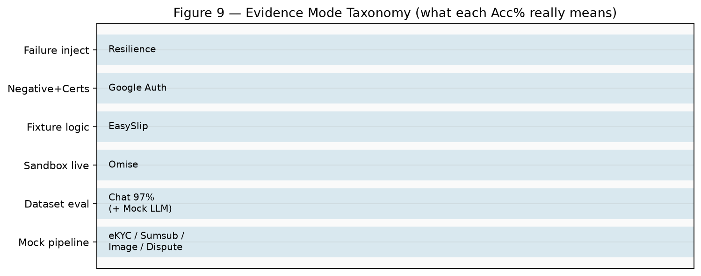

---

## 4.16 สถิติเชิงปริมาณเพิ่มเติม (N≈100)

ใช้ **Wilson score interval 95%** สำหรับสัดส่วน (Accuracy / Pass / Agreement) และสรุป Latency ด้วย mean, SD, P50, P95

### 4.16.1 ตารางสรุปพร้อมช่วงเชื่อมั่น

| โมดูล | Metric | จุดประมาณ | 95% CI (Wilson) | Latency (ms) | โหมด |
|-------|---------|-----------|-----------------|--------------|------|
| eKYC AiGen | Accuracy | 100.0% | 96.3%–100.0% | mean=2429, σ=582, P50=2457, P95=3412, max=3723 | Mock |
| Sumsub | Match Rate | 100.0% | 96.3%–100.0% | mean=3063, σ=582, P50=3123, P95=4050, max=4508 | Mock |
| Image Fraud | Accuracy | 100.0% | 96.3%–100.0% | mean=1129, σ=563, P50=879, P95=2138, max=2436 | Mock |
| Chat | Accuracy | 97.0% | 91.5%–99.0% | mean=399, σ=610, P50=0, P95=1678, max=1977 | Dataset+Mock LLM |
| Chat | Precision / Recall / F1 | 98.0% / 96.0% / 0.970 | — | — | Dataset |
| Dispute | Exact Agree | 100.0% | 96.3%–100.0% | mean=1333, σ=418, P50=1317, P95=1971, max=2010 | Mock GT |
| EasySlip | Decision Acc | 100.0% | 96.3%–100.0% | mean=299, σ=109, P50=314, P95=439, max=456 | Fixture |
| Omise | Functional Pass | 100.0% | 96.3%–100.0% | mean=1033, σ=845, P50=582, P95=2440, max=2753 | Sandbox |
| Google Auth | Verify Acc | 100.0% | 96.3%–100.0% | mean=94, σ=185, P50=0, P95=467, max=645 | Neg+Certs |
| Resilience | Fallback OK | 100.0% | 72.2%–100.0% | — | Inject |
| UAT | Pass | 100.0% | 75.7%–100.0% | — | Auto |

**การอ่าน CI:** เมื่อจุดประมาณ = 100% และ N=100 ช่วง Wilson มักอยู่ราว **96.3%–100%** แสดงว่าแม้ไม่พบความผิดพลาดในตัวอย่าง ก็ยังมีความไม่แน่นอนทางสถิติหากนำไปอ้างอิงประชากรกว้างกว่านี้

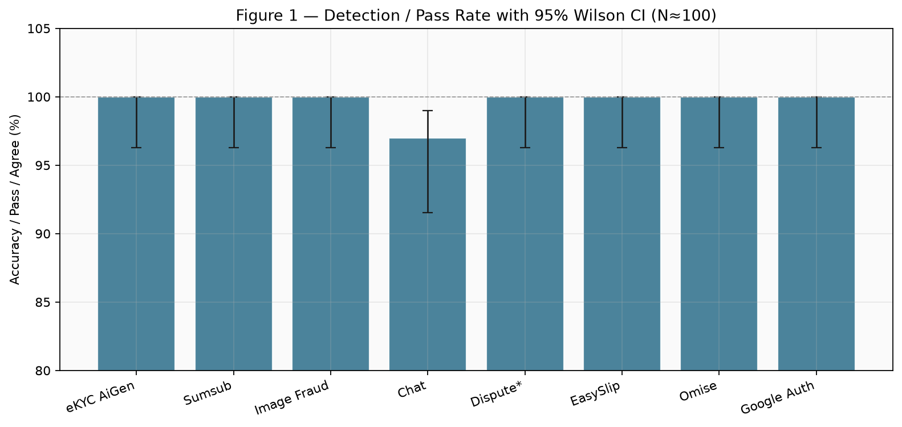

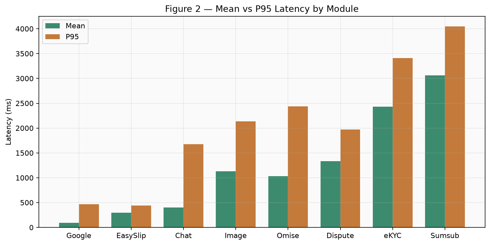

### 4.16.2 Cohen's Kappa และ McNemar (Chat)

นอกจาก Wilson CI แล้ว งานนี้รายงานสถิติข้อตกลงและการเปรียบเทียบแบบคู่บนชุดข้อความเดียวกัน:

| การทดสอบ | ผล | การตีความ |
|----------|-----|-----------|
| **Cohen's κ** — Hybrid vs GT | **0.94** | ข้อตกลงกับฉลากสูงมาก (κ>0.80 ถือว่าเกือบสมบูรณ์) |
| **Cohen's κ** — Regex-only (thr≥70) vs GT | **0.64** | Baseline กฎอย่างเดียวอ่อนกว่า (Acc 82.0%) |
| **McNemar** — Regex≥70 vs Hybrid | χ²≈11.5294, p≈0.000685 | แตกต่างอย่างมีนัยสำคัญ (α=0.05) — Hybrid ถูกเมื่อ Regex ผิด 16 เคส |
| **McNemar** — Mock LLM vs Live LLM | χ²≈0.0, p≈1.0 | ไม่พบความต่างของคู่ผิดพลาด (confusion ชุดเดียวกัน) |

> หมายเหตุ: McNemar ใช้ continuity correction; ค่า p เป็นค่าประมาณจาก χ² df=1 — เหมาะกับรายงานโครงงาน ไม่ทดแทนซอฟต์แวร์สถิติเต็มรูปแบบ

---

## 4.17 กราฟผลลัพธ์หลัก

### 4.17.1 Chat Moderation — Confusion และ Provider

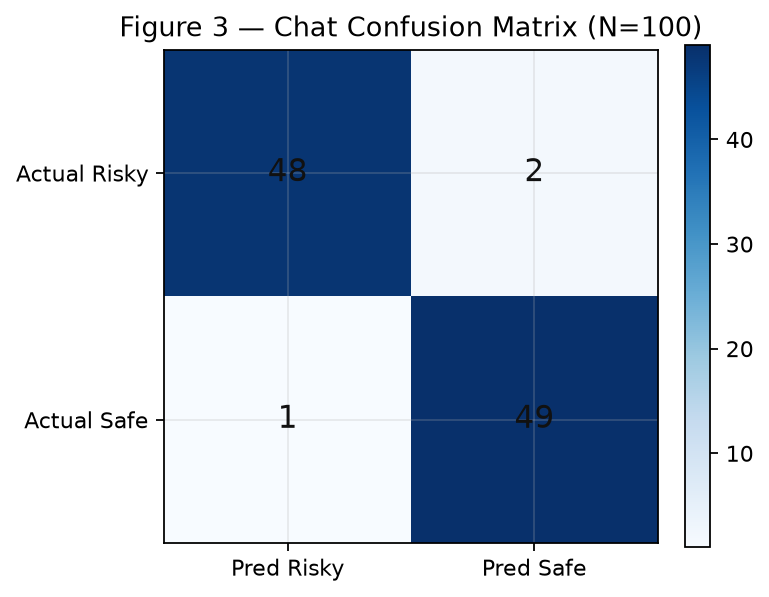

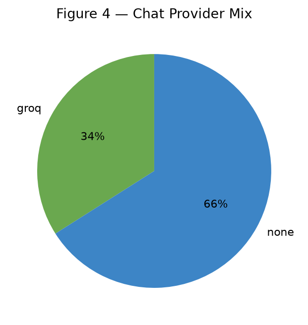

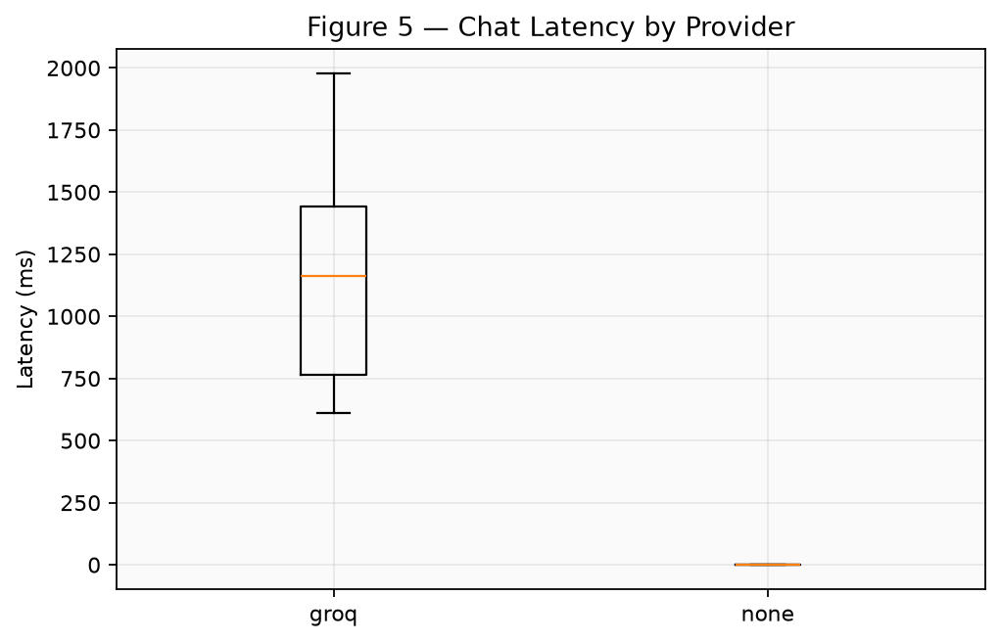

จากภาพ: เคสส่วนใหญ่จบที่ **Regex (`none`)** ทำให้ค่าเฉลี่ย Latency ของ Chat ต่ำ ในขณะที่เคสที่เข้า Groq มี Latency สูงกว่าอย่างชัดเจน — สนับสนุนสมมติฐานของ **Tiered Architecture** ว่าช่วยลดต้นทุนและเวลาตอบสนองโดยรวม

### 4.17.2 Latency ของผู้ให้บริการ eKYC (Mock)

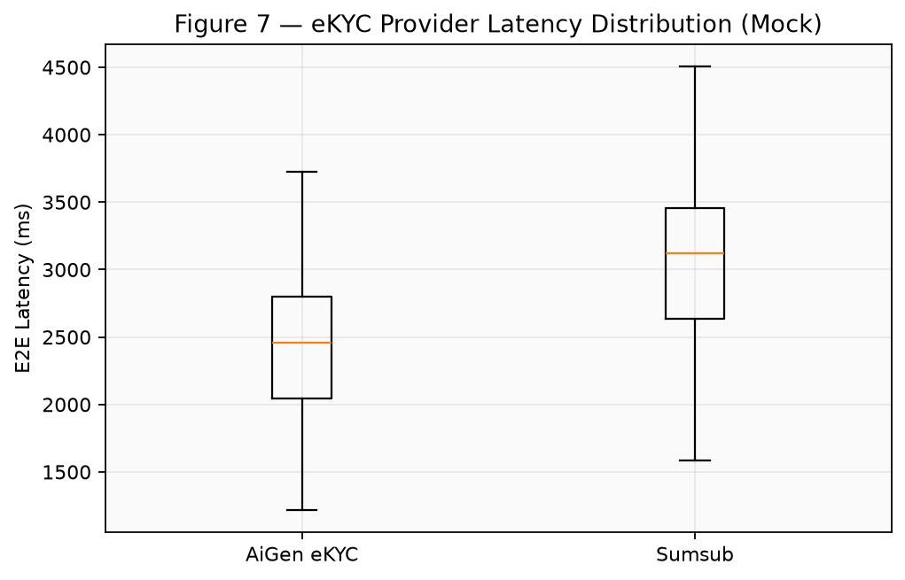

Sumsub (3 จุดเรียก) มีแนวโน้ม E2E สูงกว่า AiGen (OCR+Face) สอดคล้องกับการออกแบบ pipeline จริง แม้ทั้งคู่จะอยู่ภายใต้ Mock latency ก็ตาม

### 4.17.3 Resilience และ UAT

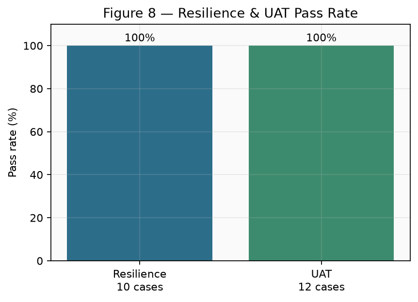

### 4.17.4 Related Work Comparison (ภาพ)

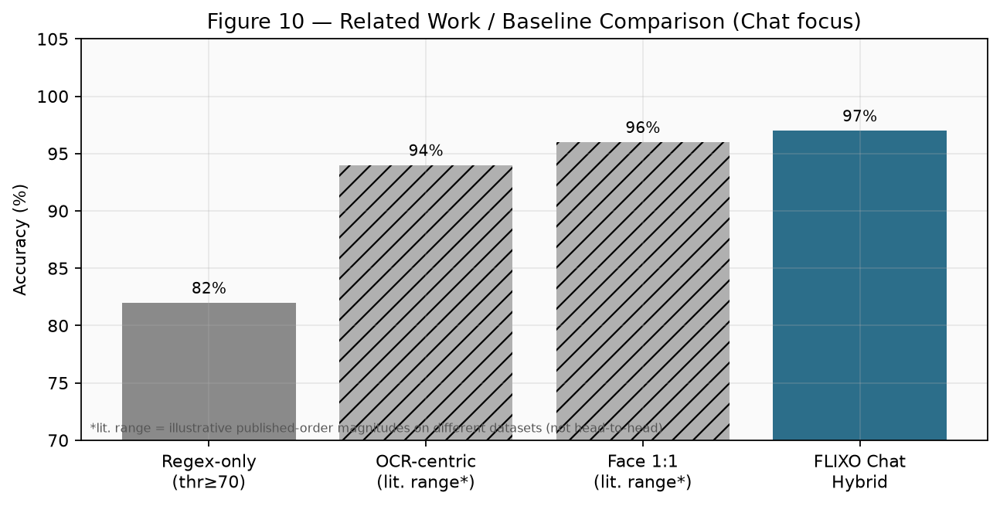

---

## 4.18 อภิปรายผลเชิงลึก (Deep Discussion)

### 4.18.0 คำเตือนสำคัญในการตีความผล
**ผลดังกล่าวสะท้อนความถูกต้องของการทำงานของ Pipeline ภายใต้ Mock Environment เป็นหลัก ไม่ใช่การรับรองความแม่นยำของโมเดล AI บนข้อมูลจริง**  
ยกเว้นโมดูลที่มีหลักฐานแยกชัด: Chat (dataset + Live LLM), eKYC Live (N=4), Omise Sandbox

### 4.18.1 ความหมายของ Accuracy 100% ใน Mock
ผล 100% ของ eKYC / Image / Dispute / Sumsub ใช้ยืนยันว่า:
1. อินพุตถึงชั้น Service ได้ครบ  
2. การแปลงผล API → สถานะธุรกิจ (`approved`/`rejected`/`pass`/`flag`) ถูกต้อง  
3. การบันทึกผลและการจัดการข้อผิดพลาดไม่ทำให้ท่อขาด  

**ไม่สามารถ** ใช้เป็นข้อสรุปว่าโมเดลใบหน้า/Vision/LLM แม่นยำ 100% บนประชากรผู้ใช้จริง  
ในงานวิจัยควรระบุเป็น *Pipeline Validation under Controlled Scenarios*

**ช่องว่าง/หลักฐานใหม่:** Image Fraud มีรอบ Live N=58 แล้ว (Acc **63.79%**, FP=0, Recall 50%) — ต่างจาก Mock 100% ชัดเจน; จุดอ่อนคือก็อปความละเอียดสูงที่ลบ EXIF และสกรีนบางส่วน

### 4.18.2 Chat 97% — จุดที่มีคุณค่าเชิงวิจัยสูงสุดในรอบนี้
Chat เป็นโมดูลที่ประเมินกับ **ชุดข้อความที่มี Ground Truth อิสระ** และยืนยันซ้ำด้วย Live LLM ได้ Acc **97%** (κ≈0.94)

| | Pred Risky | Pred Safe |
|--|------------|-----------|
| Actual Risky | TP=48 | FN=2 |
| Actual Safe | FP=1 | TN=49 |

- **Precision ≈ 98.0%** — เมื่อระบบ flag แล้ว มักถูกต้อง (FP ต่ำ)  
- **Recall = 96.0%** — ยังพลาด Risky บางรูปแบบ (FN=2)  
- **F1 ≈ 0.970**

#### Error Analysis (3 เคส MISS)
- **No.43 [C2]** GT=1 → `pass` — MISS | pred=0 | preview: Line ID sell_cash โอนสดรับของเร็ว
- **No.52 [C2]** GT=1 → `pass` — MISS | pred=0 | preview: ไลน์: escrow_skip คุยโอนเงินนอก
- **No.84 [C1]** GT=0 → `flag` — MISS | pred=1 | พบคำชักชวนโอน/ติดต่อนอกระบบ (ผ่านแอป); ข้อความมีลักษณะกำกวม ควรติดตาม (mock)

**ข้อค้นพบ:** FN ทั้งสองเกิดเมื่อ Regex ให้คะแนนต่ำจนไม่เรียก LLM ทำให้สแลง/รูปแบบนอกพจนานุกรมหลุด  
FP เกิดเมื่อข้อความ Safe กำกวมแล้วชั้น AI ให้คะแนนเข้าเกณฑ์ flag  

→ สนับสนุนว่า Hybrid ยังต้องการ (ก) ขยายพจนานุกรม Regex สำหรับสแลงไทย และ (ข) ปรับ Prompt/Threshold ของ LLM สำหรับอนุประโยค “ผ่านแอป”

การเปรียบเทียบกับ **Regex-only (thr≥70)** บนชุดเดียวกันได้ Acc 82.0% และ McNemar ชี้ว่า Hybrid ดีกว่าอย่างมีนัยสำคัญ (p≈0.000685)

### 4.18.3 Trade-off ด้าน Latency กับความลึกของการวิเคราะห์
ลำดับ Mean Latency ที่สังเกตได้:

Google Auth < EasySlip (fixture) < Chat < Image < Omise < Dispute < eKYC < Sumsub

สอดคล้องกับจำนวนขั้นของงาน: การตรวจ JWT/กฎท้องถิ่นเร็วที่สุด ส่วน identity pipeline ที่มีหลาย API ช้าที่สุด  
สำหรับ UX: KYC ควรมี progress indicator; แชทควรคง Regex-first เพื่อไม่หน่วงบทสนทนา

### 4.18.4 Graceful Degradation ในฐานะคุณสมบัติเชิงระบบ
Resilience 10/10 แสดงว่าเมื่อบังคับ failure ระบบยัง:
- ไม่ล่มกระบวนการหลัก  
- สลับไปทางสำรองที่ออกแบบไว้ (Manual KYC, EXIF flag, Regex-only, Heuristic, WAITING_VERIFY, DB poll, local disk)

ในมุมวิจัยระบบสารสนเทศ นี่คือหลักฐานของ *fault-tolerant design* ซึ่งมักขาดในต้นแบบที่เรียก API อย่างเดียวโดยไม่มีชั้นสำรอง

---

## 4.19 การเปรียบเทียบกับแนวทาง / ระบบอื่น

### 4.19.1 แนวทางป้องกันการชวนโอนนอกระบบในแชท

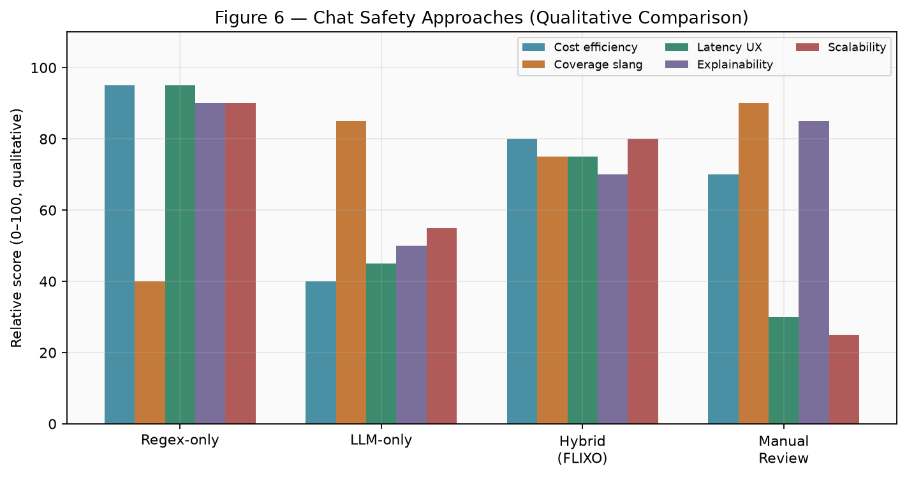

| แนวทาง | จุดแข็ง | จุดอ่อน | FLIXO เลือกอย่างไร |
|--------|---------|---------|---------------------|
| **Regex-only** | เร็ว ถูก อธิบายได้ | พลาดสแลง/ภาษาอ้อม | เป็น Tier-1 |
| **LLM-only** | เข้าใจบริบทดี | แพง ช้า อาจ hallucination | ไม่ใช้เดี่ยว |
| **Hybrid (FLIXO)** | สมดุลต้นทุน–ความครอบคลุม | ต้องจูน threshold สองชั้น | Regex → LLM เมื่อคะแนนกลาง |
| **แอดมินตรวจทุกข้อความ** | แม่นยำสูงสุด | ไม่สเกล | ใช้เฉพาะเคส flag/dispute |

**ข้อสรุปเปรียบเทียบ:** Hybrid ของ FLIXO สอดคล้องกับแนว *cascaded / tiered detection* ในระบบ content moderation อุตสาหกรรม ที่กรองถูกก่อนด้วยกฎถูก แล้วส่งเฉพาะเคสกำกวมเข้าโมเดลแพง

### 4.19.2 การยืนยันตัวตน: AiGen แบบ Self-hosted API vs Sumsub Hosted

| มิติ | AiGen (OCR+Face ในแอป) | Sumsub (`id-and-liveness`) |
|------|-------------------------|----------------------------|
| การควบคุม UX | สูง (อัปโหลดเองในแอป) | ผ่าน WebSDK ของผู้ให้บริการ |
| จำนวนขั้น API (ในการทดลอง) | 2 (OCR+Face) | 3 (token+applicant+review) |
| Latency E2E (Mock mean) | ≈2429 ms | ≈3063 ms |
| Fallback | Manual pending | sync_status เมื่อ webhook ไม่ถึง |
| ความเหมาะสม | ผู้ใช้ที่ต้องการ flow ในแอป | ต้องการ liveness ตามมาตรฐานผู้ให้บริการ |

FLIXO รองรับทั้งสองแบบ (`EKYC_PROVIDER=auto`) — เป็น *multi-provider strategy* ลด vendor lock-in

### 4.19.3 Escrow ทั่วไป vs FLIXO Escrow + AI Safety Layer

| มิติ | Escrow แบบกฎอย่างเดียว | FLIXO (งานนี้) |
|------|-------------------------|----------------|
| พักเงินกลาง | มี | มี |
| กันโอนนอกระบบในแชท | น้อย / ไม่มี | Regex+LLM |
| กันรูปสินค้าปลอม | น้อย | EXIF+Vision |
| ช่วยแอดมินตัดสินข้อพิพาท | คู่มืออย่างเดียว | Dispute AI + Heuristic |
| ยืนยันตัวตนผู้ขาย | อาจเป็นอัปโหลดเอกสาร | eKYC Face/OCR หรือ Sumsub |
| เมื่อ AI ล่ม | ระบบอาจหยุดหรือเปิดช่องโหว่ | Fallback ครบชั้น |

**จุดเด่นเชิงโครงงาน:** ไม่ได้แทนที่กฎธุรกิจ Escrow แต่เพิ่ม *AI safety layer* รอบธุรกรรมเสี่ยง

### 4.19.4 Related Work Comparison (ตารางสรุป)

ตารางนี้ใช้ **baseline ภายในงาน** (ชุดข้อมูลเดียวกัน) คู่กับ **ช่วงค่าจากวรรณกรรม/แนวทางทั่วไป** เพื่อวางบริบท — ค่าที่ติดดอกจัน (*) **ไม่ได้วัดบนชุดข้อมูลเดียวกับ FLIXO** จึงห้ามสรุปว่า “ชนะงานอื่น” แบบ head-to-head

| งาน / แนวทาง | วิธี | Accuracy (หรือช่วง) | หมายเหตุ |
|--------------|------|----------------------|----------|
| Baseline A — Regex-only | Rule (thr≥70) | **82.0%** | ชุดข้อความไทยเดียวกับ FLIXO |
| แนวทาง B — OCR-centric eKYC* | OCR เอกสาร | **~94%*** | ช่วงอ้างอิงวรรณกรรมทั่วไปบนชุดต่างกัน |
| แนวทาง C — Face verification 1:1* | Face match | **~96%*** | ช่วงอ้างอิงวรรณกรรมทั่วไป (TAR สูงที่ FAR ต่ำ) |
| **FLIXO — Chat Hybrid** | Regex + LLM | **97.0%** | Mock และ Live ให้ confusion เดียวกัน |
| FLIXO — eKYC Live | OCR + Face | **100% (N=4)** | สาธิตภาพจริง; N เล็ก |
| FLIXO — Image Fraud | EXIF + Vision | **100% (Mock only)** | ยังไม่มีรอบภาพจริง |

เมื่อเขียนบรรณานุกรม แนะนำเติม citation จริงในกลุ่ม: Escrow/C2C trust, eKYC/face, cascaded content moderation, image forensics/EXIF, human-in-the-loop decision support

---

## 4.20 ข้อจำกัดของรอบหลักฐานปัจจุบัน และแผนเมื่อได้ข้อมูลจริง

| ข้อจำกัดตอนนี้ | สถานะ / แผน |
|----------------|-------------|
| Fixtures eKYC / ไม่ใช่กล้องอย่างเดียว | **มีรอบ Live แล้ว:** 2 คน / 4 คู่ → Acc 100% — N ยังเล็ก ควรขยาย |
| Chat LLM เป็น Mock | **มีรอบ Live แล้ว:** Acc ยัง 97%; MISS คู่เดิม |
| **Image Fraud เป็น Mock ทั้งชุด** | **มีรอบ Live แล้ว:** N=58 Acc **63.79%** (FP=0, Recall 50%) — noexif ยังหลุด, tiny/clean ดี — `image_fraud_real_results.csv` |
| EasySlip เป็น fixture decision | อัปโหลดสลิปจริง N≥50 |
| ไม่มี valid GIS token | เก็บโทเคนทดสอบสั้น ๆ (ไม่บันทึก PII) |
| N=100 ต่อโมดูล | ขยาย N=500; CI แคบลง |
| ยังไม่มี ROC/DET | สแกน threshold เป็นเส้นโค้ง |
| Related work บางค่าเป็นช่วงอ้างอิง | เติม citation + หรือทำ paired study |

### 4.20.1 บันทึกผล eKYC / Chat Live (อัปเดต)
- eKYC: Genuine คะแนน ≈98–100; Impostor = 0; resize ด้านยาวสุด ~1600px เมื่อภาพใหญ่ timeout  
- Chat Live: κ เดียวกับ Mock; McNemar Mock↔Live ไม่พบความต่างของคู่ผิดพลาด  

---

## 4.21 สรุปส่วนเสริมงานวิจัย

ส่วนนี้ยกระดับบทที่ 4 จาก “รายงานผลทดสอบระบบ” สู่โครงร่างงานวิจัยเบื้องต้น โดย:
1. แยกโหมดหลักฐานให้ตีความ Acc ไม่เกินจริง  
2. เพิ่ม Wilson 95% CI, **Cohen's κ**, และ **McNemar**  
3. นำเสนอกราฟ Confusion / Latency / Provider / Comparison / Related Work  
4. อภิปราย Error Analysis ของ Chat และย้ำขอบเขต Mock  
5. ตาราง Related Work + **Threats to Validity** (§4.22)  

---

## 4.22 Threats to Validity

### 4.22.1 Internal Validity
- ชั้นคลาวด์หลายโมดูลยังอยู่ภายใต้ **Mock Environment** — ผล 100% อาจสูงเกินจริงหากนำไปอ้างความแม่นยำของ vendor model  
- Dataset Chat สร้าง/คัดเลือกภายใต้กรอบ C1/C2 อาจมี **selection bias** (ไม่ครอบคลุมทุกสแลงจริงในตลาด)  
- Threshold Regex/LLM จูนบนชุดเดียวกับที่ใช้วัด เสี่ยง **overfitting ต่อชุดทดลอง**

### 4.22.2 External Validity
- ข้อความทดลองเป็น **ภาษาไทยในบริบท C2C** — อาจไม่ generalize ไปภาษาอื่นหรือโดเมนอื่น  
- eKYC Live จำกัดที่ **2 คน / 4 คู่** — ยังน้อยเกินไปที่จะสรุปประชากร  
- Image Fraud มี Live N=58 แล้ว แต่ชุด risky รวมทั้ง synthetic (noexif/tiny) — generalization ยังจำกัด  
- **Dispute AI ยังไม่มีชุดเคสจริง / ฉลากผู้เชี่ยวชาญ** จึงยังประเมินได้แค่ Mock agreement  

### 4.22.3 Construct Validity
- ฉลาก “Risky” ในแชทเป็นการตัดสินเชิงนโยบายแพลตฟอร์ม อาจต่างจากนิยาม fraud ในงานอื่น  
- Accuracy รวม pass/flag/reject เป็นทวิภาค — ไม่แยกต้นทุนของ false reject ต่อ UX  

### 4.22.4 Reliability / Vendor Dependence
- ผลขึ้นกับ **Vendor API** (AiGen, Groq, OpenRouter, Vision, Omise ฯลฯ) ที่อาจเปลี่ยนโมเดล/โควต้า/ราคาโดยไม่แจ้งล่วงหน้า  
- Latency ที่รายงานขึ้นกับเครือข่ายและช่วงเวลาที่รัน  

### 4.22.5 สรุป Threats
ผู้วิจัยตระหนักว่าหลักฐานปัจจุบันเหมาะกับการพิสูจน์ **สถาปัตยกรรมและ pipeline** ของ FLIXO เป็นหลัก และต้องขยาย eKYC Live, ประเมิน Dispute กับผู้เชี่ยวชาญ, และสร้าง ROC/DET ของ Chat/eKYC บนชุดใหญ่ขึ้น ก่อนสรุปเชิงประชากร

---

## 4.23 ROC / Precision–Recall (Image Fraud Live) และ Mock vs Live Overview

สคริปต์: `scripts/generate_chapter4_roc_and_mock_live.py`  
สถิติ: [`appendix_ch4/live_curve_stats.json`](appendix_ch4/live_curve_stats.json)

### 4.23.1 Image Fraud Live — ROC และ PR Curve
ใช้ **Risk Score** เป็นคะแนนต่อเนื่อง และ GT Risky เป็นฉลาก แล้วกวาด threshold

| ตัวชี้วัด | ค่า |
|-----------|-----|
| N | 58 (P=42, N_neg=16) |
| **AUC-ROC** | **0.798** |
| **AUC-PR** | **0.944** |
| Operating @ Flag ≥50 | Prec=1.00, Rec=0.50, FPR=0.00 |
| Operating @ Block ≥75 | Prec=1.00, Rec=0.12, FPR=0.00 |

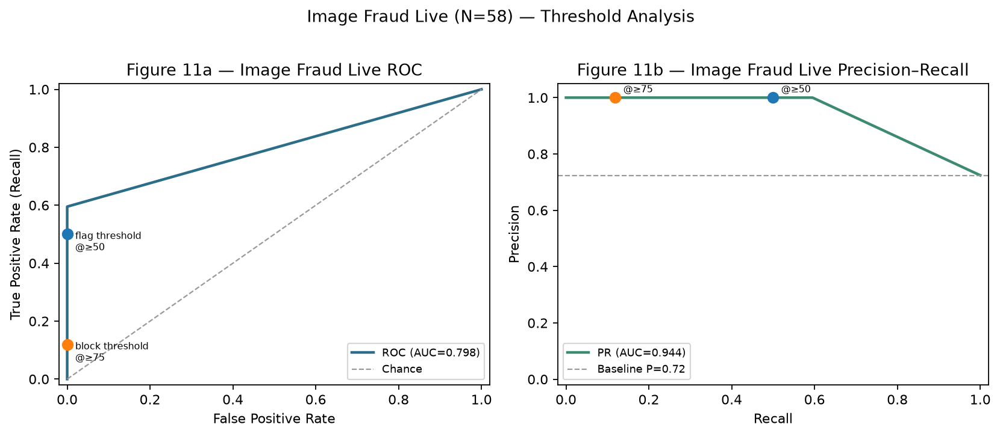

**การอ่านกราฟ:** ที่ threshold ปัจจุบันระบบรักษา **FPR=0** (ไม่ฟ้องรูปกล้อง) แต่ Recall ที่ flag=50 ยังแค่ 50% — ถ้าลด threshold เพื่อดึง Recall ขึ้น ต้องระวัง FPR  
AUC-PR สูงเพราะคลาสบวกมีสัดส่วนมากและ Precision คงที่ 1.0 ในช่วง operating ที่ใช้จริง

### 4.23.2 Mock vs Live ภาพรวมโมดูล (หน้าเดียว)

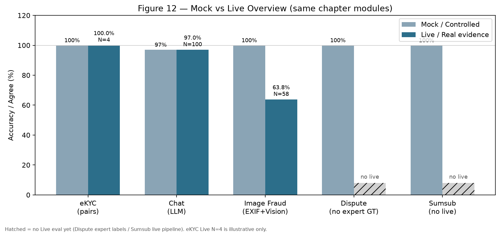

| โมดูล | Mock | Live | N Live | สถานะ |
|-------|------|------|--------|--------|
| eKYC | 100% | 100% | 4 | Live มีแล้ว แต่ **N น้อย** |
| Chat | 97% | 97% | 100 | Live LLM ครบชุดข้อความ |
| Image Fraud | 100% | **63.8%** | 58 | Live ต่างจาก Mock ชัด (มีคุณค่า) |
| Dispute | 100% Agree | — | — | **ยังไม่มี** ฉลากผู้เชี่ยวชาญ/เคสจริง |
| Sumsub | 100% | — | — | ยังเป็น Mock pipeline |

### 4.23.3 ช่องว่างที่ยังเหลือ (งานต่อไป)
1. **ขยาย eKYC Live** ให้เกิน N=4 (หลายคน/หลายสภาพแสง)  
2. **Dispute AI** — สร้างชุดเคสจริง + ให้ผู้เชี่ยวชาญติดฉลาก แล้ววัด agreement/κ  
3. **ROC/DET สำหรับ Chat และ eKYC** — ต้องการคะแนนต่อเนื่องบนชุด Live ที่ใหญ่ขึ้น (ตอนนี้ทำครบที่ Image Fraud Live แล้ว)  
4. ปรับ heuristic Image สำหรับก็อปความละเอียดสูงที่ลบ EXIF  

---

*Updated with live curves by `scripts/generate_chapter4_roc_and_mock_live.py`*

