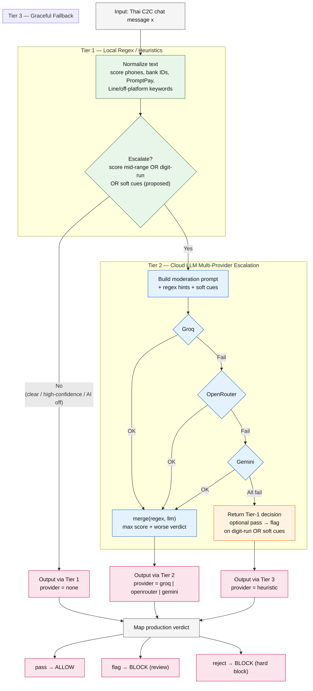
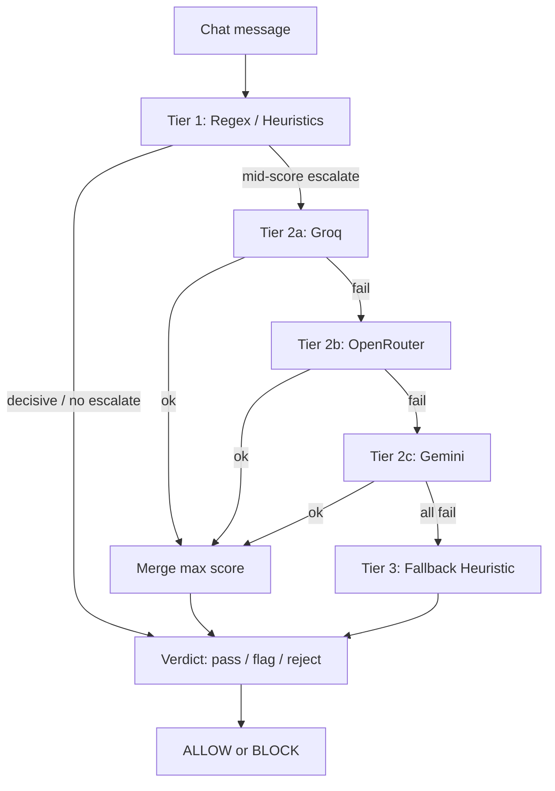

# Figure 2 — Cascaded Hybrid Moderation Architecture

**Purpose:** System pipeline diagram for the paper (Fig.~2 / architecture figure).  
**Usage:** Paste the Mermaid block into [Mermaid Live Editor](https://mermaid.live), export PNG/SVG/PDF, then include in Overleaf as `fig2_cascade.pdf`.  
**Related LaTeX:** `docs/paper_main.tex` → `\label{fig:architecture}`.

---

## Mermaid flowchart (copy-paste ready)



---

## Compact variant (single-column paper width)



---

## Figure caption (English, camera-ready)

**Fig. 2.** Cascaded hybrid moderation architecture for Thai C2C escrow chat. Incoming messages are scored by Tier~1 local regex/heuristics. Ambiguous mid-score cases escalate to Tier~2 cloud LLMs with multi-provider failover (Groq → OpenRouter → Gemini). If all providers fail, Tier~3 returns a graceful regex-based fallback. Final production verdicts (`pass` / `flag` / `reject`) map to evaluation labels \textsc{allow}/\textsc{block}.

---

## Thai caption (สำหรับสไลด์)

**รูปที่ 2** สถาปัตยกรรม Cascaded Hybrid 3 ชั้น: Tier 1 Regex → Tier 2 LLM (Groq / OpenRouter / Gemini) → Tier 3 Fallback → ผลลัพธ์ pass / flag / reject

---

## Export checklist for Overleaf

1. Open https://mermaid.live and paste the first diagram.  
2. Export **PNG** (300 dpi) or **SVG**, then convert to PDF if preferred.  
3. Upload to Overleaf project as `fig2_cascade.pdf` (or `.png`).  
4. In `paper_main.tex`, replace the `\fbox{...}` placeholder under `\label{fig:architecture}` with:

```latex
\includegraphics[width=\columnwidth]{fig2_cascade.pdf}
```
